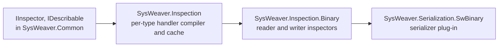

# SysWeaver.Inspection

[⬆ SysWeaver overview](../README.md)

> A reflection-driven "inspection" engine that compiles, per type, the code needed to walk an object's data in a versioned way — the foundation of SysWeaver's own binary serialization.

| | |
|---|---|
| **Layer** | Foundation (serialization infrastructure) |
| **Kind** | Library |

## Purpose

Instead of hand-writing read/write code, a type is *inspected*: fields are visited through an `IInspector`, which can be a reader, a writer or anything else (copy, compare, describe). This project builds and caches the per-type handlers (as compiled expression trees) that drive an inspector over an object.

## How it fits into SysWeaver

## Key features

- Handlers generated once per (declared type, runtime type) and cached (`TypeHandlerCache<T>`, thread safe, never released).
- Versioning: `IDescribable` types get their version from `[DescVersion(n)]` (1 without it). Data written by an older version is read with `Describe(i, version)`, data from a newer version is rejected (`StaticTypeHandler.ThrowInvalidVersion` throws an `InvalidDataException`).
- Type name handling with configurable qualification (`TypenameQualifications`: `Simple` = full name, `Assembly` = full name + assembly name, `Full` = assembly qualified name; generic arguments are qualified the same way, all resolvable by `TypeFinder`).
- Unmanaged memory blocks (`StaticTypeHandler.HandleUnmanagedMemory`) are inspected as a byte array; when reading, the memory is replaced by a pinned array (the old dispose action is called).

## How types are handled

`TypeHandler<T>` picks the first match:

1. A typed `IInspector.Field` overload: primitives, `string`, `DateTime`, `TimeSpan`, `DateOnly`, `TimeOnly`, `DateTimeOffset`, `Guid`.
2. `IDescribable`: the type describes itself. The implementation may be inherited from a base class (also a generic one) or explicit; the most-derived `Describe(IInspector)` / `Describe(IInspector, int)` is called (a method declared by a derived class, also one that hides a base method, wins).
3. Arrays of any rank (jagged too); `byte[]` as one block.
4. Enums, as their underlying type.
5. `Nullable<U>` as the value, `KeyValuePair<K, V>` as the key and the value.
6. `IList<E>`, then `ICollection<E>` (dictionaries, sets, linked lists), then the non generic `IList`.
7. All other types: every instance field (including private and inherited fields) except readonly fields.

Instances are created (when reading) with a constructor `(IInspector, int version, bool isLatestVersion)` or `(IInspector, int version)` if present, else a parameterless constructor of any accessibility (then described), the default value of a struct, else `Activator.CreateInstance` (throws `MissingMethodException` if there is no parameterless constructor).
Interfaces and abstract types are always handled through the handler of the runtime type (the type name is written).

## Limitations and considerations

- An internal building block; application code normally uses a serializer rather than inspectors directly.
- The binary format produced through it is SysWeaver specific (not interoperable with other ecosystems).
- Readonly fields are skipped silently, so get-only and init-only auto properties are not round tripped (inspection-cov-10).
- Collections are created with their parameterless constructor: a custom comparer of a `HashSet` / `Dictionary` is lost (inspection-cov-11). Read-only `ICollection<E>` implementations can be written, reading one throws (`NotSupportedException` if it exists and must change, else usually `MissingMethodException`).
- Writing (with an `IWriteInspector`) only reads the collections, so several threads may write the same collection at the same time. Other inspectors only clear and refill an `ICollection<E>` if the count or an item changed.
- The handlers are compiled expression trees: the first use of a type is slow, and every type used stays in memory.

## Known bugs

See `_docs/BugReview-2026-10-06.md`: inspection-cov-10, inspection-cov-11 (this project).

## Relationships

- **Project:** [`SysWeaver.Inspection.csproj`](SysWeaver.Inspection.csproj)
- **Builds on:** [SysWeaver.Common](../SysWeaver.Common/README.md)
- **Used by:** [SysWeaver.Inspection.Binary](../SysWeaver.Inspection.Binary/README.md)
