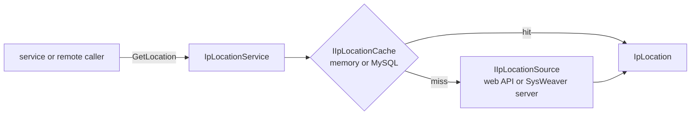

# SysWeaver.IpLocation

[⬆ SysWeaver overview](../README.md)

> IP geolocation as a service, with pluggable data sources (commercial web APIs or another SysWeaver server) and pluggable caches.

| | |
|---|---|
| **Layer** | Networking |
| **Kind** | Micro service with source and cache plug-ins |

## Purpose

Answer "where is this IP address?" (country, region, city, coordinates, autonomous system) for features like localisation, analytics or fraud checks, while keeping costs and latency low through caching and letting one central server serve many.

## How it fits into SysWeaver



The service requires at least one `IIpLocationSource` and optionally uses one `IIpLocationCache` registered before it in the manifest. A persistent cache is provided by [SysWeaver.IpLocation.MySqlCache](../SysWeaver.IpLocation.MySqlCache/README.md).

## Key features

- Sources included: [ip2location.io](https://www.ip2location.io/) (`Ip2locationIoSource`), [ipgeolocation.io](https://ipgeolocation.io/) (`AppIpgeolocationIoSource`) and another SysWeaver server running this service (`IlsSysWeaverService`), so one central server with API keys and a persistent cache can serve many.
- Sources are tried in registration order; when all of them fail, the lookup is retried with an increasing delay (`MinWaitMs` to `MaxWaitMs`).
- In-memory cache (`MaxCachedMinutes`, default one day) when no `IIpLocationCache` is registered.
- `GetLocation` is published as a web API that requires the `Service` role, so other servers can use this one as their source.
- Source failure stats and perf monitoring.

## Key components

- [`IpLocationService`](IpLocationService.cs) - the service: cache, source failover and retries
- [`IIpLocationSource`](Sources/IIpLocationSource.cs) - the source plug-in contract
- [`IIpLocationCache`](Caches/IIpLocationCache.cs) - the cache plug-in contract, implemented by [`IpLocationMemoryCache`](Caches/IpLocationMemoryCache.cs)
- [`IpLocation`](IpLocation.cs) - the result (country, region, city, coordinates, autonomous system, source)

## Using it

Register one or more sources (and optionally a cache) before the service:

```json
[
  { "Type": "SysWeaver.IpLocation.Sources.Ip2locationIoSource, SysWeaver.IpLocation",
    "Params": { "CredFile": "$(KeyFolder)/ip2location.io.txt" } },
  { "Type": "SysWeaver.IpLocation.IpLocationService, SysWeaver.IpLocation" }
]
```

To use another SysWeaver server as the source, register `SysWeaver.IpLocation.Sources.IlsSysWeaverService, SysWeaver.IpLocation` with `BaseUrl` (and credentials of a user with the `Service` role) instead.

## Limitations and considerations

- Requires at least one source; commercial sources need API keys and are subject to quotas.
- A source that answers without a location (null) ends the lookup, the next source is only tried when a source fails.
- The number of retry rounds is currently fixed (10); `MaxRetryCount` only affects how fast the delay grows.
- Geolocation accuracy is inherently limited by the source data.

## Relationships

- **Project:** [`SysWeaver.IpLocation.csproj`](SysWeaver.IpLocation.csproj)
- **Builds on:** [SysWeaver.MicroServices.ServiceManager](../SysWeaver.MicroServices.ServiceManager/README.md)
- **Used by:** [SysWeaver.IpLocation.MySqlCache](../SysWeaver.IpLocation.MySqlCache/README.md), [IpLocationService](https://github.com/dosh1974/SysWeaver.Services/blob/main/IpLocationService/README.md) (SysWeaver.Services)
