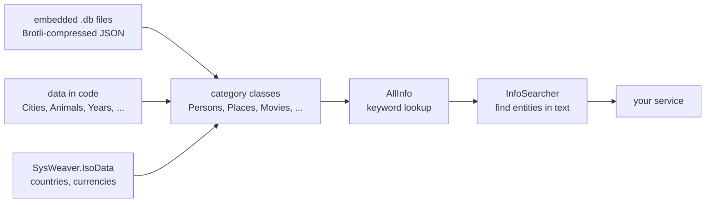

# SysWeaver.Knowledge

[⬆ SysWeaver overview](../README.md)

> An offline keyword knowledge base — people, places, cities, countries, animals, artists, art styles, movies, series, car brands, sports, historical events and years — compiled into the assembly, with a searcher that finds the known entities mentioned in a text.

| | |
|---|---|
| **Layer** | Foundation |
| **Kind** | Library with embedded data files |

## Purpose

Provides general world knowledge that services can query without an internet connection, for example to tag content with keywords, generate suggestions, or give AI features grounded reference data. Each entity is an `Info` (name, description, category and parent entities, e.g. a city's country), reachable through all its keywords (including plural forms and aliases).

## How it fits into SysWeaver

No other SysWeaver project references it; it is a standalone data library for applications.

## Key features

- Keyword to entity lookup per category (`Persons.TryGet`, `Movies.TryGet`, ...) or across all categories (`AllInfo.TryGet`)
- `InfoSearcher` scans free text for known keywords, roughly in order of importance, optionally expanding to parent entities and including custom key phrases
- Popularity figures for persons, places, artists, art styles and historical events, birth and death dates for persons
- Keyword helpers for video properties (`ScreenResolutionInfo`, `FpsInfo`)

## Key components

- [`AllInfo`](AllInfo.cs) — the combined keyword dictionary and the shared `Searcher`
- [`InfoSearcher`](InfoSearcher.cs) — finds the entities mentioned in a text
- [`Info`](Info.cs) — the entity type all categories derive from
- Categories loaded from the embedded data: [`Persons`](Persons.cs), [`Places`](Places.cs), [`Artists`](Artists.cs), [`ArtStyles`](ArtStyles.cs), [`Movies`](Movies.cs), [`Series`](Series.cs), [`CarBrands`](CarBrands.cs), [`Sports`](Sports.cs), [`HistoricalEvents`](HistoricalEvents.cs); [`Countries`](Iso.cs) are built from SysWeaver.IsoData (plus the country aliases from the data)
- Categories defined in code: [`Cities`](Cities.cs), [`Animals`](Animals.cs), [`Years`](Years.cs), [`MediaCat`](MediaCat.cs) (the parent categories of movies and series)

## Limitations and considerations

- The data is a snapshot baked into the build and will age; there is no update mechanism.
- Categories are not loaded independently: the first use of `AllInfo` (and any category, since each registers its keywords in `AllInfo`) loads and decompresses every category, which costs startup time and memory.
- Keyword matching is English-centric (simple English plural rules).

## Folder layout

| Folder | Content |
|---|---|
| [`data/`](data) | The embedded knowledge data files: each `*.db` is a Brotli compressed JSON array of strings, embedded as is (no build step) and read by `DataHelper.GetData` the first time a category is used. `Artists`, `Arts` (art styles), `Cars`, `Events`, `LangAlts` (alternative country names), `Movies`, `Persons`, `Places`, `Series` and `Sports`. Unlike the generated `data/` folders of other projects these files are source files in the repository (the `data` rule of `.gitignore` matches the folder, so new files must be added with `git add -f`). |

## Relationships

- **Project:** [`SysWeaver.Knowledge.csproj`](SysWeaver.Knowledge.csproj)
- **Builds on:** [SysWeaver.Common](../SysWeaver.Common/README.md), [SysWeaver.Compression](../SysWeaver.Compression/README.md), [SysWeaver.IsoData](../SysWeaver.IsoData/README.md), [SysWeaver.Serialization](../SysWeaver.Serialization/README.md)
