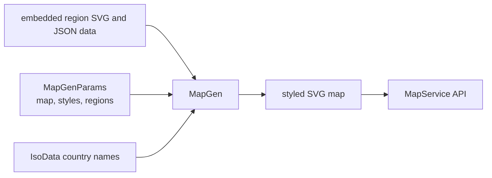

# SysWeaver.Map

[⬆ SysWeaver overview](../README.md)

> Generates styled SVG maps — the world, Africa, Europe, North America, individual countries and their administrative regions — from embedded map data.

| | |
|---|---|
| **Layer** | Media |
| **Kind** | Library with embedded data |

## Purpose

Visualise geographic data (e.g. users per country, highlighted regions) without an external map service.

## How it fits into SysWeaver

## Key features

- Maps of the world, Africa, Europe, North America, single countries and countries with their administrative zones (states, counties etc.), stored as brotli compressed SVG + JSON region data
- A base style for all regions and per-region styles (fill, stroke, extrusion, text labels with country names)
- 3D-style extrusion of regions, optional background colour and cropping to the highlighted regions
- Region listing for a map (`MapTools.GetRegions`) and an in-memory cache of loaded maps
- Parameter classes carry AI annotations so maps can be requested by tool-calling LLMs

## Key components

- [`MapGen`](MapGen.cs) — `Generate(MapGenParams)` returns the SVG
- [`MapGenParams`](MapGenParams.cs) — map selection, base style, highlighted regions, extrusion, cropping
- [`MapTools`](MapTools.cs) — map resource names and region listing
- [`Maps`](Maps.cs) — the available maps

## Limitations and considerations

- Map data is a static snapshot; border changes require new data and a rebuild
- Regional detail is limited to the regions present in the embedded data

## Folder layout

| Folder | Content |
|---|---|
| [`srcData/`](srcData/README.md) | Source map data (SVG + JSON region index per map), Brotli compressed and embedded at build time |

## Relationships

- **Project:** [`SysWeaver.Map.csproj`](SysWeaver.Map.csproj)
- **Builds on:** [SysWeaver.Common](../SysWeaver.Common/README.md), [SysWeaver.Compression](../SysWeaver.Compression/README.md), [SysWeaver.IsoData](../SysWeaver.IsoData/README.md), [SysWeaver.Media.Svg](../SysWeaver.Media.Svg/README.md), [SysWeaver.Serialization](../SysWeaver.Serialization/README.md)
- **Used by:** [SysWeaver.MicroService.Map](../SysWeaver.MicroService.Map/README.md)
