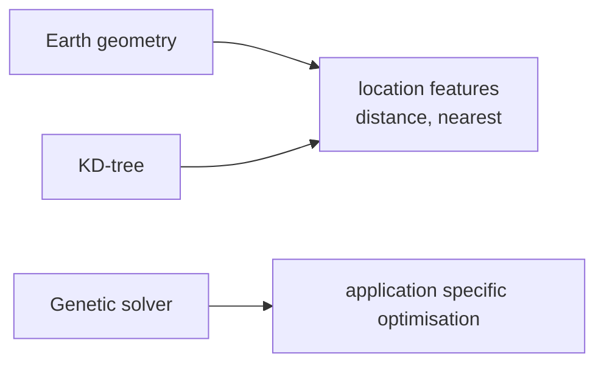

# SysWeaver.Math

[⬆ SysWeaver overview](../README.md)

> Algorithms that do not belong in the general toolbox: spatial search (KD-trees), earth geometry, bounded priority lists, rational numbers and a genetic-algorithm optimiser.

| | |
|---|---|
| **Layer** | Foundation |
| **Kind** | Library |

## Purpose

A home for reusable numeric and spatial algorithms used by location-aware and optimisation features, kept separate so that services that do not need them do not carry them.

## Key features

| Area | Capability |
|---|---|
| Spatial search (`SysWeaver.Geometry`) | `KDTree<TDimension, TNode>`: nearest-neighbour queries in N dimensions (`Search` with max count, max distance, min count and a node filter, results nearest first), `HyperRect<T>`, `BoundedPriorityList` (keeps the n smallest priorities sorted), `BinaryTreeNavigator` / `BinaryTreeNavigation` (array-backed binary tree) |
| Geometry (`SysWeaver.Geometry`) | `Earth`: conversion between latitude/longitude and (flattened) cartesian coordinates, angular differences, great-circle distance (`DistanceKm`, spherical law of cosines with the equator radius) |
| Optimisation (`SysWeaver.Search`) | `GaSolver.SolveOrOptimize`: genetic-algorithm solver, you implement `IGaOperators<T>` (clone, mutate, mutate last, error, abort) and the solver mutates a population (keeping the best 1/32 rounded down to a power of two, at least 1 and at most 32) to minimise the error; optionally in parallel |
| Numbers (`SysWeaver`) | `BigRat`: arbitrary precision rational number (port of c-ohle/RationalNumerics) implementing the .NET generic math interfaces: exact + - * / %, comparisons, rounding, conversions, parsing / formatting (repeating decimals as `0.'3`), and approximations with a selectable number of digits (Sqrt, Pow, Exp, Log, trigonometric and hyperbolic functions, Pi, E). `BigRatExt.PassProbability64` passes a random test with a rational probability |

## How it fits into SysWeaver



## Limitations and considerations

- Earth calculations use a simple geometric model (a sphere with the equator radius for distances), suitable for estimates rather than survey-grade geodesy.
- The genetic solver is generic: quality depends entirely on the operators you provide. With `maxGenerations <= 0` it only stops when `Abort` returns true. The best state is always kept (with fewer than 64 states only the best one).
- `KDTree`: the metric must return the **squared** distance (the max distance of `Search` is squared before it's compared). The default search window uses the `MinValue` / `MaxValue` fields of the dimension type when the passed limits are `default` (so 0 can't be used as an explicit limit). The point arrays are referenced, not copied. `Search` with a `minCount` returns the nearest nodes up to `minCount` when fewer are found within the max distance (a second search, so the node filter may be called twice for a node).
- `BigRat` results are not automatically reduced (`Normalize()` reduces, equality / hashing are by value). There is no NaN / infinity: invalid operations throw (`DivideByZeroException`, `ArgumentOutOfRangeException`). The functions with a `digits` parameter round to that many decimals (`Exp` counts from the most significant digit, a negative value means "same precision, unrounded"); `Log(x, 2)` is the natural logarithm with 2 digits, use `Log(x, (BigRat)2)` for base 2. The implicit conversions from `double` / `float` / `Half` are exact (same as `new BigRat(double)`: 0.1 becomes 3602879701896397/36028797018963968) and round trip back to the same double; parse the text (`BigRat.Parse("0.1")`) for decimal values. The explicit conversions to 32 bit and smaller integers go through `double`. Temporary buffers of large values (above 16K 32 bit words) are allocated on the heap instead of the stack; note that multiplication is O(n²), so huge values (ex: `Pow(2, int.MaxValue)`) take "forever" / run out of memory.
- `BigRat.Parse` / `TryParse` validate the syntax: `[sign] digits [. [digits] ['repeating digits]] […] [e [sign] digits]`, optionally `/` and a denominator; the exponent magnitude is limited to 100000. Without a format provider '.' and ',' are both accepted: if both are used the last one is the decimal separator ("1,234.5" and "1.234,5" are 1234.5), a single one used once is the decimal separator ("1,5" is 1.5), else a group separator. With a provider its separators and signs are used (group separators only with `NumberStyles.AllowThousands`).
- Pow / roots of negative values: `Pow(x, BigRat)` requires x >= 0 (use `Pow(x, int)`), `Cbrt` / `RootN` with an odd root accept negative values.
- `BigRat.ToString("Qn")` truncates (doesn't round) to n digits and appends "…"; a truncated value with more than n integer digits uses exponent notation (1234567.89 with "Q5" gives "1.2345…E+06", with "Q7" "1234567…"). The text parses back to the truncated value; use "R" for an exact round trip.

## Using it

```csharp
using SysWeaver.Geometry;
double km = Earth.DistanceKm(latA, lonA, latB, lonB);
```

## Relationships

- **Project:** [`SysWeaver.Math.csproj`](SysWeaver.Math.csproj)
- **Builds on:** [SysWeaver.Common](../SysWeaver.Common/README.md)
