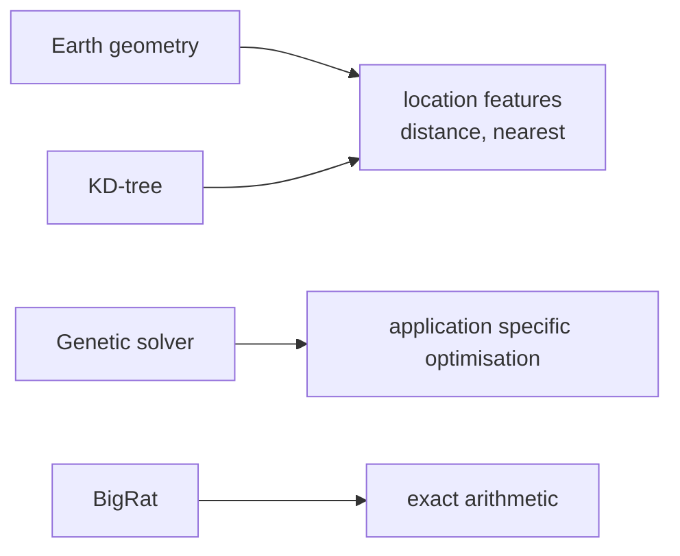

# SysWeaver.Math

[⬆ SysWeaver overview](../README.md)

> Algorithms that do not belong in the general toolbox: spatial search (KD-trees), earth geometry, bounded priority lists, rational numbers and a genetic-algorithm optimiser.

| | |
|---|---|
| **Layer** | Foundation |
| **Kind** | Library |

## Purpose

A home for reusable numeric and spatial algorithms for location-aware and optimisation features, kept separate so that projects that do not need them do not carry them.

## How it fits into SysWeaver

A stand-alone library on top of [SysWeaver.Common](../SysWeaver.Common/README.md); no other SysWeaver project currently references it, applications reference it directly.



## Key features

- **Spatial search** (`SysWeaver.Geometry`) — `KDTree<TDimension, TNode>`: nearest-neighbour queries in N dimensions (max count, max distance, min count, node filter; nearest first), plus `HyperRect<T>`, `BoundedPriorityList` and an array-backed binary tree navigator
- **Earth geometry** (`SysWeaver.Geometry`) — `Earth`: latitude/longitude to cartesian coordinates and back, angular differences, great-circle distance (`DistanceKm`)
- **Optimisation** (`SysWeaver.Search`) — `GaSolver.SolveOrOptimize`: a genetic-algorithm solver; you implement `IGaOperators<T>` (clone, mutate, error, abort) and the solver evolves a population to minimise the error, optionally in parallel
- **Rational numbers** (`SysWeaver`) — `BigRat`: arbitrary precision rational number (port of c-ohle/RationalNumerics) implementing the .NET generic math interfaces: exact arithmetic, comparisons, rounding, conversions, parsing / formatting (repeating decimals as `0.'3`) and approximations with a selectable number of digits (roots, powers, logarithms, trigonometric functions, Pi, E)

## Key components

- [`KDTree`](Geometry/KDTree.cs) — N-dimensional nearest-neighbour search
- [`Earth`](Geometry/Earth.cs) — earth geometry helpers
- [`GaSolver`](Search/GaSolver.cs) — genetic-algorithm solver
- [`BigRat`](BigRat.cs) — arbitrary precision rational number

## Using it

```csharp
using SysWeaver.Geometry;
double km = Earth.DistanceKm(latA, lonA, latB, lonB);

BigRat third = BigRat.Parse("1/3");
```

## Limitations and considerations

- Earth calculations use a sphere with the equator radius, suitable for estimates rather than survey-grade geodesy.
- The genetic solver's quality depends entirely on the operators you provide; with `maxGenerations <= 0` it only stops when `Abort` returns true. It runs in parallel by default in release builds (operators must then be thread safe) and sequentially in debug builds.
- `KDTree`: the metric must return the **squared** distance; the point arrays are referenced, not copied.
- `BigRat` results are not automatically reduced (`Normalize()` reduces); there is no NaN / infinity (invalid operations throw); conversions from `double` are exact binary values (parse text such as `"0.1"` for decimal values); multiplication is O(n²), so huge values get slow.
- The project enables unsafe code (`BigRat` uses stack buffers and pointers).

## Folder layout

| Folder | Content |
|---|---|
| [`Geometry/`](Geometry/README.md) | KD-tree and its supporting types, earth geometry |
| [`Search/`](Search/README.md) | Genetic-algorithm solver |

## Relationships

- **Project:** [`SysWeaver.Math.csproj`](SysWeaver.Math.csproj)
- **Builds on:** [SysWeaver.Common](../SysWeaver.Common/README.md)
