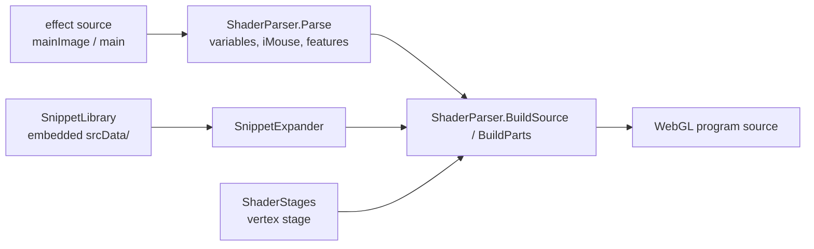

# SysWeaver.Media.Shader

[⬆ SysWeaver overview](../README.md)

> GLSL effects in the Effect Weaver format: parsing, the Ew snippet library, the optional vertex stage and the final WebGL program source. One implementation, so an effect loads the same way in every tool.

| | |
|---|---|
| **Layer** | Media |
| **Kind** | Library (no dependencies, namespace `EffectWeaver.Shaders`) |

## Purpose

Effect Weaver effects (ShaderToy style `mainImage`, GlslSandbox style `main`) may:

- call the **Ew snippet library** without defining the functions (`EwCenteredUV`, `EwHash2To1`, `EwDither`, `EW_PI` ...),
- read **live controls** from `iMouse` (x, y, z, w in [0, 1], described by `// iMouse.x = Name | Description | Default` comments),
- have a **vertex stage** (`void vertexMain(vec2 fragCoord)` + `varying` declarations).

This library turns such a source into a complete WebGL program, with the same code for every user.

## How it fits into SysWeaver



| User | How |
|---|---|
| SysWeaver media player | `MediaService.BuildEffect` ([SysWeaver.MicroService.Media](../SysWeaver.MicroService.Media/README.md)), called by `mediaPlayer/media_player_effect.js` for effects with one of the features above |
| Effect Saver, VjWeaver, the Effect Weaver editor | `ShaderParser.BuildSource` / `BuildParts` (D:\EffectWeaver, through EffectWeaver.Common) |

## Key features

- `ShaderParser.Parse`: variables, `// var:` annotations, iMouse channels and the features an effect uses
- `ShaderParser.BuildSource` / `BuildParts`: the snippets inserted, ShaderToy uniforms + `main()`, GLSL ES 3.00 or 1.00, the vertex shader after `ShaderStages.Marker`
- Snippets are inserted (with their dependencies) before the first declaration using them; `#line` keeps the line numbers
- The snippet library is embedded (brotli compressed) and decoded once, when first used; a folder of snippets can be put on top of it (the Effect Weaver editor, where admins save)
- Vertex stage support: a source is split into the two stages, the varyings are rewritten and the `main()` of the vertex shader is generated
- `SwHaveImage` (`ShaderParser.HaveImageName`): a shader that uses it gets `const bool SwHaveImage = true / false;` in the head (the `haveImage` argument of `BuildSource` / `BuildParts`: drawn with a picture texture), so one effect works with and without an image. The callers: the Effect Weaver editor (true for image / video / collage effects), Effect Saver and VjWeaver (false), SysWeaver's media player (sets the value of its texture, `media_effect_program.js`)
- `SwTransparentImage` (`ShaderParser.TransparentImageName`): the same for a picture that has transparency, `const bool SwTransparentImage = true / false;` (the `transparentImage` argument; always false without a picture). A setting of the user, never guessed from the picture: Effect Weaver's media line `//  media: image transparent <ref>` (the editor's Transparent check box), SysWeaver's media player `MediaEffect.TransparentImage` (an image / video marked Transparent sets it). Ex: a frame draws its inner effect behind the picture and alpha blends the picture on top

## Key components

- [`ShaderParser`](ShaderParser.cs) — `Parse`, `BuildSource` / `BuildParts`, `DefaultVars` and the effect description types (`EffectInfo`, `EffectVar`, `MouseChannel`)
- [`SnippetExpander`](SnippetExpander.cs) — inserts the snippets a source uses (and their dependencies)
- [`SnippetLibrary`](SnippetLibrary.cs) — the snippet library: `Builtin` (embedded), `WithFolder(folder, log)` (the built in one with a folder's snippets on top), `Load(folder, log)` (a folder only)
- [`ShaderStages`](ShaderStages.cs) — the vertex stage: `SplitProgram` / `JoinProgram`, `Split`, `RewriteVaryings`, `VertexMain`, `Marker`

### The embedded library (`SnippetLibrary`)

| Member | |
|---|---|
| `Builtin` | All embedded snippets with their code, description (`Md`, `Summary`, `Signature`), dependencies and number of places; made when first used, then shared (`Snippet.IsBuiltin`) |
| `BuiltinFiles` | The embedded files as library paths: `<folder>/<Id>.glsl`, `<folder>/<Id>.md`, `README.md` |
| `ReadBuiltinFile(path)` | The text of an embedded file (decoded once, cached), null if there is none |
| `WithFolder(folder, log)` | `Builtin` with the snippets of a folder on top: a folder snippet replaces the built in one with the same id (`Snippet.OverridesBuiltin`), new ones are added; no folder: `Builtin` |

## Using it

```csharp
var fx = ShaderParser.Parse("myEffect", source, null);
var program = ShaderParser.BuildSource(fx, ShaderParser.DefaultVars(fx), webGL2: true);
var (fragment, vertex) = ShaderStages.SplitProgram(program);
```

## Limitations and considerations

- The code was `EffectWeaver.Common/Shaders` in Effect Weaver; it keeps its namespace (`EffectWeaver.Shaders`) and style (nullable, implicit usings), so Effect Weaver uses it unchanged.
- Rules the parser applies are mirrored by the Compress tool's shader minimizer (`SysWeaver.Tools/Compress/CompressProgram_Shaders.cs`): keep them in sync.
- The build compresses every file of `srcData/` to `data/<path>.br` (brotli, `..\_tools\compress\Compress.exe -OptimizeShaders False`: stored as is, never stripped or minified) and embeds it as `snippets/<path>.br`. `data/` is generated and not in git: a removed snippet must also go from `data/` (clean it).
- The unit tests of SysWeaver.Tests (`EffectSnippetTests`) check that every effect of the media viewer and every snippet only call snippets that exist.

## Folder layout

| Folder | Content |
|---|---|
| [`srcData/`](srcData/README.md) | **The source of the snippet library**: `<folder>/<Id>.glsl` + `<Id>.md` and `README.md` (the library docs, the summary table with the number of places) |

`srcData/` used to be Effect Weaver's `_snippets`; the Effect Weaver editor's snippet folder is this folder in development (an admin's save is the source, embedded by the next build), and its scanner (`_snippets/tools/SnippetScan` there) writes the summary table and the "Found in effects" sections here.

## Relationships

- **Project:** [`SysWeaver.Media.Shader.csproj`](SysWeaver.Media.Shader.csproj)
- **Builds on:** no SysWeaver projects
- **Used by:** [SysWeaver.MicroService.Media](../SysWeaver.MicroService.Media/README.md); outside SysWeaver: EffectWeaver.Common and EffectWeaver.Server (Effect Weaver)
