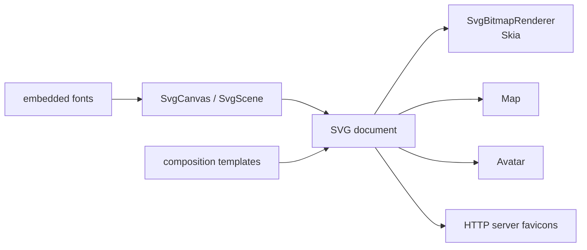

# SysWeaver.Media.Svg

[⬆ SysWeaver overview](../README.md)

> Programmatic SVG creation and rendering: a canvas/scene API with paths, shapes, gradients, shadows, 3D-style extrusion, text with embedded fonts, barcodes, composition templates, and SVG-to-bitmap rendering.

| | |
|---|---|
| **Layer** | Media |
| **Kind** | Library |

## Purpose

Generate vector graphics on the server — maps, avatars, favicons, barcodes, badges, templated images — and rasterise them when a bitmap is required.

## How it fits into SysWeaver

## Key features

- Path parsing, bounds, transforms and shape generation (n-gons, rounded and fancy rects, extrusion, bending)
- Scene builder with css styles, gradients, masks, drop shadows and 3D-style extruded faces, plus generated favicons
- XDocument based canvas for editing and combining existing SVG documents (embedding, fitting, inlining styles, recolouring)
- Text converted to glyph paths using embedded fonts (Montserrat Black, Atari Classic and others) or font files found on disc
- Code 128 (numeric, also GS1-128), Code 39 and ITF-14 barcodes as SVG paths
- Layered composition templates built from SVG/bitmap files selected by variables, with caching
- SVG to PNG/JPEG rendering with Svg.Skia, also on Linux
- All generated numbers use the invariant culture

## Key components

- [`SvgPath`](SvgPath.cs) — path parsing, geometry and transforms
- [`SvgScene`](SvgScene.cs) — builds a styled SVG document from shapes and text
- [`SvgCanvas`](SvgCanvas.cs) — XDocument based SVG editing
- [`SvgFont`](SvgFont.cs) — embedded and file based fonts for text to path conversion
- [`SvgBitmapRenderer`](SvgBitmapRenderer.cs) — SVG to PNG/JPEG via Skia

## Limitations and considerations

- Glyph-based text has no kerning or line breaking
- Bounds include curve control points (not tight bounds)
- `SvgCanvas.Image(url)` reads local files, don't pass untrusted urls
- `SvgFont.AddFontPath` and the font cache are global (static) state
- Rendering fidelity follows the Skia-based SVG renderer's feature coverage
- On Linux the referenced `SkiaSharp.NativeAssets.Linux.NoDependencies` needs no fontconfig or fonts, but installed fonts are not used: text elements fall back to font files from `SvgFont.AddFontPath` folders or the embedded `MontserratBlack`. Convert text to paths (`SvgCanvas.RasterizeText`, `SvgScene.AddText`) for identical output on every machine

## Folder layout

| Folder | Content |
|---|---|
| [`srcData/`](srcData/README.md) | TrueType fonts embedded for text-to-path conversion (`SvgFont`) |

## Relationships

- **Project:** [`SysWeaver.Media.Svg.csproj`](SysWeaver.Media.Svg.csproj)
- **Builds on:** [SysWeaver.Common](../SysWeaver.Common/README.md), [SysWeaver.Compression](../SysWeaver.Compression/README.md)
- **Used by:** [SysWeaver.HttpServer](../SysWeaver.HttpServer/README.md), [SysWeaver.Map](../SysWeaver.Map/README.md), [SysWeaver.MicroService.Avatar](../SysWeaver.MicroService.Avatar/README.md)
- **Third-party:** Svg.Skia / SkiaSharp, WaterTrans.GlyphLoader (font glyphs)
