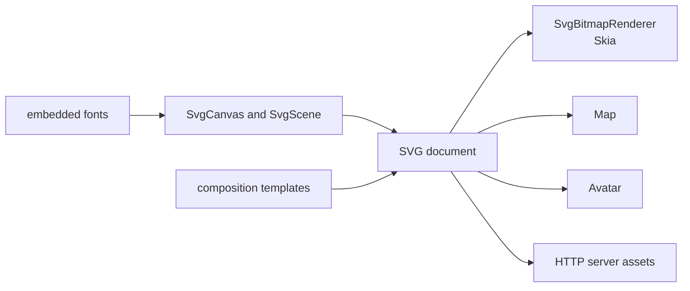

# SysWeaver.Media.Svg

[⬆ SysWeaver overview](../README.md)

> Programmatic SVG creation and rendering: a canvas/scene API with paths, shapes, gradients, shadows, 3D-style extrusion, text with embedded fonts, barcodes, composition templates, and SVG-to-bitmap rendering.

| | |
|---|---|
| **Layer** | Media |
| **Kind** | Library |

## Purpose

Generate vector graphics on the server — maps, avatars, barcodes, badges, charts, templated images — and rasterise them when a bitmap is required.

## How it fits into SysWeaver

## Key features

- Vector drawing API with styling primitives and effects.
- Text layout using embedded font glyphs (text converted to paths where needed).
- Code 128 (numeric only, also GS1-128), Code 39 and ITF-14 barcodes.
- Reusable composition templates with caching.
- Rendering to bitmaps via Skia.

## API overview

| Type | What it does |
|---|---|
| `SvgPath` | Path parsing (`Process`, M/L/H/V/C/S/Q/T/A/Z absolute and relative, implicit repeats), bounds (`UpdateMinMax`, `GetMinMaxForPaths`), in place transforms of path lists (`TransformPaths`, `ModifyAbsolutePaths`, `OptimizePaths`, `MakeAbsolute`, `FitPaths`, `NormalizeInto`, `VerticalBend`), shapes (`GetNGonPath`, `GetRoundedRect`, `GetFancyRect` with `SvgCornerShape`), `JoinPaths`, `Extrude`, `ComputeApproxCentroid`, `FindInnerMostPoint` and text to glyph paths (`GetSvgTextPaths`) |
| `SvgMinMaxState` | Axis aligned bounds (`Update` callback, `Expand`, `IsEmpty`) |
| `SvgScene` | Builds an svg document from css classes (`AddStyle`), gradients, masks and geometry; `AddPath` draws a face with an optional extrusion (3D sides) and drop shadow; `AddNGon`, `AddText`, `AddRect`, `AddFavIcon` (deterministic generated icons), `ToSvg`, `ToPng` |
| `SvgTools` | Invariant number formatters (`GetFormat`, `FullFormat`) and complete documents (`GetSvgFromPath`, `GetSvgNCon`, `GetSvgImageFromText`) |
| `SvgCanvas`, `SvgCanvasTools` | XDocument based editing: create / load, elements (`Rect`, `Circle`, `Path`, `Graph`, `Image`), definitions (gradients, drop shadows, clip paths, `GenId`), embedding other documents (`EmbeddSvg`, `Add`), `GetTransformToFit`, opacity pushing, `StyleToInline`, `SetFillAndStrokeHue`, `RasterizeText` (text elements to paths) |
| `SvgColor`, `SvgColorStyle`, `SvgStrokeStyle`, `SvgShadowParams`, `SvgGradStop`, `ISvgCss` | Colors (`#rgb`, `#rrggbb`, `rgb()`, `rgba()`) and css styles |
| `Svg3dParams`, `SvgExtrudeParams`, `SvgNgonParams`, `SvgTextParams`, `SvgTextPathParams` | Parameters of the scene / text helpers |
| `SvgFont` | Embedded fonts (`MontserratBlack`, `AtariClassic`, ...) and fonts loaded from files (`GetOrCreate(filename)`, fuzzy family search with `GetOrCreate(family, style, weight)` and `AddFontPath`) |
| `SvgBarcodeCode128`, `SvgBarcodeCode39`, `SvgBarcodeItf14` | Bar codes as svg paths (one rectangle sub path per bar, no quiet zone or text) |
| `SvgCompositionTemplate`, `SvgCompositionTemplateCache` | Layered images from svg / bitmap files selected by variables, with gray scale recoloring |
| `SvgBitmapRenderer` | Svg to png / jpeg (Svg.Skia) |

## Limitations and considerations

- Glyph-based text uses the embedded fonts or font files (`SvgFont.GetOrCreate`); there is no kerning or line breaking.
- All generated numbers use the invariant culture (also when the current culture uses a decimal comma).
- `SvgPath.Process` follows the svg number grammar: signs, exponents ("1e-3"), compact numbers ("1.5.5-2"), any white space or ',' as separators
  and arc flags without separators (as written by `SvgMinifier`, "a5 5 0 0110 10"). Invalid chars or numbers throw a `FormatException`.
- `SvgCanvas.StyleToInline` handles simple css: only the last class / element name of a selector is used, white space inside values is kept,
  repeated selectors are merged (later values override, like css).
- `SvgBarcodeCode128.GetGs1Path` writes GS1-128 (start C, FNC1, digit pairs, a trailing odd digit in code set A); only digits, so no FNC1 separators
  between fields (a variable length field must be the last one).
- Bounds include curve control points (not tight bounds).
- `SvgPath.Extrude` supports absolute M, L, H, V, Q and Z only (a Z extrudes the closing segment back to the sub path start).
- `SvgPath.TransformPaths` transforms arcs exactly (radii and rotation of the transformed ellipse, the sweep flag flips for a mirroring scale);
  the first pair of a leading relative 'm' is treated as absolute (translated).
- `SvgPath.ModifyAbsolutePaths` (and `VerticalBend`) only moves end points and control points: arcs are converted to cubic beziers (at most 90 degrees each),
  H / V stay H / V only while the modified segment is still axis aligned (else they are written as L), straight segments are not subdivided.
- `SvgFont.GetOrCreate(family, style, weight)` returns null if no font file name contains a word of the family (`SvgCanvas.RasterizeText` then uses `MontserratBlack`).
- `SvgBarcodeItf14.GetPath` / `Measure` throw an `ArgumentException` for non digits (an empty or odd length text still returns null / 0).
- `SvgCompositionTemplateCache` caches files by their full path ('$' names by name and reader, readers are compared with `Delegate.Equals`).
- `SvgCanvas.SetFillAndStrokeHue` keeps fill / stroke values that aren't colors ("none", "url(#a)", "currentColor").
- `SvgBitmapRenderer` throws an `InvalidDataException` for data that isn't an svg document (also when the root element isn't an svg element), an `XmlException` for invalid xml.
- `SvgBitmapRenderer`: a width or height of zero uses the svg size for that axis, the axes are scaled independently (only setting the width stretches the image).
- `SvgCanvas.Image(url)` reads local files, don't pass untrusted urls. `SvgCanvas.Create` requires the svg namespace on the root element.
- `SvgFont.AddFontPath` and the font cache are global (static) state.
- Rendering fidelity follows the Skia-based SVG renderer's feature coverage.
- `SvgBitmapRenderer` text elements: an installed font family is used if the system font manager has it, else a font file found by
  `SvgFont.GetOrCreate(family, style, weight)` (folders added with `SvgFont.AddFontPath`, top level files matched by file name), else the embedded
  `SvgFont.MontserratBlack` (like `SvgCanvas.RasterizeText`). For the same text on every machine, convert the text to paths first (`SvgCanvas.RasterizeText`, `SvgScene.AddText`).

## Platforms (Linux)

`SvgBitmapRenderer` (and `SvgScene.ToPng`) use SkiaSharp. The native libraries for Windows and macOS come with SkiaSharp, the Linux ones with
`SkiaSharp.NativeAssets.Linux.NoDependencies` (referenced by this project): linux-x64, linux-arm64, linux-arm, linux-x86 and linux-musl-x64 / arm64 / arm (Alpine),
HarfBuzzSharp has the same set. Tested on Ubuntu 24.04 x64 (the plain `mcr.microsoft.com/dotnet/sdk:10.0` image), Alpine x64 and Ubuntu arm64 (emulated).

- Needed on the machine: only what .NET itself needs (glibc or musl, libstdc++, libgcc). No fontconfig, freetype or fonts are needed.
- The "NoDependencies" library has no system font manager, installed fonts are NOT used on Linux: text elements use the font files found with
  `SvgFont.AddFontPath` folders (by family name) or the embedded `MontserratBlack` font (see above).
  To use the installed fonts instead, reference `SkiaSharp.NativeAssets.Linux` (same version as SkiaSharp) in the application instead; that library needs
  `libfontconfig1` (it doesn't load without it) and installed fonts (ex: `fonts-dejavu-core`).
- Shapes and text converted to paths render the same pixels on Windows and Linux; text elements with the same font differ slightly (anti aliasing / hinting of the glyph rasterizers).

## Known bugs (svg-cov review 2026-10-10)

No known open bugs.

Fixed in this review: svg-cov-1 to svg-cov-23 (see `_docs/BugReview-2026-10-06.md`), ex: the last number of a path was dropped, Code 39 encoded '$', '/', '+', '%' wrong,
culture dependent numbers in the generated svg, `rgba()` parsing, gray colors of composition templates, `GetSvgTextPaths` changed the thread culture.
Fixed later: svg-cov-36 (`SvgPath.Process` number tokenizer), svg-cov-41 (`StyleToInline` keeps spaces in values, merges repeated selectors), svg-cov-43 (GS1-128 with FNC1),
svg-cov-37 (`Extrude` closing segment), svg-cov-38 (`TransformPaths` leading 'm' and arcs), svg-cov-39 (`ModifyAbsolutePaths` / `VerticalBend` arcs and H / V),
svg-cov-40 (`EmbeddSvg` view box origin), svg-cov-42 (font family search returns null on no match), svg-cov-44 (ITF-14 rejects non digits),
svg-cov-45 (template cache keyed by full path / reader), svg-cov-47 (`SetFillAndStrokeHue` keeps non colors), svg-cov-48 (`InvalidDataException` for a non-svg root),
svg-cov-51 (rendering on Linux: the SkiaSharp Linux library is referenced, text falls back to font files / the embedded font).

## Relationships

- **Project:** [`SysWeaver.Media.Svg.csproj`](SysWeaver.Media.Svg.csproj)
- **Builds on:** [SysWeaver.Common](../SysWeaver.Common/README.md), [SysWeaver.Compression](../SysWeaver.Compression/README.md)
- **Used by:** [SysWeaver.HttpServer](../SysWeaver.HttpServer/README.md), [SysWeaver.Map](../SysWeaver.Map/README.md), [SysWeaver.MicroService.Avatar](../SysWeaver.MicroService.Avatar/README.md)
