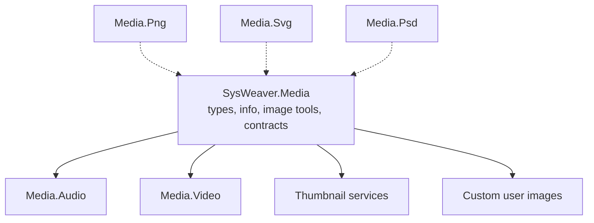

# SysWeaver.Media

[⬆ SysWeaver overview](../README.md)

> Media fundamentals shared by the media-related services: media type classification, media information, image processing helpers built on ImageMagick, and the contracts for screenshot and web-thumbnail services.

| | |
|---|---|
| **Layer** | Media |
| **Kind** | Library |

## Purpose

Provide the common media vocabulary so thumbnails, uploads, user images and the media viewer agree on file types, sizes and processing.

## How it fits into SysWeaver

## Key features

- `MediaFileTypes.GetMediaType`: classification of a file extension (case insensitive, leading dots ignored) into `MediaTypes.Image` / `Video` / `Audio` / `None` using a fixed table.
- `MediaInfo`: size, duration, fps, a description and an icon (thumbnail) for a media file. `GetAsync` caches the result in a temp folder (`FileMetaDataDbAsync`).
  Images are read with ImageMagick, videos and audio through `VideoInfo.GetMediaInfo` (SysWeaver.Media.Video) / `AudioInfo.GetMediaInfo` (SysWeaver.Media.Audio), found by reflection.
  `AddMediaInfoCreator` adds a handler for a file extension that is tried first. The extension is the one of the file name (`Path.GetExtension`), a '.' in a folder name is ignored.
  There is one cache per icon size and fill flag (cache name `MediaInfo_MediaInfo<w>x<h>`, plus `_fill`).
- `ImageTools` (ImageMagick): `FillInto` (scale to cover and crop) / `FitInto` (scale to fit, optionally extend with a color), reading images from files, urls and memory, and `ImageData32` conversion / saving.
- `ColorSpace`: sRGB / linear RGB / OkLab / OkLch conversions (verified against the published reference values), CSS colors from OkLch and OkHsv (`OkHsvToOkLab` follows the reference okhsv_to_srgb: v = 0 is black, s = v = 1 is in the sRGB gamut), and OkLab to OkHsl (the hue is [0, 1), not radians; gray colors have a saturation of 0).
- Screenshot request/response contracts used by browser-based rendering (`ScreenshotRequest`, `ScreenshotJpegRequest`, `ScreenshotPngRequest`, `ScreenshotImageRequest`, `ScreenshotImageResponse`, namespace `SysWeaver.MicroService`).
- The web thumbnail service contract (`IThumbnailWebService`).

## Limitations and considerations

- ImageMagick is a large native dependency; image processing is CPU and memory intensive.
- `ImageTools.ReadImage` downloads `http(s)://` names; `ReadImageWeb` returns null for unsuccessful status codes.

## Relationships

- **Project:** [`SysWeaver.Media.csproj`](SysWeaver.Media.csproj)
- **Builds on:** [SysWeaver.CommandLine](../SysWeaver.CommandLine/README.md), [SysWeaver.Storage](../SysWeaver.Storage/README.md)
- **Used by:** [SysWeaver.Media.Audio](../SysWeaver.Media.Audio/README.md), [SysWeaver.Media.Video](../SysWeaver.Media.Video/README.md), [SysWeaver.MicroService.CustomUserImage](../SysWeaver.MicroService.CustomUserImage/README.md), [SysWeaver.MicroService.MediaThumbnail](../SysWeaver.MicroService.MediaThumbnail/README.md), [SysWeaver.MicroService.Thumbnail](../SysWeaver.MicroService.Thumbnail/README.md), [SysWeaver.MicroService.Thumbnail.Web](../SysWeaver.MicroService.Thumbnail.Web/README.md)
