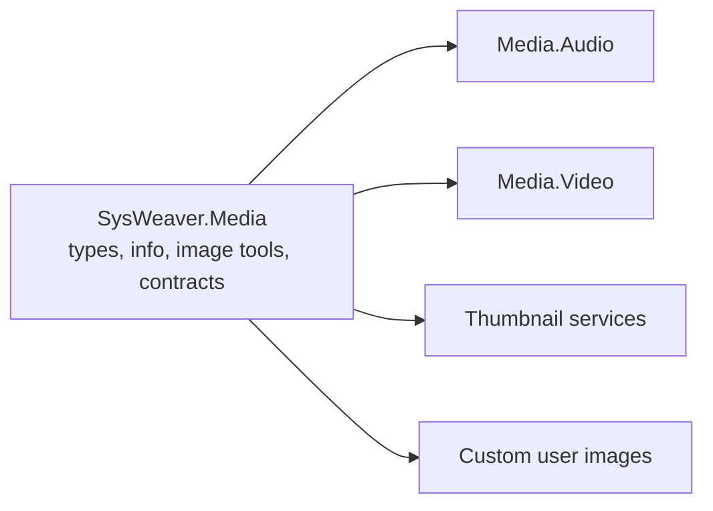

# SysWeaver.Media

[⬆ SysWeaver overview](../README.md)

> Media fundamentals shared by the media-related services: media type classification, media information, image processing helpers built on ImageMagick, and the contracts for screenshot and web-thumbnail services.

| | |
|---|---|
| **Layer** | Media |
| **Kind** | Library |

## Purpose

Provide the common media vocabulary so thumbnails, uploads, user images and the media viewer agree on file types, sizes and processing.

## How it fits into SysWeaver

`MediaInfo` reads images itself (ImageMagick) and finds the readers of [SysWeaver.Media.Video](../SysWeaver.Media.Video/README.md) and [SysWeaver.Media.Audio](../SysWeaver.Media.Audio/README.md) by reflection, so those assemblies are optional at run time.

## Key features

- Classification of file extensions into image, video, audio or none (`MediaFileTypes.GetMediaType`)
- Media information (size, duration, fps, description) plus an optional icon (thumbnail) file, cached on disc per icon size (`FileMetaDataDbAsync`)
- Pluggable per-extension media info creators (`MediaInfo.AddMediaInfoCreator`) that are tried before the built-in readers
- ImageMagick helpers: scale to fill (crop) or fit (optionally extend), read images from files, urls and memory, convert and save `ImageData32`
- Colour space conversions: sRGB, linear RGB, OkLab, OkLch, OkHsv and OkHsl, and CSS colours from OkLch/OkHsv
- Screenshot request/response contracts (`ScreenshotRequest`, `ScreenshotJpegRequest`, `ScreenshotPngRequest`, `ScreenshotImageRequest`, `ScreenshotImageResponse`, namespace `SysWeaver.MicroService`) and the web thumbnail service contract `IThumbnailWebService`

## Key components

- [`MediaInfo`](MediaInfo.cs) — cached media information and icon creation for a file
- [`MediaFileTypes`](MediaFileTypes.cs) — file extension to `MediaTypes` table
- [`ImageTools`](ImageTools.cs) — ImageMagick based image helpers
- [`ColorSpace`](ColorSpace.cs) — Ok* colour space conversions
- [`IThumbnailWebService`](IThumbnailWebService.cs) — contract for screenshots of urls, implemented by [SysWeaver.MicroService.Thumbnail.Web](../SysWeaver.MicroService.Thumbnail.Web/README.md)

## Limitations and considerations

- ImageMagick is a large native dependency; image processing is CPU and memory intensive
- `ImageTools.ReadImage` downloads `http(s)://` names (15 second timeout); `ReadImageWeb` returns null for unsuccessful status codes
- Video and audio information is only available when SysWeaver.Media.Video / SysWeaver.Media.Audio can be loaded

## Relationships

- **Project:** [`SysWeaver.Media.csproj`](SysWeaver.Media.csproj)
- **Builds on:** [SysWeaver.CommandLine](../SysWeaver.CommandLine/README.md), [SysWeaver.Storage](../SysWeaver.Storage/README.md)
- **Used by:** [SysWeaver.Media.Audio](../SysWeaver.Media.Audio/README.md), [SysWeaver.Media.Video](../SysWeaver.Media.Video/README.md), [SysWeaver.MicroService.CustomUserImage](../SysWeaver.MicroService.CustomUserImage/README.md), [SysWeaver.MicroService.MediaThumbnail](../SysWeaver.MicroService.MediaThumbnail/README.md), [SysWeaver.MicroService.Thumbnail](../SysWeaver.MicroService.Thumbnail/README.md), [SysWeaver.MicroService.Thumbnail.Web](../SysWeaver.MicroService.Thumbnail.Web/README.md)
- **Third-party:** Magick.NET (`Magick.NET-Q16-AnyCPU`)
