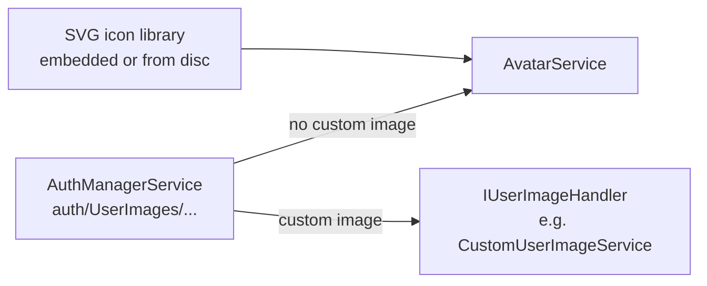

# SysWeaver.MicroService.Avatar

[⬆ SysWeaver overview](../README.md)

> Generated default profile pictures, composed from a library of SVG avatar parts.

| | |
|---|---|
| **Layer** | Security |
| **Kind** | Micro service (default user image provider) |

## Purpose

Every user gets a recognisable picture without uploading one. The auth manager service picks up this service as its default user image handler.

## How it fits into SysWeaver



## Key features

- Deterministic picture per user: the user guid seeds the colours, a background shape (rounded rectangle, polygon or fancy shape) and one icon picked from the library
- Around 650 embedded SVG icons; alternatively a folder of SVG files on disc, which an Admin/Ops API can reload
- Opaque or transparent background
- Images are also served directly as `Avatars/<seed>.svg`, cached in memory, optionally restricted by auth tokens
- Performance and statistics reporting

## Key components

- [`AvatarService`](AvatarService.cs) — the `IDefaultUserImageHandler` and HTTP module that generates the images

## Using it

```json
{ "Type": "SysWeaver.MicroService.AvatarService, SysWeaver.MicroService.Avatar" }
```

## Limitations and considerations

- Generated pictures are decorative; for real photos add [SysWeaver.MicroService.CustomUserImage](../SysWeaver.MicroService.CustomUserImage/README.md)
- When a disc folder is configured but missing, no images are generated
- Images are always 256×256 SVG, regardless of the requested size

## Relationships

- **Project:** [`SysWeaver.MicroService.Avatar.csproj`](SysWeaver.MicroService.Avatar.csproj)
- **Builds on:** [SysWeaver.HttpServer](../SysWeaver.HttpServer/README.md), [SysWeaver.Media.Svg](../SysWeaver.Media.Svg/README.md)
