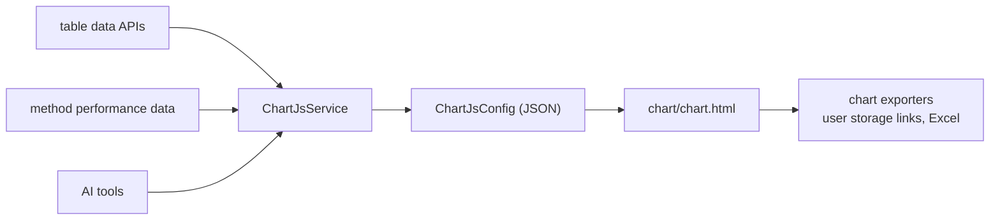

# SysWeaver.MicroService.ChartJs

[⬆ SysWeaver overview](../README.md)

> Charts for SysWeaver using Chart.js: a typed chart configuration model, automatic charts from table data, performance charts, chart export and AI tool integration.

| | |
|---|---|
| **Layer** | Media |
| **Kind** | Micro service with a web front-end |

## Purpose

Let services return charts as data — and let users chart any table — with rendering done in the browser by Chart.js (bundled, v4.5.0, with the data-labels plugin).

## How it fits into SysWeaver



## Key features

- Server-side model of the Chart.js configuration (`ChartJsConfig`: datasets, scales, legends, titles, tooltips, plugins) and a simpler `Chart` model (bar, line, pie, doughnut, polar area)
- `TableChart` API: charts any table-data API (key and value columns) the caller is allowed to use
- `PerformanceChart`: a debug menu item graphing active and peak method calls
- Chart export through exporters contributed by other services (`IHaveChartExporters`); when a user storage service is present, charts can also be saved as private, protected or public links
- AI tools (`BuildChart`, `DisplayChart` and advanced variants taking a full `ChartJsConfig`) so assistants can produce charts in chat

## Key components

- [`ChartJsService`](ChartJsService.cs) — the micro service: chart APIs, table charts, exporter registry and AI tools
- [`ChartJsConfig`](ChartJsConfig.cs) — root of the typed Chart.js configuration model
- [`Chart`](Chart.cs) — simplified chart description used by the AI tools

## Using it

```json
{
  "Type": "SysWeaver.MicroService.ChartJsService, SysWeaver.MicroService.ChartJs"
}
```

## Limitations and considerations

- Rendering happens client-side; charts are only as capable as the bundled Chart.js version.
- Table charts need the local API module (`ApiHttpServerModule`), resolved when the service starts; `TableChartAvailable` reports whether it was found.

## Folder layout

| Folder | Content |
|---|---|
| [`srcWeb/`](srcWeb/README.md) | Embedded web assets: the chart page, chart type icons and the bundled Chart.js libraries |

## Relationships

- **Project:** [`SysWeaver.MicroService.ChartJs.csproj`](SysWeaver.MicroService.ChartJs.csproj)
- **Builds on:** [SysWeaver.Serialization.NewtonsoftJson](../Serialization/SysWeaver.Serialization.NewtonsoftJson/README.md), [SysWeaver.MicroServices.ServiceManager](../SysWeaver.MicroServices.ServiceManager/README.md)
- **Used by:** [SysWeaver.MicroService.ChartJs.Excel](../SysWeaver.MicroService.ChartJs.Excel/README.md), [SysWeaver.MicroService.ServerManager](../SysWeaver.MicroService.ServerManager/README.md), [ExchangeRateService](https://github.com/dosh1974/SysWeaver.Services/blob/main/ExchangeRateService/README.md)
- **Third-party:** Chart.js, chartjs-plugin-datalabels, Hammer.js and canvas2svg (bundled browser scripts)
