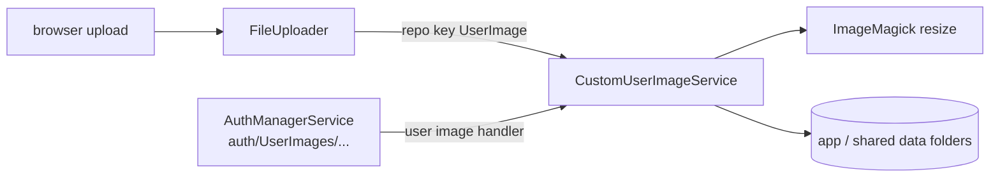

# SysWeaver.MicroService.CustomUserImage

[⬆ SysWeaver overview](../README.md)

> User-uploaded profile pictures, processed into standard sizes and stored per user, plus a general image repository that stores uploads in several sizes.

| | |
|---|---|
| **Layer** | Security |
| **Kind** | Micro services |

## Purpose

Let users upload their own picture, which then replaces the generated avatar wherever the UI shows the user.

## How it fits into SysWeaver



`CustomUserImageService` is an upload repository for the [file uploader](../SysWeaver.MicroService.FileUploader/README.md) and the `IUserImageHandler` that `AuthManagerService` asks for user images; users without an uploaded picture fall back to the default image handler (for example [Avatar](../SysWeaver.MicroService.Avatar/README.md)).

## Key features

- Upload of PNG, JPEG, TIFF, WebP and AVIF pictures (up to 10 MB), validated by decoding the data
- Resized into a set of square sizes and saved as PNG (or JPEG), with transparency removed onto a background colour unless allowed
- Separate auth for public (small) and private (large) sizes
- Per-application or machine-wide storage, sharded over the data folders
- Users can remove their own picture
- `ImageRepoService`: configurable upload repositories that store each uploaded image in several named sizes and formats

## Key components

- [`CustomUserImageService`](CustomUserImageService.cs) — upload repository and user image handler
- [`CustomUserImageParams`](CustomUserImageParams.cs) — repository key, sizes, format, background colour, storage scope and auth
- [`ImageRepoService`](ImageRepoService.cs) — container of general [`ImageRepo`](ImageRepo.cs) upload repositories ([`ImageRepoParams`](ImageRepoParams.cs))
- [`ImageSize`](ImageSize.cs) — one output of an `ImageRepo`: name, size, fit / fill, format and quality

## Using it

```json
[
  { "Type": "SysWeaver.MicroService.CustomUserImageService, SysWeaver.MicroService.CustomUserImage",
    "Params": { "Sizes": [ -64, 512 ] } },
  { "Type": "SysWeaver.MicroService.ImageRepoService, SysWeaver.MicroService.CustomUserImage",
    "Params": { "Repos": [ { "Key": "Gallery", "UploadAuth": "",
      "Sizes": [ { "Name": "{0}_thumb", "Width": 256, "Ext": ".jpg" } ] } ] } }
]
```

A negative size is served with the public auth (`PublicAuth`, default: no auth), a positive with the private auth (`PrivateAuth`, default `""`: any logged in user). Uploaded pictures are served by `AuthManagerService` as `auth/UserImages/<user>/...`.

## Limitations and considerations

- Requires the file uploader service; image processing costs CPU on upload
- One picture per user; a new upload replaces all sizes. Uploads of the same file (same hash) are reported as already uploaded
- `ImageSize.Name` must be set (the default `"{0}"` is rejected when the service starts) and `ImageSize.Ext` must be `.png` or `.jpg`; other extensions are only detected when an image is uploaded

## Relationships

- **Project:** [`SysWeaver.MicroService.CustomUserImage.csproj`](SysWeaver.MicroService.CustomUserImage.csproj)
- **Builds on:** [SysWeaver.HttpServer](../SysWeaver.HttpServer/README.md), [SysWeaver.Media](../SysWeaver.Media/README.md), [SysWeaver.MicroService.Auth](../SysWeaver.MicroService.Auth/README.md), [SysWeaver.MicroService.FileUploader](../SysWeaver.MicroService.FileUploader/README.md)
