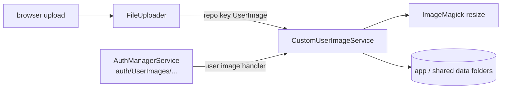

# SysWeaver.MicroService.CustomUserImage

[⬆ SysWeaver overview](../README.md)

> User-uploaded profile pictures, processed into standard sizes and stored per user, plus a general image repository that stores uploads in several sizes.

| | |
|---|---|
| **Layer** | Security |
| **Kind** | Micro services |

## Purpose

Let users upload their own picture, which then replaces the generated avatar wherever the UI shows the user.

## How it fits into SysWeaver



`CustomUserImageService` is an upload repository for the [file uploader](../SysWeaver.MicroService.FileUploader/README.md) and the `IUserImageHandler` that `AuthManagerService` asks for user images; users without an uploaded picture fall back to the default image handler (for example [Avatar](../SysWeaver.MicroService.Avatar/README.md)).

## Key features

- Upload of PNG, JPEG, TIFF, WebP and AVIF pictures (up to 10 MB), validated by decoding the data
- Resized into a set of square sizes and saved as PNG (or JPEG), with transparency removed onto a background colour unless allowed
- Separate auth for public (small) and private (large) sizes
- Per-application or machine-wide storage, sharded over the data folders
- Users can remove their own picture
- `ImageRepoService`: configurable upload repositories that store each uploaded image in several named sizes and formats

## Key components

- [`CustomUserImageService`](CustomUserImageService.cs) — upload repository and user image handler
- [`ImageRepoService`](ImageRepoService.cs) — container of general [`ImageRepo`](ImageRepo.cs) upload repositories

## Using it

```json
[
  { "Type": "SysWeaver.MicroService.CustomUserImageService, SysWeaver.MicroService.CustomUserImage",
    "Params": { "Sizes": [ -64, 512 ] } }
]
```

A negative size is served with the public auth, a positive with the private auth.

## Limitations and considerations

- Requires the file uploader service; image processing costs CPU on upload

## Relationships

- **Project:** [`SysWeaver.MicroService.CustomUserImage.csproj`](SysWeaver.MicroService.CustomUserImage.csproj)
- **Builds on:** [SysWeaver.HttpServer](../SysWeaver.HttpServer/README.md), [SysWeaver.Media](../SysWeaver.Media/README.md), [SysWeaver.MicroService.Auth](../SysWeaver.MicroService.Auth/README.md), [SysWeaver.MicroService.FileUploader](../SysWeaver.MicroService.FileUploader/README.md)
