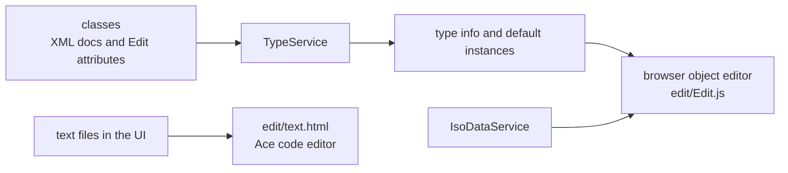

# SysWeaver.MicroService.Edit

[⬆ SysWeaver overview](../README.md)

> The generic object editor: type metadata and default instances for a browser-based editor that can edit any serializable object, plus a text/code editor and ISO reference data for the web UI.

| | |
|---|---|
| **Layer** | Administration |
| **Kind** | Micro services with a large web front-end |

## Purpose

Configuration and request objects in SysWeaver are plain classes documented with XML comments and `Edit*` attributes. `TypeService` describes those types to the browser, which renders appropriate editors (numbers with ranges, sliders, passwords, multi-line text, enums and flags, collections and maps, languages, countries, currencies, …). The same web front-end is used wherever the UI needs to fill in an object, e.g. API parameter forms in the API explorer and pop-up dialogs in [SysWeaver.MicroService.ServerManager](../SysWeaver.MicroService.ServerManager/README.md).

## How it fits into SysWeaver



## Key features

- `GetTypeInfo` / `GetDefaultInstance`: type descriptions (members, flags, ranges, documentation) and default instances, cached per type
- A type information page (`edit/type.html`) linked from type names in tables, and `GetApiInfo` for detailed API documentation (debug)
- A text/code editor (`edit/text.html`, based on Ace) registered as the extension editor for common text file types (`.txt`, `.json`, `.cs`, `.js`, `.xml`, `.log`, …)
- `IsoDataService` registers the ISO data module (languages, countries, currencies, phone prefixes) used by the editor's lookups

## Key components

- [`TypeService`](TypeService.cs) — the type metadata micro service, served under `edit/`
- [`IsoDataService`](IsoDataService.cs) — hosts the `IsoDataHttpServerModule`
- [`TypeMemberDesc`](TypeMemberDesc.cs) — the type and member descriptions sent to the browser

## Using it

```json
[
  { "Type": "SysWeaver.MicroService.TypeService, SysWeaver.MicroService.Edit" },
  { "Type": "SysWeaver.MicroService.IsoDataService, SysWeaver.MicroService.Edit" }
]
```

## Limitations and considerations

- Editing quality depends on the XML documentation and edit attributes on the types.
- Only public types accepted by the data-type rules of `TypeFinder` are described; sessions with the debug role get additional details.

## Folder layout

| Folder | Content |
|---|---|
| [`srcWeb/`](srcWeb/README.md) | Embedded web assets: object editor, type information page, text / code editor, vendored Ace and Prettier |

## Relationships

- **Project:** [`SysWeaver.MicroService.Edit.csproj`](SysWeaver.MicroService.Edit.csproj)
- **Builds on:** [SysWeaver.Docs](../SysWeaver.Docs/README.md), [SysWeaver.HttpServer.IsoDataModule](../SysWeaver.HttpServer.IsoDataModule/README.md), [SysWeaver.HttpServer](../SysWeaver.HttpServer/README.md), [SysWeaver.MicroServices.ServiceManager](../SysWeaver.MicroServices.ServiceManager/README.md), [SysWeaver.MicroServices](../SysWeaver.MicroServices/README.md)
- **Used by:** [SysWeaver.Services](https://github.com/dosh1974/SysWeaver.Services) applications: ExchangeRateService, FakeEmailService, FakeTextService, IpLocationService, ReverseProxyClient, ReverseProxyServer, SwLanCertManager, SwServerManager, TranslationService, WebServerService
- **Third-party:** Ace editor and Prettier (bundled browser scripts)
