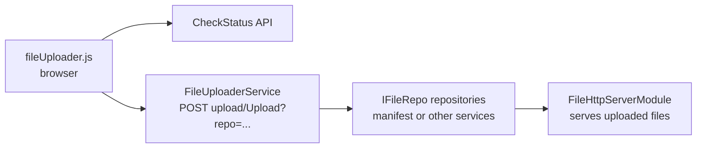

# SysWeaver.MicroService.FileUploader

[⬆ SysWeaver overview](../README.md)

> Browser file uploads into named repositories, with pre-upload status checks, optional chunk-level deduplication and automatic pruning.

| | |
|---|---|
| **Layer** | Files / Sync |
| **Kind** | Micro service |

## Purpose

A single, reusable upload mechanism for all features that accept files (user images, user storage, thumbnails, server management). Features plug in their own repositories; simple disc-backed repositories can be configured directly in the manifest.

## How it fits into SysWeaver



## Key features

- Repositories are found automatically: configured `StaticFileRepo` entries, plus any service implementing `IFileRepo` or `IFileRepoContainer` (added and removed as services come and go)
- `CheckStatus` lets the client ask per file (name, size, hash) whether it is accepted, already uploaded or refused before sending any data
- Compressed uploads (`Content-Encoding`) can be stored pre-compressed and served as such
- Optional content-defined chunking: a client may send chunk hashes and only needs to upload the chunks the server is missing
- `StaticFileRepo`: size and extension limits, per-user subfolders, optional serving of uploaded files with their own auth, and hourly pruning of files not used for `RemoveIfUnusedDays`
- Browser script (`common/fileUploader.js`) with drag-and-drop / file picker helpers, and a debug page (`upload/Example.html`) for manual uploads

## Key components

- [`FileUploaderService`](FileUploaderService.cs) — the micro service: repository registry, upload endpoint, status API, pruning
- [`IFileRepo`](IFileRepo.cs) — the contract a repository implements
- [`StaticFileRepo`](StaticFileRepo.cs) — configurable disc-backed repository

## Using it

```json
{
  "Type": "SysWeaver.MicroService.FileUploaderService, SysWeaver.MicroService.FileUploader",
  "Params": {
    "Repos": [ { "Key": "Docs", "UploadAuth": "", "Extensions": [ "pdf", "txt" ], "RemoveIfUnusedDays": 30 } ]
  }
}
```

## Limitations and considerations

- Repositories define what is accepted; the uploader itself is generic.
- Exposing uploaded files requires the `FileHttpServerModule` to be registered.

## Relationships

- **Project:** [`SysWeaver.MicroService.FileUploader.csproj`](SysWeaver.MicroService.FileUploader.csproj)
- **Builds on:** [SysWeaver.Common](../SysWeaver.Common/README.md), [SysWeaver.HttpServer](../SysWeaver.HttpServer/README.md), [SysWeaver.MicroServices.ServiceManager](../SysWeaver.MicroServices.ServiceManager/README.md), [SysWeaver.MicroServices](../SysWeaver.MicroServices/README.md), [SysWeaver.Storage.Cdc](../SysWeaver.Storage.Cdc/README.md)
- **Used by:** [SysWeaver.MicroService.CustomUserImage](../SysWeaver.MicroService.CustomUserImage/README.md), [SysWeaver.MicroService.ServerManager](../SysWeaver.MicroService.ServerManager/README.md), [SysWeaver.MicroService.Thumbnail.Web](../SysWeaver.MicroService.Thumbnail.Web/README.md), [SysWeaver.MicroService.UserStorage](../SysWeaver.MicroService.UserStorage/README.md), [SwServerManager](https://github.com/dosh1974/SysWeaver.Services/blob/main/SwServerManager/README.md) (SysWeaver.Services)
