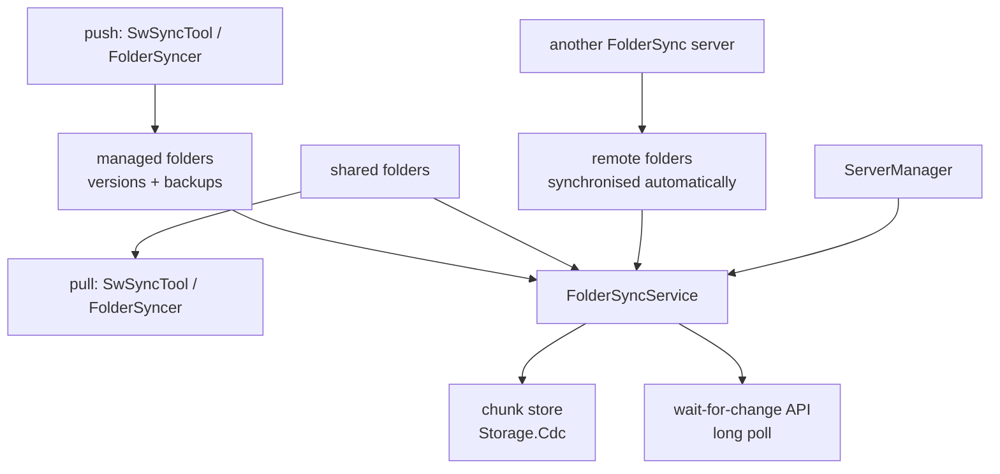

# SysWeaver.MicroService.FolderSync

[⬆ SysWeaver overview](../README.md)

> Server side of folder synchronisation: managed folders that can be updated remotely, shared folders that clients pull, and remote folders the server keeps in sync from elsewhere — all with chunk-level transfer and change notification.

| | |
|---|---|
| **Layer** | Files / Sync |
| **Kind** | Micro service |

## Purpose

A deployment and distribution hub: build servers push new versions, target machines pull shared folders or keep remote folders updated automatically.

## How it fits into SysWeaver



## Key features

- Three folder roles configured independently (`ManagedFolders`, `SharedFolders`, `RemoteFolders`)
- **Managed folders**: each push becomes a new version folder next to the active one; versions can be activated, removed, compressed (CDC) and are pruned after `RemoveBackupsDays`; optional commands run on new folder, activation and deactivation; `AllowPull` also exposes the folder as a shared folder
- **Shared folders**: clients pull them chunk by chunk and can long-poll (`WaitUntilSharedFolderHasChanged`) for a new version
- **Remote folders**: pulled from another server and optionally served as a web folder, with a swap method (`IFramePage`, `HttpRedirect`, `None`) so browsers never mix files from two versions; old versions are deleted after `DeleteAfterHours`
- Binary upload/download endpoints (`FolderSync/`, `FolderSyncCdc/`, `FolderSyncCdcChunks/`, `FolderSyncCdcPullChunks/`) for efficient file and chunk transfer
- Operator tables for managed, shared and remote folders, browsable folder contents, audited push operations

## Key components

- [`FolderSyncService`](FolderSyncService.cs) — the micro service (split into partial files per folder role)
- [`FolderSyncParams`](FolderSyncParams.cs) — lists of managed, shared and remote folders
- [`FsManagedFolder`](FsManagedFolder.cs), [`FsSharedFolder`](FsSharedFolder.cs), [`FsRemoteFolder`](FsRemoteFolder.cs) — per-folder configuration

## Using it

```json
{
  "Type": "SysWeaver.MicroService.FolderSyncService, SysWeaver.MicroService.FolderSync",
  "Params": {
    "ManagedFolders": [ { "Name": "MyApp", "DiscFolder": "D:\\Deploy\\MyApp", "AllowPull": true } ]
  }
}
```

## Limitations and considerations

- Disc usage grows with the number of kept versions; tune `RemoveBackupsDays` / `DeleteAfterHours` and consider `Compress`.
- Folder-level auth must be configured carefully — managed folders can overwrite deployed content (a `null` auth means the `Debug` role).
- Serving remote folders on the web needs the `FileHttpServerModule` (and `StaticDataHttpServerModule` for versioned data).

## Relationships

- **Project:** [`SysWeaver.MicroService.FolderSync.csproj`](SysWeaver.MicroService.FolderSync.csproj)
- **Builds on:** [SysWeaver.FolderSync](../SysWeaver.FolderSync/README.md), [SysWeaver.MicroServices.ServiceManager](../SysWeaver.MicroServices.ServiceManager/README.md), [SysWeaver.Storage.Cdc](../SysWeaver.Storage.Cdc/README.md)
- **Used by:** [SysWeaver.MicroService.ServerManager](../SysWeaver.MicroService.ServerManager/README.md), [SwServerManager](https://github.com/dosh1974/SysWeaver.Services/blob/main/SwServerManager/README.md) (SysWeaver.Services)
