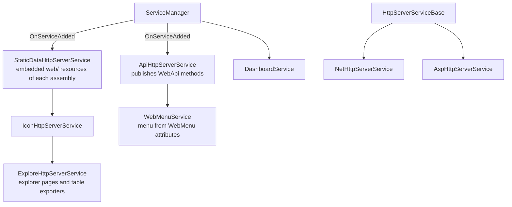

# SysWeaver.MicroService.HttpServer

[⬆ SysWeaver overview](../README.md)

> The micro services that assemble a complete web front-end from the manifest: API publishing, embedded web assets, icons, the developer explorer, the navigation menu and dashboards — plus the common base class of the HTTP server services.

| | |
|---|---|
| **Layer** | Web platform |
| **Kind** | Library with micro services |

## Purpose

Bridge the [SysWeaver.HttpServer](../SysWeaver.HttpServer/README.md) library and the [SysWeaver.MicroServices.ServiceManager](../SysWeaver.MicroServices.ServiceManager/README.md). Each service here is a small adapter that creates a module, registers it, and keeps it in sync as other services come and go.

## How it fits into SysWeaver



## Key features

- **API service** (`ApiHttpServerService`): publishes the `[WebApi]` methods of the service manager and of every local service, including services registered later, and connects `IApiAuditService` implementations.
- **Static data service** (`StaticDataHttpServerService`): serves the embedded resources in the `web/` folder of the assembly of every registered service — adding a service automatically adds its web pages.
- **Icon service** (`IconHttpServerService`): serves the shared icon set of [SysWeaver.HttpServer.IconModule](../SysWeaver.HttpServer.IconModule/README.md).
- **Explore service** (`ExploreHttpServerService`): the explorer pages of [SysWeaver.HttpServer.ExploreModule](../SysWeaver.HttpServer.ExploreModule/README.md) and the table export formats offered in the UI (CSV, HTML, Markdown, JSON, and saving to user storage when an `IUserStorageService` is registered), extendable by services implementing `IHaveTableDataExporters`.
- **Menu service** (`WebMenuService`): collects the `[WebMenu*]` declarations of all services and APIs into the UI menus, filtered by the session's auth.
- **Dashboard service** (`DashboardService`): returns per-user dashboards read from a key/value store.
- **Server service base** (`HttpServerServiceBase`): creates the HTTP server with the registered certificate providers, auth manager and firewall handler, attaches every module, raw module, transformer and template variable group service (now and later), and provides admin APIs to read and save the server manifest (current, last known good and previous versions) and restart the process.

## Key components

- [`HttpServerServiceBase`](HttpServerServiceBase.cs) — common base of the HTTP server micro services
- [`ApiHttpServerService`](ApiHttpServerService.cs) — Web API publishing
- [`StaticDataHttpServerService`](StaticDataHttpServerService.cs) — embedded web assets of all services
- [`WebMenuService`](WebMenuService.cs) — the navigation menus
- [`ExploreHttpServerService`](ExploreHttpServerService.cs) — explorer and table exporters

## Using it

```json
[
  { "Type": "SysWeaver.MicroService.NetHttpServerService, SysWeaver.MicroService.NetHttpServer",
    "Params": { "ListenOn": [ { "Prefix": "http://localhost:8080" } ] } },
  { "Type": "SysWeaver.MicroService.StaticDataHttpServerService, SysWeaver.MicroService.HttpServer" },
  { "Type": "SysWeaver.MicroService.ApiHttpServerService, SysWeaver.MicroService.HttpServer" },
  { "Type": "SysWeaver.MicroService.IconHttpServerService, SysWeaver.MicroService.HttpServer" },
  { "Type": "SysWeaver.MicroService.ExploreHttpServerService, SysWeaver.MicroService.HttpServer" },
  { "Type": "SysWeaver.MicroService.WebMenuService, SysWeaver.MicroService.HttpServer" }
]
```

## Limitations and considerations

- Some services resolve dependencies in their constructors and must be ordered accordingly: icons after static data, explorer after both, the menu after the API service, the HTTP server service after the auth manager, firewall handler and certificate providers.
- Multiple instances of these services are discouraged by their own documentation.
- The manifest admin APIs (Admin role) write the manifest file directly; a restart is needed for changes to take effect.
- `DashboardService` only reads dashboards (stored per user under `Dashboard_<id>_<user>` keys); nothing in the framework writes them yet, and sessions without a user get none.

## Relationships

- **Project:** [`SysWeaver.MicroService.HttpServer.csproj`](SysWeaver.MicroService.HttpServer.csproj)
- **Builds on:** [SysWeaver.Auth.Core](../SysWeaver.Auth.Core/README.md), [SysWeaver.CommandLine](../SysWeaver.CommandLine/README.md), [SysWeaver.HttpServer.ExploreModule](../SysWeaver.HttpServer.ExploreModule/README.md), [SysWeaver.HttpServer.IconModule](../SysWeaver.HttpServer.IconModule/README.md), [SysWeaver.HttpServer](../SysWeaver.HttpServer/README.md), [SysWeaver.MicroServices.ServiceManager](../SysWeaver.MicroServices.ServiceManager/README.md), [SysWeaver.Storage](../SysWeaver.Storage/README.md)
- **Used by:** [SysWeaver.MicroService.AspHttpServer](../SysWeaver.MicroService.AspHttpServer/README.md), [SysWeaver.MicroService.NetHttpServer](../SysWeaver.MicroService.NetHttpServer/README.md), [SwLanCertManager](https://github.com/dosh1974/SysWeaver.Services/blob/main/SwLanCertManager/README.md), [SwServerManager](https://github.com/dosh1974/SysWeaver.Services/blob/main/SwServerManager/README.md), [TranslationService](https://github.com/dosh1974/SysWeaver.Services/blob/main/TranslationService/README.md)
