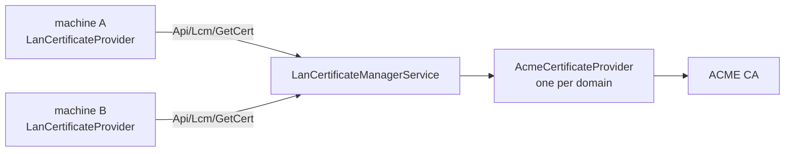

# SysWeaver.MicroService.LanCertificateManager

[⬆ SysWeaver overview](../README.md)

> Central issuer of certificates for LAN domains: obtains ACME certificates for a list of domains and hands them out to other SysWeaver machines, which request and renew their certificates from this service.

| | |
|---|---|
| **Layer** | Security |
| **Kind** | Micro service (`ILanCertificateManager`) |

## Purpose

Give internal machines browser-trusted certificates for their host names from one place, instead of running ACME on each machine. Clients use the `LanCertificateProvider` from [SysWeaver.Security](../SysWeaver.Security/README.md).

## How it fits into SysWeaver



## Key features

- One [ACME certificate provider](../SysWeaver.Security.Acme/README.md) per configured domain (Let's Encrypt by default), sharing the subject and file settings
- `GetCert` returns the certificate of a domain as a `.pfx` protected with a password chosen by the caller, and nothing when the caller already has the current version
- Domains without a certificate are retried every minute
- *Domains* table for operators, with a manual update action per domain

## Key components

- [`LanCertificateManagerService`](LanCertificateManagerService.cs) — the `ILanCertificateManager` API, retries and the domain table

## Using it

```json
{ "Type": "SysWeaver.MicroService.LanCertificateManagerService, SysWeaver.MicroService.LanCertificateManager",
  "Params": { "Domains": [ "server1.lan.example.com", "server2.lan.example.com" ], "Email": "admin@example.com" } }
```

The [SwLanCertManager](https://github.com/dosh1974/SysWeaver.Services/blob/main/SwLanCertManager/README.md) service is a ready-made host for it.

## Limitations and considerations

- The ACME HTTP challenges for every domain must reach this service on port 80
- Fetching certificates requires one of the Ops, Dev, Debug or Service tokens; the domain table and manual update require Ops, Dev or Debug
- The manager is a single point of trust and availability for all LAN certificates

## Relationships

- **Project:** [`SysWeaver.MicroService.LanCertificateManager.csproj`](SysWeaver.MicroService.LanCertificateManager.csproj)
- **Builds on:** [SysWeaver.MicroServices.ServiceManager](../SysWeaver.MicroServices.ServiceManager/README.md), [SysWeaver.Security.Acme](../SysWeaver.Security.Acme/README.md)
- **Used by:** the service [SwLanCertManager](https://github.com/dosh1974/SysWeaver.Services/blob/main/SwLanCertManager/README.md)
