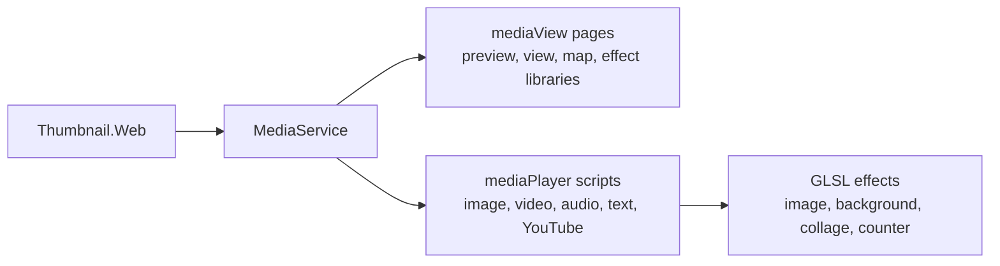

# SysWeaver.MicroService.Media

[⬆ SysWeaver overview](../README.md)

> A browser-based media player and viewer: images, video, audio, text and YouTube with WebGL shader effects, collages, animated counters and map views.

| | |
|---|---|
| **Layer** | Media |
| **Kind** | Micro service with a web application |

## Purpose

Present media attractively in the browser — previews, slideshows, signage-style displays — with effects rendered on the GPU. The service ships the viewer/player pages and GLSL effect libraries, registers the media viewer for common media file extensions and lists the available effects through its API.

## How it fits into SysWeaver



[SysWeaver.MicroService.Thumbnail.Web](../SysWeaver.MicroService.Thumbnail.Web/README.md) renders these pages in a headless browser to produce thumbnails of media and effects, and uses the media description types in the `SysWeaver.MicroService.Media` namespace (`MediaImage`, `MediaVideo`, `MediaYouTube`, `MediaEffect`, ...).

## Key features

- Embedded web application (`mediaView/`, `mediaPlayer/`): media view and preview pages, a map view and a text effect demo
- Libraries of GLSL image, background, collage and counter effects, listed by the API (`GetImageEffects`, `GetBackgroundEffects`, `GetCollageEffects`, `GetCounterEffects`)
- Registered as the extension viewer for image, video, audio and `.glsl` files (`mediaView/MediaView.html`)
- Debug menu entries (developers only) for browsing the effect libraries and demos
- Optional Google Maps key (`MediaParams.GoogleMapsKey`) for the map demo, exposed to developers only

## Key components

- [`MediaService`](MediaService.cs) — the service: API, menu entries and extension viewer registration
- [`MediaParams`](MediaParams.cs) — service parameters
- [`MediaEffect`](Media/MediaEffect.cs) — description of an effect to render (one of the media data types in `Media/`)

## Using it

```json
{ "Type": "SysWeaver.MicroService.MediaService, SysWeaver.MicroService.Media" }
```

## Limitations and considerations

- Effects require WebGL-capable browsers and GPUs; heavy effects can be demanding on low-end devices
- The Google map demo only works when a Google Maps key is configured

## Relationships

- **Project:** [`SysWeaver.MicroService.Media.csproj`](SysWeaver.MicroService.Media.csproj)
- **Builds on:** [SysWeaver.Common](../SysWeaver.Common/README.md), [SysWeaver.Compression](../SysWeaver.Compression/README.md), [SysWeaver.MicroServices.ServiceManager](../SysWeaver.MicroServices.ServiceManager/README.md)
- **Used by:** [SysWeaver.MicroService.Thumbnail.Web](../SysWeaver.MicroService.Thumbnail.Web/README.md), [SwServerManager](https://github.com/dosh1974/SysWeaver.Services/blob/main/SwServerManager/README.md)
