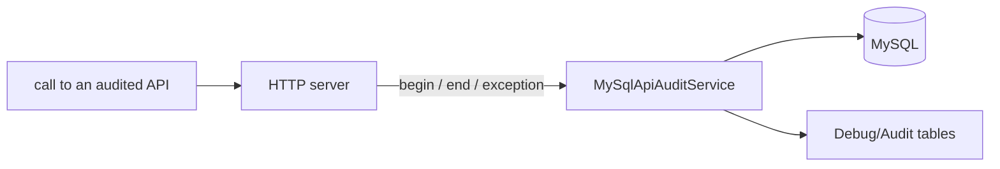

# SysWeaver.MicroService.MySqlAudit

[⬆ SysWeaver overview](../README.md)

> Audit trail for web API calls: every method marked `[WebApiAudit]` is recorded with its caller in MySQL and browsable in the web UI.

| | |
|---|---|
| **Layer** | Security |
| **Kind** | Micro service (`IApiAuditService`) |

## Purpose

Accountability for sensitive operations. Service authors only add `[WebApiAudit]` to a method; the HTTP server reports the begin, end or exception of those calls to this service, which stores them.

## How it fits into SysWeaver



## Key features

- Records each audited call with its (optionally filtered) input, result or exception, the signed in user and session
- Clients (IP address, device id, user agent, language and time zone) are de-duplicated into their own table
- Buffered writes in batches, so auditing doesn't slow down the calls
- *Debug/Audit* menu with *Api calls* and *Clients* tables (Admin, Ops or Debug token)

## Key components

- [`MySqlApiAuditService`](MySqlApiAuditService.cs) — the `IApiAuditService` implementation and its tables

## Using it

```json
{ "Type": "SysWeaver.MicroService.MySqlApiAuditService, SysWeaver.MicroService.MySqlAudit",
  "Params": { "Server": "db.local", "Schema": "Audit", "User": "svc", "Password": "…" } }
```

## Limitations and considerations

- Only methods explicitly marked with `[WebApiAudit]` are recorded
- Parameters and results may contain personal data; use `[WebApiAuditFilterParams]` / `[WebApiAuditFilterReturn]` to redact them
- Requires MySQL; there is no automatic clean-up of old records

## Relationships

- **Project:** [`SysWeaver.MicroService.MySqlAudit.csproj`](SysWeaver.MicroService.MySqlAudit.csproj)
- **Builds on:** [SysWeaver.DbSimpleStack.MySql](../SysWeaver.DbSimpleStack.MySql/README.md), [SysWeaver.MicroServices.ServiceManager](../SysWeaver.MicroServices.ServiceManager/README.md)
- **Used by:** [SysWeaver.WebBrowser.Cef](../Internet/SysWeaver.WebBrowser.Cef/README.md), and the services [ExchangeRateService](https://github.com/dosh1974/SysWeaver.Services/blob/main/ExchangeRateService/README.md), [IpLocationService](https://github.com/dosh1974/SysWeaver.Services/blob/main/IpLocationService/README.md), [SwServerManager](https://github.com/dosh1974/SysWeaver.Services/blob/main/SwServerManager/README.md), [TranslationService](https://github.com/dosh1974/SysWeaver.Services/blob/main/TranslationService/README.md)
