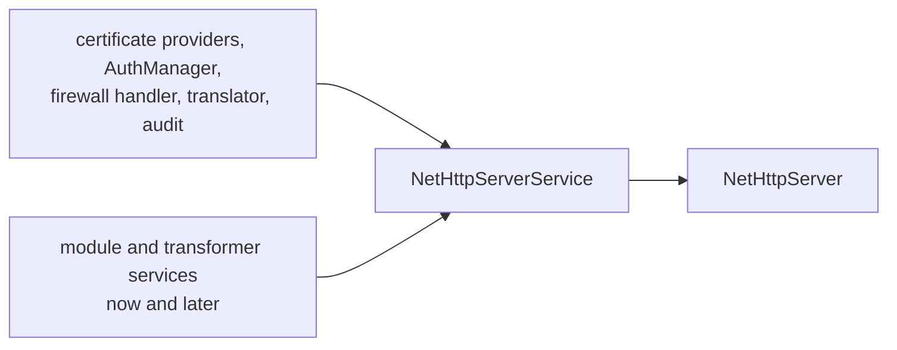

# SysWeaver.MicroService.NetHttpServer

[⬆ SysWeaver overview](../README.md)

> Micro service that runs the HttpListener-based SysWeaver web server.

| | |
|---|---|
| **Layer** | Web platform |
| **Kind** | Micro service |

## Purpose

Declare a web server in the manifest. `NetHttpServerService` creates a [SysWeaver.NetHttpServer](../SysWeaver.NetHttpServer/README.md), wires it with what is registered in the service manager (certificate providers, auth manager, firewall handler, translator, audit service, modules, transformers, template variable groups) and starts it. The integration logic lives in `HttpServerServiceBase` in [SysWeaver.MicroService.HttpServer](../SysWeaver.MicroService.HttpServer/README.md).

## How it fits into SysWeaver



## Key components

- [`NetHttpServerService`](NetHttpServerService.cs) — the micro service
- [`NetHttpServerServiceParams`](NetHttpServerServiceParams.cs) — the server parameters plus `Start` and `InstanceName`

## Using it

```json
{ "Type": "SysWeaver.MicroService.NetHttpServerService, SysWeaver.MicroService.NetHttpServer",
  "Params": { "ListenOn": [ { "Prefix": "http://localhost:8080" } ] } }
```

## Limitations and considerations

- Certificate providers, the auth manager, the firewall handler, the translator and the audit service are looked up once at construction and must be registered before this service; modules and transformers can be added later.
- Use one server service per process.
- See [SysWeaver.NetHttpServer](../SysWeaver.NetHttpServer/README.md) for HttpListener specific limitations (HTTPS binding on Windows only).

## Relationships

- **Project:** [`SysWeaver.MicroService.NetHttpServer.csproj`](SysWeaver.MicroService.NetHttpServer.csproj)
- **Builds on:** [SysWeaver.Auth.Core](../SysWeaver.Auth.Core/README.md), [SysWeaver.HttpServer](../SysWeaver.HttpServer/README.md), [SysWeaver.MicroService.HttpServer](../SysWeaver.MicroService.HttpServer/README.md), [SysWeaver.MicroServices.ServiceManager](../SysWeaver.MicroServices.ServiceManager/README.md), [SysWeaver.NetHttpServer](../SysWeaver.NetHttpServer/README.md)
- **Used by:** [ExchangeRateService](https://github.com/dosh1974/SysWeaver.Services/blob/main/ExchangeRateService/README.md), [FakeEmailService](https://github.com/dosh1974/SysWeaver.Services/blob/main/FakeEmailService/README.md), [FakeTextService](https://github.com/dosh1974/SysWeaver.Services/blob/main/FakeTextService/README.md), [IpLocationService](https://github.com/dosh1974/SysWeaver.Services/blob/main/IpLocationService/README.md), [ReverseProxyClient](https://github.com/dosh1974/SysWeaver.Services/blob/main/ReverseProxyClient/README.md), [ReverseProxyServer](https://github.com/dosh1974/SysWeaver.Services/blob/main/ReverseProxyServer/README.md), [SwLanCertManager](https://github.com/dosh1974/SysWeaver.Services/blob/main/SwLanCertManager/README.md), [SwServerManager](https://github.com/dosh1974/SysWeaver.Services/blob/main/SwServerManager/README.md), [TranslationService](https://github.com/dosh1974/SysWeaver.Services/blob/main/TranslationService/README.md), [WebServerService](https://github.com/dosh1974/SysWeaver.Services/blob/main/WebServerService/README.md)
