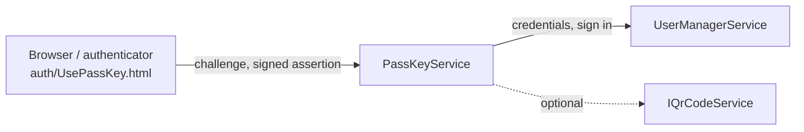

# SysWeaver.MicroService.PassKey

[⬆ SysWeaver overview](../README.md)

> Passwordless login with passkeys (WebAuthn / FIDO2), including adding a passkey from another device via QR code.

| | |
|---|---|
| **Layer** | Security |
| **Kind** | Micro service |

## Purpose

Offer phishing-resistant, passwordless sign-in for accounts managed by the user manager, using the platform authenticators of browsers and phones.

## How it fits into SysWeaver



The service issues WebAuthn challenges, verifies the responses with the Fido2 library and stores and resolves the credentials through [SysWeaver.MicroService.UserManager](../SysWeaver.MicroService.UserManager/README.md), which signs the session in as the owning user.

## Key features

- Discoverable (user-less) passkey sign-in, including synced passkeys and passkeys on a phone, and user-specific sign-in after entering a user id (also works with non-discoverable credentials)
- Adding passkeys to the signed-in account, to an account using a link token (reset or add password), and creating a new account with a passkey (sign-up)
- Cross-device enrolment through a single-use QR code link
- Per-challenge state with server side expiry, so several tabs can sign in at the same time
- Per passkey: signature counter (clone detection), transports, backup state, provider (AAGUID) and a friendly name; pages and APIs to list, rename and remove passkeys (the last sign-in method of a user can't be removed)
- *User* menu entries for signing in, adding and managing passkeys, shown only when applicable

## Key components

- [`PassKeyService`](PassKeyService.cs) — challenge, sign-in, enrolment and management APIs
- [`PassKeyParams`](PassKeyParams.cs) — relying party, origin and verification settings

## Using it

```json
{ "Type": "SysWeaver.MicroService.PassKeyService, SysWeaver.MicroService.PassKey",
  "Params": { "RpName": "Example", "RpId": "example.org", "Prefixes": [ "https://login.example.org" ] } }
```

All parameters are optional.

## Limitations and considerations

- Requires `UserManagerService`; the QR code enrolment needs an `IQrCodeService`
- The origin and relying party id are taken from the request: passkeys work on https (and `http://localhost`), not on IP addresses. Behind a proxy that changes the scheme or host, add the public origins to `Prefixes`
- Passkeys are bound to the host they were created on, unless `RpId` is set to a registrable domain (e.g. `example.org`), then they work on that domain and all its sub domains; changing `RpId` invalidates existing passkeys
- User verification (PIN / biometrics) and discoverable credentials are required by default (`UserVerification`, `ResidentKey`)

## Folder layout

| Folder | Content |
|---|---|
| [`srcWeb/`](srcWeb/README.md) | Embedded passkey pages (`auth/`) and icons (`icons/`) |

## Relationships

- **Project:** [`SysWeaver.MicroService.PassKey.csproj`](SysWeaver.MicroService.PassKey.csproj)
- **Builds on:** [SysWeaver.MicroService.Auth](../SysWeaver.MicroService.Auth/README.md), [SysWeaver.MicroService.UserManager](../SysWeaver.MicroService.UserManager/README.md)
- **Third-party:** [Fido2](https://www.nuget.org/packages/Fido2) (fido2-net-lib)
