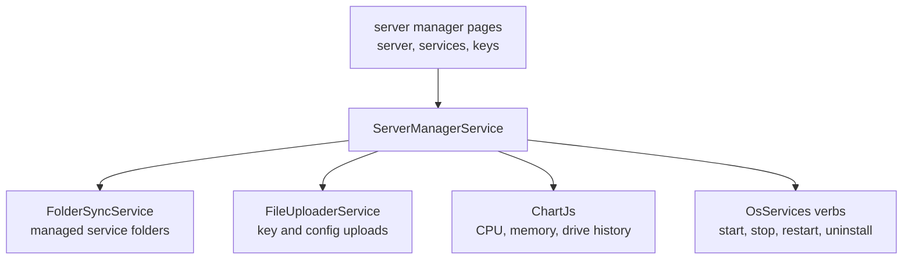

# SysWeaver.MicroService.ServerManager

[⬆ SysWeaver overview](../README.md)

> Remote server administration for SysWeaver hosts: manage deployed SysWeaver services and folders (versions, backups, configs), watch processes, CPU, memory and drives, view and edit text files and the hosts file, manage key files, and reboot.

| | |
|---|---|
| **Layer** | Administration |
| **Kind** | Micro service |

## Purpose

Operate a fleet of SysWeaver machines from the browser: deploy new service versions through folder sync, keep backups and configurations, and monitor the host. It is the core of the [SwServerManager](https://github.com/dosh1974/SysWeaver.Services/blob/main/SwServerManager/README.md) application.

## How it fits into SysWeaver



## Key features

- **Managed services**: each SysWeaver service is a managed folder (pushed with `SwSyncTool`); versions can be activated, compressed, expanded, verified and deleted; backups are kept for `RemoveServiceBackupsDays`
- Service control by running the service host verbs (start, stop, pause, continue, restart, uninstall, kill) and per-service CPU and memory charts
- Master configuration files copied into new versions, config and log file viewing, editing and deletion
- Additional managed folders (`Folders`) and chunk storage statistics
- Host monitoring: CPU, memory and drive charts with history, process table with per-process charts and kill (Kill and Reboot need a token that is only sent with the process list / `GetServerInfo` (`SmProcessKillToken`: HMAC, random key per process, bound to the process start time, valid at least 15 minutes), so a crafted link or an image GET can't use them; the idle and system processes and the server manager itself can't be killed)
- Configurable text files (`TextFiles`) and the hosts file (`AllowHosts`, `AllowHostsEdit`) viewable/editable in the browser
- Key file management for the key folder, and reboot of the machine
- Row actions give a clear outcome (never a bare false): `KillProcess` answers 403 with the reason (token missing / expired, a process that can't be killed) or 409 (the process has already ended, its id now belongs to another process); `RemoveService` answers 409 when the service is not managed (any more)
- **Service executable detection** (any language / runtime, see below), a selection on the service page (`SelectExe`), and a fallback to the next executable when the one in use doesn't respond as a service
- **Self update**: activating a version of the server manager itself is done by a detached script that restores the previous version on any failure (see below)
- Service verbs have time outs (`VerbTimeoutSeconds`); when activating a version, a service that doesn't uninstall (stop) within `SwapStopTimeoutSeconds` is killed and the activation continues
- Linux: the execute permission is added to uploaded executables (ELF executables and `#!` scripts, detected by content), the upload format has no file mode

## Service executable

A managed service is any program that implements the [SysWeaver.OsServices](../SysWeaver.OsServices/README.md) command line interface (the verbs `install`, `uninstall`, `start`, `stop`, `status` ... and their exit codes), it doesn't have to be .NET.
The executable is found by content, not by name (`IPlatformTools.FindExecutables`, see `ExecutableFinder` in SysWeaver.Common):

- Windows: `*.exe` files that are PE images with the console or gui subsystem (dll's are skipped). Linux: any file that is an ELF executable (or PIE) or a `#!` script (`*.so*` names are skipped).
- The best guess is first: console executables, then gui executables, then scripts; known bundled tools (`createdump`, crash handlers) last; then the **newest** (bundled tools are copied from a package and are older than the executable that was just built); then the name.
- The chosen file name is persisted per service (app key value store, `ServerManagerExe_<name>`) and used as long as it exists (also in new versions); a missing file is re-detected.
- If a verb gives an unexpected result (the executable can't be run, or neither a documented exit code nor a result line), the next executables (at most 3) are probed with `status` and the first one that answers as a service (a status line, a result line or a documented non-zero status code) is used and persisted. At most once per 5 minutes per service. A time out never triggers this (the right executable can hang).
- The service page lists the executables (format, .NET app host, known tool, not executable, time, size): "Automatic" (the best guess with the fallback) or a selected executable (`SelectExe`, never replaced automatically).

## Self update

When the active folder that is swapped is the folder this process runs from, the in process swap can't work (the uninstall stops this process).
`FsManagedFolder.OnSwapAsync` hands the activation to `SelfFolderSwap`, it writes a uniquely named script to the temp folder (`SysWeaver_SelfSwap_<ticks>.cmd` / `.sh`) and starts it detached
(Windows: `cmd.exe`; Linux: a transient systemd unit with `systemd-run`, required since stopping a systemd service kills every process in its cgroup; `setsid` without systemd). The script:

1. Waits 3 seconds (the http response is sent), checks that the folders and executables exist, the backup name is free and the parent folder is writable: on any error it stops without changing anything.
2. Uninstalls the running service; if that doesn't finish within `SwapStopTimeoutSeconds`, every process running from the active folder is killed (Linux: its systemd unit is stopped first, so it isn't restarted) and it continues.
3. Renames the active folder to the backup name and the new folder to the active name (retried, a stopped process can hold on to it's files).
4. Starts the new version, it must report "running" for `SelfUpdateStableSeconds` (and answer `SelfUpdateHealthUrl` if set).

On any failure the steps that were made are undone in reverse order and the previous version is started (retried until it keeps running). If the folders can't be renamed back, the previous version is started from the backup folder (manual clean up needed) - the server manager must never stay down.
The script deletes itself, it's log (`SysWeaver_SelfSwap_<ticks>.log`) is kept and the outcome is reported in the messages when the server manager starts. The backup isn't compressed (use the version page).

`SelfUpdateHealthUrl` is optional but recommended: a process can be "running" without being usable (ex: the web server failed to bind its port), a url that is only answered when the web server works (ex: `https://localhost:443/ServerManager/`) catches that.

## Key components

- [`ServerManagerService`](ServerManagerService.cs) — the micro service and all its APIs
- [`ServerManagerService.Executables`](ServerManagerService.Executables.cs) — the service executable (detection, persisted selection, fallback, verbs with time outs), `SmServiceCli` (the expected results of the service interface) and the self update hand over
- [`SelfFolderSwap`](SelfFolderSwap.cs) — the self update script (cmd / bash) generation and launch
- [`ServerManagerParams`](ServerManagerParams.cs) — service folder, managed services and folders, text files, hosts access
- [`ManagedService`](ManagedService.cs) — configuration of one managed service

## Using it

```json
{
  "Type": "SysWeaver.MicroService.ServerManagerService, SysWeaver.MicroService.ServerManager",
  "Params": {
    "SyncAuth": "Admin",
    "Services": [ { "Name": "MyService" } ]
  }
}
```

`FolderSyncService`, `FileUploaderService` and the `FileHttpServerModule` must be registered before it. Services can also be added and removed at runtime (persisted in the app key-value store).

## Limitations and considerations

- Powerful operations (kill processes, reboot, edit hosts and key files) — restrict to administrators; most host APIs require `AdminOps`.
- The per service APIs (service verbs, charts, details, versions, configs, logs) declare the union of the roles of all managed services (`ManagedService.SyncAuth`, default `ServerManagerParams.SyncAuth`, through `IRunTimeWebApiAuth`), so users without any of them get 403 before the call and `Api/auth/CanCall` reports it; the per service check still applies and refuses with 403 (an unknown service is 404), not 500. A service added at run time with a new role is only usable by users with one of the declared roles until a restart.
- Managed services are expected to implement the service host command line interface ([SysWeaver.OsServices](../SysWeaver.OsServices/README.md)) so the service verbs work.
- Killing the processes of a service that doesn't stop (activation and self update) matches the executable path of the processes and the command line arguments (`dotnet /opt/svc/Svc.dll`, `dotnet C:\Svc\Svc.dll`); only fully qualified paths are matched, a relative argument (`dotnet Svc.dll` started in the folder) isn't.
- Windows: a killed SysWeaver service is restarted by the service control manager after `RestartDelaySeconds` (default 2 minutes, the swap is done long before that; the new version is then already running so the restart does nothing).
- Linux: before killing, the systemd units of the matched processes are stopped with `systemctl stop --no-block` so that `Restart=` doesn't restart them while the folders are swapped (the unit of the server manager / the script is never stopped, user managers and login sessions are skipped). The new version's `start` (or the rollback) starts the unit again.
- The self update script is tested with a fake service on Windows and with the bash logic in Git Bash, `systemd-run` itself needs a test on a real Linux host.

## Folder layout

| Folder | Content |
|---|---|
| [`srcWeb/`](srcWeb/README.md) | Embedded server manager pages (server, services, service/version details, metrics, key files) |

## Relationships

- **Project:** [`SysWeaver.MicroService.ServerManager.csproj`](SysWeaver.MicroService.ServerManager.csproj)
- **Builds on:** [SysWeaver.MicroService.ChartJs](../SysWeaver.MicroService.ChartJs/README.md), [SysWeaver.MicroService.FileUploader](../SysWeaver.MicroService.FileUploader/README.md), [SysWeaver.MicroService.FolderSync](../SysWeaver.MicroService.FolderSync/README.md), [SysWeaver.MicroServices.ServiceManager](../SysWeaver.MicroServices.ServiceManager/README.md), [SysWeaver.OsServices](../SysWeaver.OsServices/README.md)
- **Used by:** [SwServerManager](https://github.com/dosh1974/SysWeaver.Services/blob/main/SwServerManager/README.md) (SysWeaver.Services)
