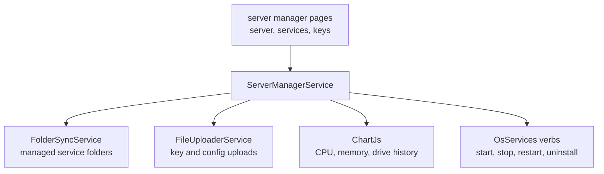

# SysWeaver.MicroService.ServerManager

[⬆ SysWeaver overview](../README.md)

> Remote server administration for SysWeaver hosts: manage deployed SysWeaver services and folders (versions, backups, configs), watch processes, CPU, memory and drives, view and edit text files and the hosts file, manage key files, and reboot.

| | |
|---|---|
| **Layer** | Administration |
| **Kind** | Micro service |

## Purpose

Operate a fleet of SysWeaver machines from the browser: deploy new service versions through folder sync, keep backups and configurations, and monitor the host. It is the core of the [SwServerManager](https://github.com/dosh1974/SysWeaver.Services/blob/main/SwServerManager/README.md) application.

## How it fits into SysWeaver



## Key features

- **Managed services**: each SysWeaver service is a managed folder (pushed with `SwSyncTool`); versions can be activated, compressed, expanded, verified and deleted; backups are kept for `RemoveServiceBackupsDays`
- Service control by running the service host verbs (start, stop, pause, continue, restart, uninstall, kill) and per-service CPU and memory charts
- Master configuration files copied into new versions, config and log file viewing, editing and deletion
- Additional managed folders (`Folders`) and chunk storage statistics
- Host monitoring: CPU, memory and drive charts with history, process table with per-process charts and kill
- Configurable text files (`TextFiles`) and the hosts file (`AllowHosts`, `AllowHostsEdit`) viewable/editable in the browser
- Key file management for the key folder, and reboot of the machine

## Key components

- [`ServerManagerService`](ServerManagerService.cs) — the micro service and all its APIs
- [`ServerManagerParams`](ServerManagerParams.cs) — service folder, managed services and folders, text files, hosts access
- [`ManagedService`](ManagedService.cs) — configuration of one managed service

## Using it

```json
{
  "Type": "SysWeaver.MicroService.ServerManagerService, SysWeaver.MicroService.ServerManager",
  "Params": {
    "SyncAuth": "Admin",
    "Services": [ { "Name": "MyService" } ]
  }
}
```

`FolderSyncService`, `FileUploaderService` and the `FileHttpServerModule` must be registered before it. Services can also be added and removed at runtime (persisted in the app key-value store).

## Limitations and considerations

- Powerful operations (kill processes, reboot, edit hosts and key files) — restrict to administrators; most host APIs require `AdminOps`.
- Managed services are expected to be SysWeaver service hosts ([SysWeaver.OsServices](../SysWeaver.OsServices/README.md)) so the service verbs work.

## Folder layout

| Folder | Content |
|---|---|
| [`srcWeb/`](srcWeb/README.md) | Embedded server manager pages (server, services, service/version details, metrics, key files) |

## Relationships

- **Project:** [`SysWeaver.MicroService.ServerManager.csproj`](SysWeaver.MicroService.ServerManager.csproj)
- **Builds on:** [SysWeaver.MicroService.ChartJs](../SysWeaver.MicroService.ChartJs/README.md), [SysWeaver.MicroService.FileUploader](../SysWeaver.MicroService.FileUploader/README.md), [SysWeaver.MicroService.FolderSync](../SysWeaver.MicroService.FolderSync/README.md), [SysWeaver.MicroServices.ServiceManager](../SysWeaver.MicroServices.ServiceManager/README.md), [SysWeaver.OsServices](../SysWeaver.OsServices/README.md)
- **Used by:** [SwServerManager](https://github.com/dosh1974/SysWeaver.Services/blob/main/SwServerManager/README.md) (SysWeaver.Services)
