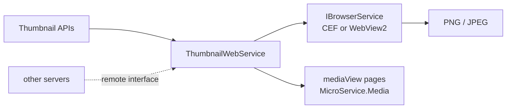

# SysWeaver.MicroService.Thumbnail.Web

[⬆ SysWeaver overview](../README.md)

> Thumbnails and screenshots of *web* content — image and video URLs, YouTube videos, Google Maps positions, media effects and arbitrary web pages — rendered with a headless browser.

| | |
|---|---|
| **Layer** | Media |
| **Kind** | Micro service (`IThumbnailWebService`) |

## Purpose

Produce preview images for links (e.g. in chat or content lists) by actually rendering them, and offer a screenshot service to other services such as [SysWeaver.MicroService.MediaThumbnail](../SysWeaver.MicroService.MediaThumbnail/README.md).

## How it fits into SysWeaver



Media, effect, YouTube and map thumbnails are rendered by loading the `mediaView` pages of [SysWeaver.MicroService.Media](../SysWeaver.MicroService.Media/README.md) from the local server in the browser service.

## Key features

- Web API (`Thumbnail/`): media image, video, effect and YouTube thumbnails, Google Maps images and web page screenshots, as JSON (image plus `MediaInfo`) or raw PNG/JPEG
- HTTP module: `thumbnailWeb/<W>x<H>.png?<url>` returns a thumbnail of any URL
- A short-lived proxy (`thumbnailWebProxy/`) for media that cannot be loaded cross-origin
- Implements `IThumbnailWebService` (from [SysWeaver.Media](../SysWeaver.Media/README.md)); `IThumbnailRemoteService` describes the API for use from other servers
- Run-time configurable auth for all methods (`ThumbnailWebParams.Auth`, default the `Service` role), caching and a concurrency limit (`MaxConcurrency`)

## Key components

- [`ThumbnailWebService`](ThumbnailWebService.cs) — the service, API and HTTP module
- [`ThumbnailWebParams`](ThumbnailWebParams.cs) — auth, caching, concurrency and the Google Maps key
- [`IThumbnailRemoteService`](IThumbnailWebService.cs) — the remote interface

## Using it

```json
{ "Type": "SysWeaver.MicroService.ThumbnailWebService, SysWeaver.MicroService.Thumbnail.Web" }
```

Requires an `IBrowserService` (e.g. [SysWeaver.WebBrowser.Cef](../Internet/SysWeaver.WebBrowser.Cef/README.md) or [SysWeaver.WebBrowser.WebView2](../Internet/SysWeaver.WebBrowser.WebView2/README.md)) earlier in the manifest, and the `MediaService` for media thumbnails.

## Limitations and considerations

- The browser implementations in this repository are Windows only
- Rendering arbitrary URLs has security implications (server-side request forgery); keep access restricted through the auth setting
- Google Maps images need a Google Maps key (`GoogleMapsKey`)
- Rendering is slow compared to image processing

## Relationships

- **Project:** [`SysWeaver.MicroService.Thumbnail.Web.csproj`](SysWeaver.MicroService.Thumbnail.Web.csproj)
- **Builds on:** [SysWeaver.HttpServer](../SysWeaver.HttpServer/README.md), [SysWeaver.Media](../SysWeaver.Media/README.md), [SysWeaver.MicroService.FileUploader](../SysWeaver.MicroService.FileUploader/README.md), [SysWeaver.MicroService.Media](../SysWeaver.MicroService.Media/README.md), [SysWeaver.MicroServices.ServiceManager](../SysWeaver.MicroServices.ServiceManager/README.md), [SysWeaver.WebBrowser](../SysWeaver.WebBrowser/README.md)
