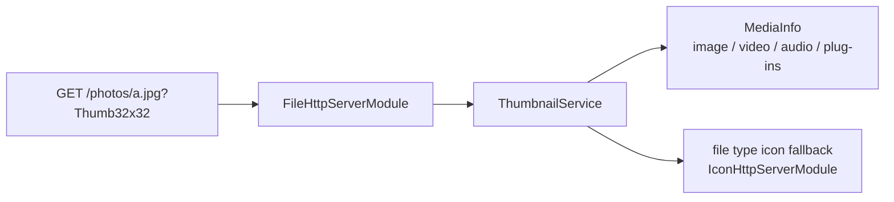

# SysWeaver.MicroService.Thumbnail

[⬆ SysWeaver overview](../README.md)

> Instant thumbnails for any file served from disc: append a size key such as `?Thumb32x32` to the file's URL.

| | |
|---|---|
| **Layer** | Media |
| **Kind** | Micro service (file transformer + HTTP module) |

## Purpose

Galleries and file browsers need previews. This service transforms requests for files served by the file module into thumbnails — images, video frames, audio waveforms and whatever other media info creators are registered — and falls back to file-type icons for everything else.

## How it fits into SysWeaver



Thumbnails are produced by `MediaInfo` of [SysWeaver.Media](../SysWeaver.Media/README.md): images always, video frames when [SysWeaver.Media.Video](../SysWeaver.Media.Video/README.md) is deployed, audio waveforms when [SysWeaver.Media.Audio](../SysWeaver.Media.Audio/README.md) is deployed, and SVG/GLSL previews when [SysWeaver.MicroService.MediaThumbnail](../SysWeaver.MicroService.MediaThumbnail/README.md) is running.

## Key features

- One file transformer per configured resolution (`Resolutions`, key = `Prefix` + `WIDTHxHEIGHT`); resolutions can also be added at run time (`AddThumbSize`)
- Thumbnails of web media: `thumbnail/<key>.png?<url>` returns a thumbnail of an `http(s)` URL
- In-memory caching of media information (`CacheSeconds`) on top of the on-disc `MediaInfo` cache
- Performance monitoring and cache statistics

## Key components

- [`ThumbnailService`](ThumbnailService.cs) — the file transformer and HTTP module
- [`ThumbnailParams`](ThumbnailParams.cs) — prefix, resolutions and cache duration

## Using it

```json
{ "Type": "SysWeaver.MicroService.ThumbnailService, SysWeaver.MicroService.Thumbnail",
  "Params": { "Resolutions": [ "32x32", "64x64" ] } }
```

List it after the icon module and a file module.

## Limitations and considerations

- Requires the icon module and a file module; only files served by the file module are covered
- Unsupported formats get file-type icons rather than previews
- Resolutions are maximum sizes for guidance; the image is fitted inside

## Relationships

- **Project:** [`SysWeaver.MicroService.Thumbnail.csproj`](SysWeaver.MicroService.Thumbnail.csproj)
- **Builds on:** [SysWeaver.HttpServer.IconModule](../SysWeaver.HttpServer.IconModule/README.md), [SysWeaver.HttpServer](../SysWeaver.HttpServer/README.md), [SysWeaver.Media](../SysWeaver.Media/README.md), [SysWeaver.MicroServices.ServiceManager](../SysWeaver.MicroServices.ServiceManager/README.md)
