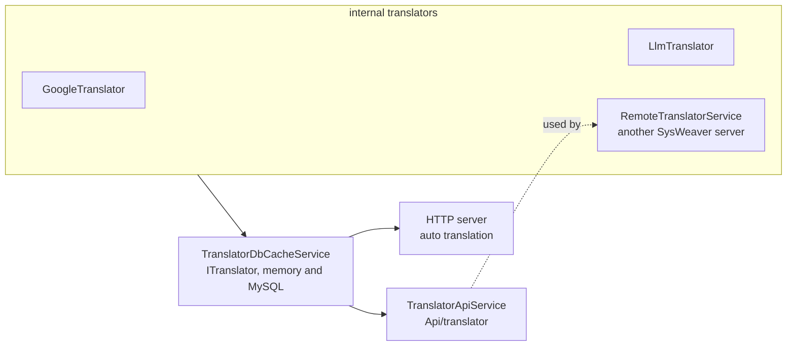

# SysWeaver.MicroService.Translation

[⬆ SysWeaver overview](../README.md)

> Translation as a web API, and translation *from* another server: exposes the process's translator over HTTP and provides a remote translator client with memory caching.

| | |
|---|---|
| **Layer** | Translation |
| **Kind** | Micro services |

## Purpose

Centralise translation: one server owns the translation back-ends and caches; other servers and browser pages use it through an API.

## How it fits into SysWeaver



`TranslatorApiService` and `TranslatorDebugService` publish the registered `ITranslator` (typically [SysWeaver.MicroService.TranslationDbCache](../SysWeaver.MicroService.TranslationDbCache/README.md)). On another server, `RemoteTranslatorService` is an internal translator that forwards to that API, so a fleet of servers can share one translation back-end.

## Key features

- `TranslatorApiService`: translate one text, multiple texts and to multiple languages, check source / target languages; client and request caching; auth configurable at runtime (`Auth`, default `Service`)
- `TranslatorDebugService`: tables of the supported source and target languages in the `Debug/Translator` menu (default auth `Debug`)
- `RemoteTranslatorService`: an `IInternalTranslator` using a generated HTTP proxy to a remote `ITranslator`, with an in-memory cache per retention level, cached language lists, a concurrency limit and statistics; it also registers the file translation handlers of [SysWeaver.FileTranslation](../SysWeaver.FileTranslation/README.md)

## Key components

- [`TranslatorApiService`](TranslatorApiService.cs) — the translation web API
- [`TranslatorDebugService`](TranslatorDebugService.cs) — debug tables of supported languages
- [`RemoteTranslatorService`](RemoteTranslatorService.cs) — translator client for a remote translation server

## Using it

Server (after the translators and the translation cache):

```json
{ "Type": "SysWeaver.MicroService.TranslatorApiService, SysWeaver.MicroService.Translation", "Params": { "Auth": "Service" } }
```

Client (before its own translation cache):

```json
{ "Type": "SysWeaver.MicroService.RemoteTranslatorService, SysWeaver.MicroService.Translation",
  "Params": { "BaseUrl": "https://translator.example.com", "CredFile": "$(KeyFolder)/Translator.txt" } }
```

## Limitations and considerations

- The API and debug services need a registered `ITranslator` when they are created
- Translation endpoints can incur cost (e.g. LLM back-ends) if left open — configure their auth

## Relationships

- **Project:** [`SysWeaver.MicroService.Translation.csproj`](SysWeaver.MicroService.Translation.csproj)
- **Builds on:** [SysWeaver.Common](../SysWeaver.Common/README.md), [SysWeaver.FileTranslation](../SysWeaver.FileTranslation/README.md), [SysWeaver.IsoData](../SysWeaver.IsoData/README.md), [SysWeaver.MicroServices.ServiceManager](../SysWeaver.MicroServices.ServiceManager/README.md)
- **Used by:** [TranslationService](https://github.com/dosh1974/SysWeaver.Services/blob/main/TranslationService/README.md) (SysWeaver.Services)
