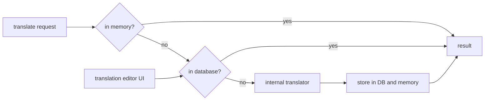

# SysWeaver.MicroService.TranslationDbCache

[⬆ SysWeaver overview](../README.md)

> The caching front of the translation pipeline: an `ITranslator` that serves translations from memory and MySQL and asks an internal translator only for new texts. Includes a translation editor.

| | |
|---|---|
| **Layer** | Translation |
| **Kind** | Micro service (`ITranslator`) |

## Purpose

Translate each distinct text once, keep the result, and let people correct it. This is the translator the HTTP server and other services should use.

## How it fits into SysWeaver



The service is the `ITranslator` of the process; the internal translator behind it (`IInternalTranslator`, e.g. [SysWeaver.AI.LlmTranslator](../SysWeaver.AI.LlmTranslator/README.md), [SysWeaver.Translation.Google](../SysWeaver.Translation.Google/README.md) or [`RemoteTranslatorService`](../SysWeaver.MicroService.Translation/README.md)) is resolved once, on creation.

## Key features

- Two-level cache (memory, MySQL) with separate durations per retention level (short, medium, long) and randomized expiration; expired entries are pruned periodically
- A table of all translations (`Debug/Translator` menu) and a web editor to inspect, override and delete translations (`Debug` role, changes are audited)
- Statistics and performance monitoring

## Key components

- [`TranslatorDbCacheService`](TranslatorDbCacheService.cs) — the caching translator, translation table and editor APIs
- [`TranslatorDbCacheParams`](TranslatorDbCacheParams.cs) — database and cache parameters

## Using it

Register after the internal translator:

```json
{ "Type": "SysWeaver.MicroService.TranslatorDbCacheService, SysWeaver.MicroService.TranslationDbCache", "Params": { "CredFile": "$(KeyFolder)/MySql.txt" } }
```

## Limitations and considerations

- Requires MySQL (schema `Translations` by default) and an internal translator registered before it (`TranslatorInstance` selects one by name)

## Folder layout

| Folder | Content |
|---|---|
| [`srcWeb/`](srcWeb/README.md) | Embedded translation editor page |

## Relationships

- **Project:** [`SysWeaver.MicroService.TranslationDbCache.csproj`](SysWeaver.MicroService.TranslationDbCache.csproj)
- **Builds on:** [SysWeaver.Common](../SysWeaver.Common/README.md), [SysWeaver.Compression](../SysWeaver.Compression/README.md), [SysWeaver.DbSimpleStack.MySql](../SysWeaver.DbSimpleStack.MySql/README.md), [SysWeaver.IsoData](../SysWeaver.IsoData/README.md), [SysWeaver.MicroServices.ServiceManager](../SysWeaver.MicroServices.ServiceManager/README.md)
- **Used by:** [TranslationService](https://github.com/dosh1974/SysWeaver.Services/blob/main/TranslationService/README.md) (SysWeaver.Services)
