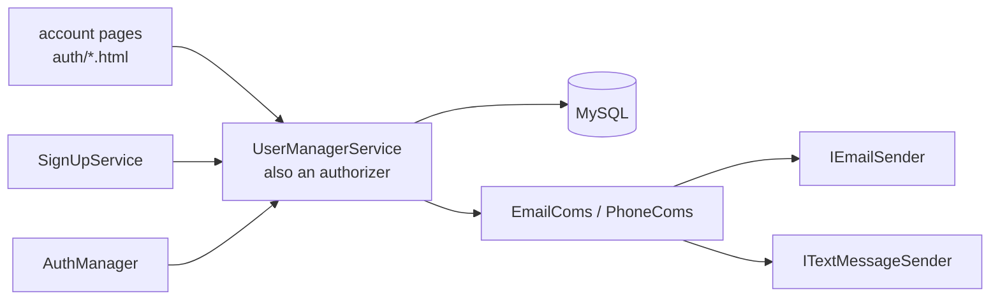

# SysWeaver.MicroService.UserManager

[⬆ SysWeaver overview](../README.md)

> Self-service user accounts on MySQL: sign-up and invitations, passwords, e-mail and phone verification, nick names, passkey storage and account deletion — all driven by action tokens or short codes sent through e-mail/SMS with localized templates.

| | |
|---|---|
| **Layer** | Security |
| **Kind** | Micro services (an authorizer, a sign-up service and communication methods) |

## Purpose

Provide a complete account lifecycle for public-facing applications. The user manager is itself an authorizer, so accounts it manages can log in through the standard [SysWeaver.MicroService.Auth](../SysWeaver.MicroService.Auth/README.md) flow.

## How it fits into SysWeaver



Every account change follows the same pattern: the user requests an action, the service sends a link with a token (or a numeric short code) through e-mail or SMS, and the action completes when the user presents it. **One live link per user and purpose:** sending a new link (reset password, add / delete password, delete account, add / change e-mail or phone, share device) revokes the older unused link of the same user and purpose, a new invitation to an address revokes the older invitation to it (sign up links are separate). **Revocation by purpose group** (`ActionTokenGroups`, a `TokenGroups` declaration, SysWeaver.Common): every change of the account revokes the outstanding links whose meaning depends on the old state. A credential change (set / reset / add / delete password, an administrator's forced reset, a passkey added or removed) or the deletion revokes every link of the user; an e-mail change or removal revokes the links sent to every address (reset / add / delete password, passkey, delete account) and every e-mail link (add / change / restore), not a pending phone link; the same for a phone change. A restore link (sent to a removed address) works only until a newer address is confirmed and never replaces one. A new token kind must be declared in `ActionTokenGroups` (`AddAction` refuses an undeclared kind); the unit tests generate the matrix of every kind and every event (`AccountEvents`). Tokens carry a tag of the subject and purpose (`SubjectTokens`). **A dead link is a 410, not a 500:** the action answers 410 with `X-Sw-Reason` and the real cause for people ("This link no longer works: a newer link was sent, use the link in the newest message." / "...: the password of the account was changed after it was sent." / "...: it was already used." / "...: it has expired."; a wrong typed code 400). **Check a link without using it:** `CheckActionToken({ Token, Kind })` (anonymous) returns `{ State: Live / Used / Replaced / Revoked / Expired / Unknown / WrongKind, Kind, Reason, Account, Target, Expires }`, so a link page shows "This link no longer works" with the cause on load, and the facts (account, new address) in its confirmation (the cause of a dead link is kept in memory: after a restart the page gets the generic sentence). The account exceptions (address in use, no e-mail, wrong current password, unknown account ...) answer 400 / 404 / 409 with a reason (`IHttpRefusal`).

## Key features

- Sign-up (per communication method), invitations and an administrative user table
- Invitation domain (`InviteUserRequest.Domain`, `UserManagerService.ValidateInviteDomain`): empty means the inviter's own domain; another domain only for Debug or Admin (403 with a reason otherwise, 400 for a domain over 256 characters or with control characters)
- Row actions give a clear outcome: `CancelInvitation` ("Withdraw invitation") answers 409 "The invitation could not be withdrawn: it was already used, has expired or was withdrawn" instead of false
- Roles (`UserManagerRoles`, the original roles): inviting a user, the pending invitations, forcing a password reset and the admin recovery below need `UserManagement`; the user tables (`UserDataTable`, `UserAdminTable`, the Users page) need `Ops`, `Debug` or `UserManagement` (the original value lacked a comma, "Ops,DebugUserManagement,Debug", so `UserManagement` alone could invite but not see the users)
- User tables: `UserDataTable` is the plain table as before (`DbUser`, no row actions, 3 s server cache); the Users page reads `UserAdminTable` (`DbUserAdminRow`: the same columns plus the row actions, not cached on the server, so the re-read after an action shows the new state at once); a viewer who may not manage users (no `ManageUser`, ex: Ops, Debug) gets the plain `UserDataTable` on the Users page, as the original "View users" (no empty Actions column)
- **A disabled account** (`DisableUser`) can't sign in in any way: the right password answers `AuthInfo.AccountDisabled` (the sign in page says "This account is disabled", only to someone who knows the password; anyone else gets the usual wrong user id or password); `ForgotPassword` sends no message (and answers as for an unknown user id, see below); its links (reset, add password, delete account, e-mail / phone, passkey) answer 423 and `CheckActionToken` gives the state `Disabled`, so a link page says so on load; they work again once the account is enabled
- **`ForgotPassword` tells nothing about who has an account**: anyone can call it, so it is the same for an unknown, a disabled and an existing account (and one with no e-mail address or phone number): it answers the typed user id (trimmed), never the e-mail addresses and phone numbers of the account (it used to answer 404 "No account ... was found" and the full list); the account is looked up and the message sent in the background (the time of the answer is the same); **the reset code belongs to the account, not to the browser that asked**: `ValidateResetCode(UserId, Code)` checks it in any browser (ex: asked on a computer, the text message read on the phone), and a right code becomes the short code of that session, so `ResetPassword.html?<code>` works as before. Every code sent in its last 15 minutes works (a late message still works, and someone who keeps asking for a victim's user id can't make the code the victim got useless: the victim gets every new code too). The codes are kept in memory (a restart forgets them, the link still works) and dropped when the password is reset or changed (any account event that revokes the reset link). The session only remembers the user id it asked for (`ValidateResetCode` with no user id uses it, never returned). An unknown user id answers like an account with a wrong code (0, then -2). An account gets reset messages with a growing pause (`ResetPasswordBackoff`: 60 s, doubling up to 1 h while asked again within the hour): asking sooner sends nothing (the codes sent before keep working).
- **Wrong short code tries count per account** (`CodeTriesPerUser`, default 3 per 5 minutes and 50 per day, every limit must allow a try), from all browsers together, in memory only (a restart resets them): over the limit every try answers -2 "too many wrong codes, wait", also a right one, until the window frees a try. A right code never counts. Reset codes (`ValidateResetCode`) always have a limit (10 per 15 minutes when `CodeTriesPerUser` is empty), unknown user ids get the same limit (so -2 tells nothing), at most 100000 unknown ids are remembered. Session codes of an account (add / change e-mail or phone, delete account ...) count too, on top of the 10 tries per code (sign up codes have no account: only those). The trade-off: someone who knows a user id can use up its tries, then codes for it fail for up to a day; the links in e-mails still work (not limited, they can't be guessed), a phone only account must wait (the reset text message has no link: it must stay within one text message) At most 20 requests per 10 minutes from one ip address are handled (more answer the same and do nothing), at most 4 lookups / sends run at once, more than 200 waiting are dropped (logged); a send that fails gives the pause back (asking again sends at once); a backwards clock jump ends a pause; when the service stops the waiting work ends quietly. Asking for a reset replaces any other short code pending in that browser session (ex: an open sign up code step), also for an unknown id. Why nothing was sent is logged at Debug (the user id masked), a failed send as a warning. An empty user id answers 400. Apps showing the answer should word it as "If an account uses ..., a code is on its way". The messages go where `Send` sends them (all the targets with `SendAllComs`, else the first that works). The forced reset at sign in (`StartPasswordChange`, an administrator required a new password) still sends at once and answers the real targets and errors
- **Changing the e-mail address tells the old address** (`ChangedEmail*`, e-mail only, no web notification: the one who changed it would see it): "This email address is no longer linked to ...", an **"Undo this change"** button (`[UndoLink]`, `auth/UndoEmail.html?<token>`, see below) and, for when that no longer works, a "Reset your password" link to `auth/ForgotPassword.html` (SysWeaver's page, under the site's own root `ExternalRootUri` when known, not the Host of the request: the caller may be the one who took the account), how to sign in for the reset (the phone number or user name; the code never goes to the old address) and "Contact [Site]" when the phone is gone. The new address is not named. A failed notice is logged and does not fail the change. Localized message folders without `ChangedEmail*` (or with only one of its two files) use the built in (English) template
- **`SetNickName`** answers true when the user has the name afterwards (also when it already was the name); a change of the letter case only is saved
- **Undo an e-mail change** (`UndoEmailChange(token)`, the page `auth/UndoEmail.html?<token>`, no sign in: the account may be taken): one button (opening the page changes nothing, mail scanners open links) gives the account back to the old address: the address, the user name / nick name when they were the address, and the phone number as they were at the change; the passkeys created from a day before the change on are removed; the password stops working (no hash, a new one must be chosen); every other link of the account is revoked and every session signed out; then a reset link and code go to the old address (and this browser gets the code). The link works for 7 days, once; only the deletion of the account revokes it (the one who changed the address can't make it stop working: password, passkey or phone changes don't), and a second change doesn't replace it (one undo link per changed address: after A -> B -> C the link sent to A still works). Refused (409) when another account now uses the old address. Raises `OnEmailChanged` (and the phone events when the phone was put back)
- **Links in messages** (reset, sign up, invite, add / change / delete e-mail, phone and password, delete account, the changed e-mail notice and `[Root]`) are built from `HttpServerBase.GetLinkRoot`: the request prefix only when it is a listener prefix as is (a fixed host), else (a wildcard listener such as `https://*:8097/`: the host is the client's Host header, anyone could make a real reset mail link to their own site) the configured `ExternalRootUri`. Set `ExternalRootUri` when listening on a wildcard prefix
- **A password row without a hash is no password**: `GetSaltAsync` adds one (`MustResetPassword`, no hash) for a user without a password when anyone asks for the salt; `HaveAnyPassword`, `SendAddPasswordRequest` and `SendDeletePasswordRequest` now use `IsUsablePassword` (before, an anonymous salt lookup of a passkey only user made "Add password" answer "already has a password")
- **The delete account link** is `auth/DeleteAccount.html?<token>`, as the other links (it was `?token=<token>`; the page reads both)
- Pending invitations: `InvitationTable` lists the account links that were sent and are not used or expired yet (the Users page, "Pending invitations"); its "Withdraw invitation" row action (`CancelInvitation`, with the row token) stops the link and code; its done text (`TableDataActionsFull`, S6 Admin N48): "The invitation of <address> is withdrawn: its link and code no longer work. You can invite <address> again." It is declared final (`TableDataActionFlags.Final`, G47): the row stays muted without actions until the next refresh. The four Users row actions (Force password reset, Undo forced reset, Disable, Enable) are declared not final: the row is re-read and offers the actions of its new state (S6-Final, Admin N53).
- Forced password reset: `ForcePasswordReset` / `ForcePasswordResetUser` (by user name, e-mail or phone; `FindPasswordResetUser` looks the user up first) and the users table row action `RowForcePasswordReset` remove the password at once and sign the user's sessions out; a sign in with the old password creates no session and answers `AuthInfo.PasswordChangeRequired` with `SentTo` (where the link and code to choose a new one were sent); passkeys keep working
- **No action leaves a user without a way to sign in (lockout):** a forced reset of a user who has a password but no passkey and no e-mail address or phone number to send the link to is refused (409 + the reason, `X-Sw-Outcome: Refused`, nothing changed). `FindPasswordResetUser` returns the facts for the confirmation: `Reachable` (addresses / numbers a link can be sent to), `PassKeys`, `MustResetPassword`, `Disabled`, `LockedOut`, `Consequences` (translated sentences: what the reset does to this user) and `Refused` (why it would be refused).
- **Admin recovery** (role `UserManagerRoles.ManageUser`: UserManagement; audited and logged with who and whom), POST `AdminUserRequest { User, Confirm }` (user name, e-mail or phone): `UnlockUser` (undo a pending forced reset: the current password works again), `DisableUser` / `EnableUser` (a disabled account can't sign in in any way, password, passkey or link, its sessions end, nothing is deleted; stored as the reserved role `sw-disabled-<id>`), `AdminDeleteUser` (`Confirm` must be the account's user name; removes the account, its sign in methods, addresses, roles and data, revokes its links, ends its sessions). Your own account can't be disabled or deleted here. Already in the asked state = 409 `AlreadyDone`. The users table of the Users page (`UserAdminTable`) has the matching row actions with per row visibility (Force password reset only when it can be done, Undo forced reset when one is pending, Disable / Enable by state), each with its done text (`TableDataActionsFull`: the row's result and announcement, ex: "ann@example.com can sign in again." instead of "Enable (ann@example.com): done"); delete is the Users page header action "Delete user..." (type to confirm). `GetMyComTargets` (signed in, read only) says where a code would be sent (not used by the pages: as before, the request mode pages send the code when they open).
- Password add / change / delete, forgot password and forced reset, with policy enforcement
- Multiple communication methods per user (e-mail addresses and phone numbers) with verification; the last sign-in method can't be removed
- Numeric short codes as an alternative to links
- Localized message templates (HTML and text), embedded defaults that can be replaced with a folder-per-language layout
- Passkey credential storage used by [SysWeaver.MicroService.PassKey](../SysWeaver.MicroService.PassKey/README.md)
- Optional nick names and account deletion
- Can hold identity data without allowing login through it (`DisableLogin`)
- Account pages and *User* menu entries shown only when the action applies to the signed in user

## Key components

- [`UserManagerService`](UserManagerService.cs) — the authorizer and account API (split over several `UserManagerService_*.cs` files)
- [`SignUpService`](SignUpService.cs) — the public sign-up API and menu entry
- [`EmailComs`](EmailComs.cs) / [`PhoneComs`](PhoneComs.cs) — communication methods sending templated messages through an e-mail or text message sender

## Using it

```json
[
  { "Type": "SysWeaver.MicroService.UserManagerService, SysWeaver.MicroService.UserManager",
    "Params": { "Server": "db.local", "Schema": "users", "User": "svc", "Password": "…" } },
  { "Type": "SysWeaver.MicroService.SignUpService, SysWeaver.MicroService.UserManager" }
]
```

Register an `IEmailSender` (and, for phone numbers, `PhoneComs` with an `ITextMessageSender`) together with the auth services. Without any communication method registered, an `EmailComs` with default parameters is created.

## Limitations and considerations

- Requires MySQL and an e-mail sender; phone numbers additionally need a text message sender
- The default message templates are generic; adapt them for your product and languages

## Folder layout

| Folder | Content |
|---|---|
| [`Db/`](Db/README.md) | Database row types: users, passwords, passkeys, e-mail addresses, phone numbers, actions, tokens, user data |
| [`srcData/`](srcData/README.md) | Default e-mail and text message templates for every account action |
| [`srcWeb/`](srcWeb/README.md) | Embedded account management pages (`auth/`) |

## Relationships

- **Project:** [`SysWeaver.MicroService.UserManager.csproj`](SysWeaver.MicroService.UserManager.csproj)
- **Builds on:** [SysWeaver.Common](../SysWeaver.Common/README.md), [SysWeaver.DbSimpleStack.MySql](../SysWeaver.DbSimpleStack.MySql/README.md), [SysWeaver.HttpServer](../SysWeaver.HttpServer/README.md), [SysWeaver.MicroService.Auth](../SysWeaver.MicroService.Auth/README.md), [SysWeaver.MicroServices.ServiceManager](../SysWeaver.MicroServices.ServiceManager/README.md), [SysWeaver.MicroServices](../SysWeaver.MicroServices/README.md)
- **Used by:** [SysWeaver.MicroService.PassKey](../SysWeaver.MicroService.PassKey/README.md)
