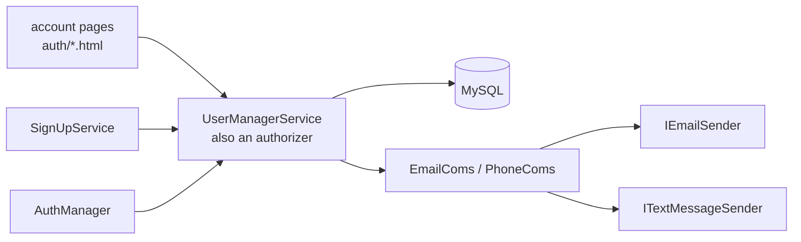

# SysWeaver.MicroService.UserManager

[⬆ SysWeaver overview](../README.md)

> Self-service user accounts on MySQL: sign-up and invitations, passwords, e-mail and phone verification, nick names, passkey storage and account deletion — all driven by action tokens or short codes sent through e-mail/SMS with localized templates.

| | |
|---|---|
| **Layer** | Security |
| **Kind** | Micro services (an authorizer, a sign-up service and communication methods) |

## Purpose

Provide a complete account lifecycle for public-facing applications. The user manager is itself an authorizer, so accounts it manages can log in through the standard [SysWeaver.MicroService.Auth](../SysWeaver.MicroService.Auth/README.md) flow.

## How it fits into SysWeaver



Every account change follows the same pattern: the user requests an action, the service sends a link with a token (or a numeric short code) through e-mail or SMS, and the action completes when the user presents it.

## Key features

- Sign-up (per communication method), invitations and an administrative user table
- Password add / change / delete, forgot password and forced reset, with policy enforcement
- Multiple communication methods per user (e-mail addresses and phone numbers) with verification; the last sign-in method can't be removed
- Numeric short codes as an alternative to links
- Localized message templates (HTML and text), embedded defaults that can be replaced with a folder-per-language layout
- Passkey credential storage used by [SysWeaver.MicroService.PassKey](../SysWeaver.MicroService.PassKey/README.md)
- Optional nick names and account deletion
- Can hold identity data without allowing login through it (`DisableLogin`)
- Account pages and *User* menu entries shown only when the action applies to the signed in user

## Key components

- [`UserManagerService`](UserManagerService.cs) — the authorizer and account API (split over several `UserManagerService_*.cs` files)
- [`SignUpService`](SignUpService.cs) — the public sign-up API and menu entry
- [`EmailComs`](EmailComs.cs) / [`PhoneComs`](PhoneComs.cs) — communication methods sending templated messages through an e-mail or text message sender

## Using it

```json
[
  { "Type": "SysWeaver.MicroService.UserManagerService, SysWeaver.MicroService.UserManager",
    "Params": { "Server": "db.local", "Schema": "users", "User": "svc", "Password": "…" } },
  { "Type": "SysWeaver.MicroService.SignUpService, SysWeaver.MicroService.UserManager" }
]
```

Register an `IEmailSender` (and, for phone numbers, `PhoneComs` with an `ITextMessageSender`) together with the auth services. Without any communication method registered, an `EmailComs` with default parameters is created.

## Limitations and considerations

- Requires MySQL and an e-mail sender; phone numbers additionally need a text message sender
- The default message templates are generic; adapt them for your product and languages
- `UserManagerRoles.ViewUser` is built by string concatenation without a separating comma (`Roles.Ops + "UserManagement,Debug"`), which yields the tokens `Ops`, `DebugUserManagement` and `Debug`, so the `UserManagement` token alone doesn't grant access to the user table

## Folder layout

| Folder | Content |
|---|---|
| [`Db/`](Db/README.md) | Database row types: users, passwords, passkeys, e-mail addresses, phone numbers, actions, tokens, user data |
| [`srcData/`](srcData/README.md) | Default e-mail and text message templates for every account action |
| [`srcWeb/`](srcWeb/README.md) | Embedded account management pages (`auth/`) |

## Relationships

- **Project:** [`SysWeaver.MicroService.UserManager.csproj`](SysWeaver.MicroService.UserManager.csproj)
- **Builds on:** [SysWeaver.Common](../SysWeaver.Common/README.md), [SysWeaver.DbSimpleStack.MySql](../SysWeaver.DbSimpleStack.MySql/README.md), [SysWeaver.HttpServer](../SysWeaver.HttpServer/README.md), [SysWeaver.MicroService.Auth](../SysWeaver.MicroService.Auth/README.md), [SysWeaver.MicroServices.ServiceManager](../SysWeaver.MicroServices.ServiceManager/README.md), [SysWeaver.MicroServices](../SysWeaver.MicroServices/README.md)
- **Used by:** [SysWeaver.MicroService.PassKey](../SysWeaver.MicroService.PassKey/README.md)
