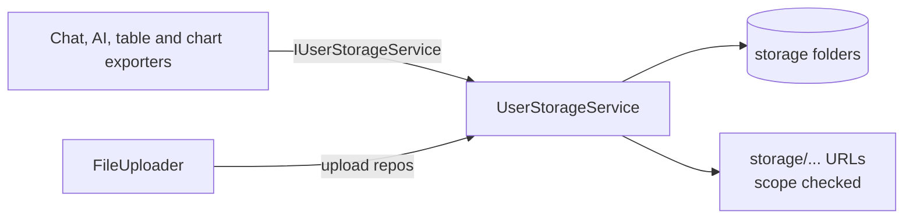

# SysWeaver.MicroService.UserStorage

[⬆ SysWeaver overview](../README.md)

> Per-user file and link storage with access scopes (private, protected, public), retention, quotas, spreading over several folders and on-disc compression.

| | |
|---|---|
| **Layer** | Storage / Data |
| **Kind** | Micro service (`IUserStorageService`) |

## Purpose

A shared place where features can persist files on behalf of users — for example files shared in chat, AI generated content or exported tables and charts — with consistent permissions and lifetime.

## How it fits into SysWeaver



Consumers only depend on the `IUserStorageService` interface from [SysWeaver.HttpServer](../SysWeaver.HttpServer/README.md) and find the service at runtime, so there are no project references to this one.

## Key features

- Access scopes: private (owner only), protected (other users with the link, optionally requiring auth tokens) and public (anyone with the link)
- Per-scope upload repositories for the [file uploader](../SysWeaver.MicroService.FileUploader/README.md), each with its own auth, size limit and extension white/black list (protected uploads are enabled by default)
- Retention plans (days kept after the last access, per scope) and a per-user disc quota, optionally decided per user by an `IUserStoragePerUserHandler`
- Files spread over several storage folders, compressed on disc (Brotli by default)
- Stored links: a URL (with the stored files it references) served as an embedding page, using an extension viewer when one exists
- APIs and tables for users to list and delete their own files and links

## Key components

- [`UserStorageService`](UserStorageService.cs) — storage, HTTP serving, pruning and the user APIs
- [`UserStorageParams`](UserStorageParams.cs) — folders, compression, retention and upload settings

## Using it

```json
{ "Type": "SysWeaver.MicroService.UserStorageService, SysWeaver.MicroService.UserStorage",
  "Params": { "Folders": [ "D:\\UserStorage" ] } }
```

Without `Folders`, a `UserStorage` folder in the application data folder is used.

## Limitations and considerations

- File system based; capacity and backups are the operator's responsibility
- Public and protected items are reachable by anyone holding the link — enable public uploads deliberately
- Files are spread over the folders by a hash or at random, not by free space

## Folder layout

| Folder | Content |
|---|---|
| [`srcData/`](srcData/README.md) | HTML templates for the pages served for stored links (`embed.html`, `img.html`) |

## Relationships

- **Project:** [`SysWeaver.MicroService.UserStorage.csproj`](SysWeaver.MicroService.UserStorage.csproj)
- **Builds on:** [SysWeaver.Auth.Core](../SysWeaver.Auth.Core/README.md), [SysWeaver.Common](../SysWeaver.Common/README.md), [SysWeaver.HttpServer](../SysWeaver.HttpServer/README.md), [SysWeaver.MicroService.FileUploader](../SysWeaver.MicroService.FileUploader/README.md), [SysWeaver.MicroServices.ServiceManager](../SysWeaver.MicroServices.ServiceManager/README.md)
