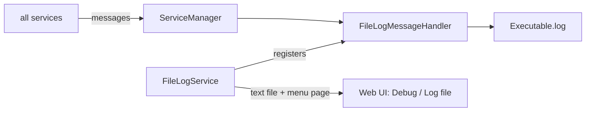

# SysWeaver.MicroServices.Log

[⬆ SysWeaver overview](../README.md)

> A micro service that writes all application messages to a size-limited log file and makes that file available in the web UI.

| | |
|---|---|
| **Layer** | Runtime |
| **Kind** | Micro service |

## Purpose

Persist the message stream of the `ServiceManager` to disk with zero code — just a manifest entry — and let operators read the log through the web interface.

## How it fits into SysWeaver



## Key features

- Log file path from a path template such as `$(CommonApplicationData)` (defaults to `<executable base name>.log`)
- Message detail style and sync/async write mode selectable
- Automatic truncation when the file grows beyond a size limit (2 MiB by default)
- Log file exposed as a viewable text file (admin/ops), as an embedded web page under *Debug / Log file* and as raw text through the `logFile` API; admins can delete the file from the UI
- Optional dump of all statistics tables next to the log file when the service shuts down (on by default in debug builds)

## Key components

- [`FileLogService`](FileLogService.cs) — the micro service; registers a `FileLogMessageHandler` (from SysWeaver.Common) with the service manager
- [`FileLogParams`](FileLogParams.cs) — manifest parameters

## Using it

```json
{ "Type": "SysWeaver.MicroService.FileLogService, SysWeaver.MicroServices.Log", "Params": { "Filename": "$(ExecutableBase).log" } }
```

## Limitations and considerations

- Truncation keeps roughly the newest three quarters of the size limit (cut at a line start); it is not a rotating archive.
- Only messages produced after the service is registered are written — list it first in the manifest.
- The web page is embedded as pre-compressed (Brotli) resources produced at build time by `_tools/compress/Compress.exe` (a Windows executable).

## Folder layout

| Folder | Content |
|---|---|
| [`srcWeb/`](srcWeb/README.md) | Embedded log file viewer page (`logFile/`) |

## Relationships

- **Project:** [`SysWeaver.MicroServices.Log.csproj`](SysWeaver.MicroServices.Log.csproj)
- **Builds on:** [SysWeaver.Common](../SysWeaver.Common/README.md), [SysWeaver.MicroServices.ServiceManager](../SysWeaver.MicroServices.ServiceManager/README.md)
- **Used by:** services [ExchangeRateService](https://github.com/dosh1974/SysWeaver.Services/blob/main/ExchangeRateService/README.md), [FakeEmailService](https://github.com/dosh1974/SysWeaver.Services/blob/main/FakeEmailService/README.md), [FakeTextService](https://github.com/dosh1974/SysWeaver.Services/blob/main/FakeTextService/README.md), [IpLocationService](https://github.com/dosh1974/SysWeaver.Services/blob/main/IpLocationService/README.md), [ReverseProxyClient](https://github.com/dosh1974/SysWeaver.Services/blob/main/ReverseProxyClient/README.md), [ReverseProxyServer](https://github.com/dosh1974/SysWeaver.Services/blob/main/ReverseProxyServer/README.md), [SwLanCertManager](https://github.com/dosh1974/SysWeaver.Services/blob/main/SwLanCertManager/README.md), [SwServerManager](https://github.com/dosh1974/SysWeaver.Services/blob/main/SwServerManager/README.md), [TranslationService](https://github.com/dosh1974/SysWeaver.Services/blob/main/TranslationService/README.md), [WebServerService](https://github.com/dosh1974/SysWeaver.Services/blob/main/WebServerService/README.md)
