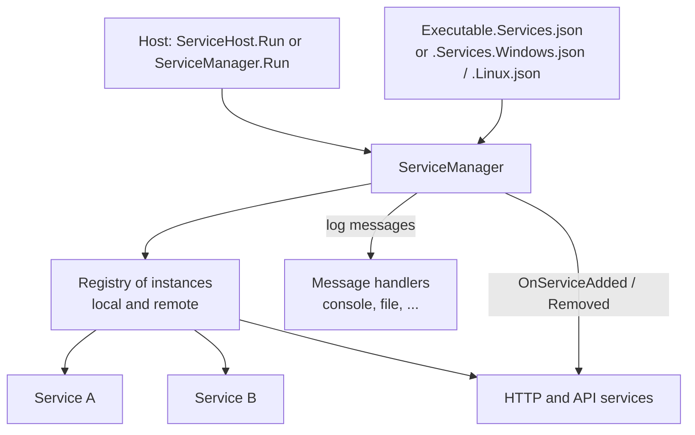

# SysWeaver.MicroServices.ServiceManager

[⬆ SysWeaver overview](../README.md)

> The composition root and runtime registry of every SysWeaver application: it reads the service manifest, constructs services through constructor injection, owns their lifetime, routes messages between them, and exposes the running system for diagnostics.

| | |
|---|---|
| **Layer** | Runtime |
| **Kind** | Library with micro services |

## Purpose

In SysWeaver an application is *configured*, not *coded*: the executable is little more than a host, and the set of running services is described in a JSON manifest. The `ServiceManager` turns that manifest into a live object graph and keeps track of it for the lifetime of the process.

## How it fits into SysWeaver



Startup: the manager attaches console/debugger log handlers, locates the manifest (`<Executable>.Services.<Os>.json` first, then `<Executable>.Services.json`), and for each entry in file order resolves the type string, picks the richest satisfiable constructor, constructs the service and raises `OnServiceAdded`. On dispose, owned services are disposed in reverse registration order.

## Key features

- **Manifest** — an ordered JSON array of entries `{ Type, Name, Params }`; comments and trailing commas are allowed
- **Constructor injection** — constructors are tried from most to fewest parameters; parameters are satisfied from already registered services (single instances, arrays or collections of all matching instances), the manager itself and the entry's `Params` object; unresolved reference-type parameters receive `null`
- **Special entry kinds** — serializer (`ISerializerType`) and compressor (`ICompType`) plug-ins are *registered* statically instead of instantiated; an interface type with `RemoteConnection` parameters becomes a generated remote proxy
- **Lookups** — `Get` / `TryGet` / `GetAll` by type, optionally filtered by instance name, local vs. remote and oldest/newest
- **Events and messaging** — `OnServiceAdded` / `OnServiceRemoved` let infrastructure services attach to services registered later; `PostMessage` delivers keyed messages to all `IServiceMessageListener` instances; the manager is also the central logging hub (`MessageHost`)
- **Process control** — pause/resume propagated to `IServicePausable` services and a controlled process restart (when the host supports it)
- **Diagnostics** — statistics and performance data from all services, published as web tables (services, stats, performance, scheduled tasks, text files)
- **Manifest editing** — `ReadManifest` / `BuildManifest` convert the manifest to typed entries and back, used by the web admin UI to view and edit server configuration
- **Shared helpers** — one-time pads, a file extension editor/viewer registry and text-file access used by other framework services
- **Built-in services** — `CpuService` (priority class, affinity mask or core slicing) and `NetworkService` (wait until the machine has a LAN address)
- **Messaging contracts** — interfaces and data types for text message senders/receivers (`ITextMessageSender`, `ITextMessageReceiverService`, `ITextMessageStatusService`, `TextMessageQueue<T>`) and e-mail receivers (`IEmailReceiverService`)

## Key components

- [`ServiceManager`](ServiceManager.cs) — manifest loading, registry, lifetime, events, statistics
- [`ServiceManifest`](ServiceManifest.cs) — one manifest entry and the conversion of its `Params`
- [`CpuService`](Services/CpuService.cs) / [`NetworkService`](Services/NetworkService.cs) — built-in services

## Using it

```csharp
// Console host: runs until Ctrl+C / SIGTERM, loading <exe>.Services.json
await SysWeaver.MicroService.ServiceManager.Run("MyApp");
```

```json
[
  { "Type": "SysWeaver.MicroService.FileLogService, SysWeaver.MicroServices.Log" },
  { "Type": "SysWeaver.MicroService.CpuService, SysWeaver.MicroServices.ServiceManager", "Params": { "SliceCount": 2, "SliceIndex": 0 } },
  { "Type": "MyApp.OrderService, MyApp", "Name": "orders", "Params": { } }
]
```

Inside a service:

```csharp
public OrderService(ServiceManager manager, OrderParams p)
{
    var mail = manager.TryGet<IEmailSender>();       // optional dependency
    manager.OnServiceAdded += (s, info) => { /* react to late services */ };
}
```

## Limitations and considerations

- **Order matters.** Services are created strictly in manifest order and a constructor only sees services registered before it. Infrastructure that looks up dependencies once in its constructor (e.g. the HTTP server and the auth manager) must come after those dependencies. See the ordering rules in the [SysWeaver overview](../README.md).
- A failing entry (unknown type, no satisfiable constructor, constructor exception) aborts manifest loading; the error lists the types that could not be resolved. Combine with the auto-recovery of [SysWeaver.OsServices](../SysWeaver.OsServices/README.md) for resilience.
- Constructor selection is by parameter count and resolvability, not by attributes; ambiguous constructors can pick an unexpected overload.
- Type strings should be assembly-qualified (`"Namespace.Type, Assembly"`), otherwise the type is only found if its assembly happens to be loaded already.

## Folder layout

| Folder | Content |
|---|---|
| [`Services/`](Services/README.md) | Built-in `CpuService` and `NetworkService`, text message and e-mail receiver contracts and data types |

## Relationships

- **Project:** [`SysWeaver.MicroServices.ServiceManager.csproj`](SysWeaver.MicroServices.ServiceManager.csproj)
- **Builds on:** [SysWeaver.CommandLine](../SysWeaver.CommandLine/README.md), [SysWeaver.Common](../SysWeaver.Common/README.md), [SysWeaver.HttpServer](../SysWeaver.HttpServer/README.md), [SysWeaver.MicroServices](../SysWeaver.MicroServices/README.md), [SysWeaver.Remote.Connection](../SysWeaver.Remote.Connection/README.md), [SysWeaver.TableData](../SysWeaver.TableData/README.md)
- **Used by:** [SysWeaver.AI](../SysWeaver.AI/README.md), [SysWeaver.AI.ComfyUi](../SysWeaver.AI.ComfyUi/README.md), [SysWeaver.AI.OpenAI](../SysWeaver.AI.OpenAI/README.md), [SysWeaver.Chat](../SysWeaver.Chat/README.md), [SysWeaver.Email.Fake](../Communication/SysWeaver.Email.Fake/README.md), [SysWeaver.EmailReader.Imap](../Communication/SysWeaver.EmailReader.Imap/README.md), [SysWeaver.EmailReader.Pop3](../Communication/SysWeaver.EmailReader.Pop3/README.md), [SysWeaver.ExchangeRate](../SysWeaver.ExchangeRate/README.md), [SysWeaver.IpLocation](../SysWeaver.IpLocation/README.md), [SysWeaver.MicroService.AspHttpServer](../SysWeaver.MicroService.AspHttpServer/README.md), [SysWeaver.MicroService.Auth](../SysWeaver.MicroService.Auth/README.md), [SysWeaver.MicroService.ChartJs](../SysWeaver.MicroService.ChartJs/README.md), [SysWeaver.MicroService.ChartJs.Excel](../SysWeaver.MicroService.ChartJs.Excel/README.md), [SysWeaver.MicroService.Edit](../SysWeaver.MicroService.Edit/README.md), [SysWeaver.MicroService.FileUploader](../SysWeaver.MicroService.FileUploader/README.md), [SysWeaver.MicroService.FolderSync](../SysWeaver.MicroService.FolderSync/README.md), [SysWeaver.MicroService.HttpServer](../SysWeaver.MicroService.HttpServer/README.md), [SysWeaver.MicroService.LanCertificateManager](../SysWeaver.MicroService.LanCertificateManager/README.md), [SysWeaver.MicroService.Media](../SysWeaver.MicroService.Media/README.md), [SysWeaver.MicroService.MediaThumbnail](../SysWeaver.MicroService.MediaThumbnail/README.md), [SysWeaver.MicroService.MySqlAudit](../SysWeaver.MicroService.MySqlAudit/README.md), [SysWeaver.MicroService.NetHttpServer](../SysWeaver.MicroService.NetHttpServer/README.md), [SysWeaver.MicroService.QR](../SysWeaver.MicroService.QR/README.md), [SysWeaver.MicroService.ServerManager](../SysWeaver.MicroService.ServerManager/README.md), [SysWeaver.MicroService.Thumbnail](../SysWeaver.MicroService.Thumbnail/README.md), [SysWeaver.MicroService.Thumbnail.Web](../SysWeaver.MicroService.Thumbnail.Web/README.md), [SysWeaver.MicroService.Translation](../SysWeaver.MicroService.Translation/README.md), [SysWeaver.MicroService.TranslationDbCache](../SysWeaver.MicroService.TranslationDbCache/README.md), [SysWeaver.MicroService.UserManager](../SysWeaver.MicroService.UserManager/README.md), [SysWeaver.MicroService.UserStorage](../SysWeaver.MicroService.UserStorage/README.md), [SysWeaver.MicroServices.Log](../SysWeaver.MicroServices.Log/README.md), [SysWeaver.OsServices](../SysWeaver.OsServices/README.md), [SysWeaver.OsServices.ServiceHostFactoryUnix](../Platform/SysWeaver.OsServices.ServiceHostFactoryUnix/README.md), [SysWeaver.OsServices.ServiceHostFactoryWin32NT](../Platform/SysWeaver.OsServices.ServiceHostFactoryWin32NT/README.md), [SysWeaver.ReverseProxy](../SysWeaver.ReverseProxy/README.md), [SysWeaver.TextMessage.AmazonEndUserMessaging](../Communication/SysWeaver.TextMessage.AmazonEndUserMessaging/README.md), [SysWeaver.TextMessage.Fake](../Communication/SysWeaver.TextMessage.Fake/README.md), [SysWeaver.TextMessage.Router](../Communication/SysWeaver.TextMessage.Router/README.md), [SysWeaver.TextMessage.Twilio](../Communication/SysWeaver.TextMessage.Twilio/README.md), [SysWeaver.TextMessage.WhatsApp](../Communication/SysWeaver.TextMessage.WhatsApp/README.md); services [ExchangeRateService](https://github.com/dosh1974/SysWeaver.Services/blob/main/ExchangeRateService/README.md), [IpLocationService](https://github.com/dosh1974/SysWeaver.Services/blob/main/IpLocationService/README.md), [SwServerManager](https://github.com/dosh1974/SysWeaver.Services/blob/main/SwServerManager/README.md), [TranslationService](https://github.com/dosh1974/SysWeaver.Services/blob/main/TranslationService/README.md)
