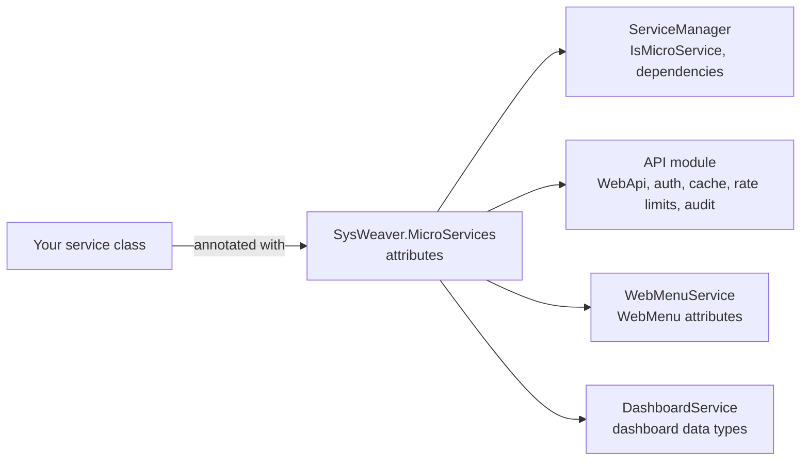

# SysWeaver.MicroServices

[⬆ SysWeaver overview](../README.md)

> The declarative vocabulary for writing SysWeaver services: attributes that mark a class as a micro service, publish methods as web APIs, add menu entries and dashboards, and describe dependencies — plus a handful of cross-service interfaces.

| | |
|---|---|
| **Layer** | Runtime |
| **Kind** | Library (attributes and interfaces, no runtime logic) |

## Purpose

A service author should be able to write a plain C# class and *annotate* it, instead of registering routes, menus or dependencies in code. This project defines those annotations. The behaviour behind them lives elsewhere: the [SysWeaver.MicroServices.ServiceManager](../SysWeaver.MicroServices.ServiceManager/README.md) creates services, [SysWeaver.HttpServer](../SysWeaver.HttpServer/README.md) turns `[WebApi]` methods into endpoints, and [SysWeaver.MicroService.HttpServer](../SysWeaver.MicroService.HttpServer/README.md) builds menus and dashboards.

## How it fits into SysWeaver



## Key features

- **Service declaration** — `[IsMicroService]` marks intent; `[RequiredDep]` / `[OptionalDep]` (also generic forms such as `[RequiredDep<T>]`) document which other services must or may be registered
- **Web API publishing** — `[WebApi]` publishes a method; `[WebApiUrl]` sets the path prefix of a class; `[WebApiAuth]` sets required tokens (`null` = no auth, `""` = any signed-in user, or a comma separated list of tokens such as the `Roles` constants)
- **Response policy** — client cache (`[WebApiClientCache]`), server-side request cache (`[WebApiRequestCache]`, global or per session), preferred compression (`[WebApiCompression]`) and raw, pre-serialized responses (`[WebApiRaw]`, `[WebApiRawText]`)
- **Protection and accountability** — per-process and per-session rate limits (`[WebApiServiceRateLimit]`, `[WebApiSessionRateLimit]`), auditing of calls (`[WebApiAudit]`, with optional filtering of logged parameters/results) and optional APIs that are only published when a member on the instance returns true (`[WebApiOptional]`)
- **Navigation** — `[WebMenu*]` attributes place links, tables, charts, embedded pages or scripts into the web UI's menu tree
- **Dashboards** — `WebDashboard` / `WebDashItem` data types (embedded frames or inline HTML) used by the dashboard service
- **Cross-service interfaces** — `IServiceMessageListener` (service-to-service notifications), `IRunTimeWebApiAuth` (endpoint permissions decided from configuration at run time), `IHaveDefaultInstanceName`, `IEmailSender`, `IQrCodeService` and template variables (`IHaveTemplateVariables`)
- Services remain plain classes: no base class is required

## Using it

```csharp
using SysWeaver;
using SysWeaver.MicroService;

[IsMicroService]
[WebApiUrl("orders")]                          // /Api/orders/...
public sealed class OrderService
{
    [WebApi]                                   // /Api/orders/Count
    [WebApiClientCache(10)]
    public int Count() => 42;

    [WebApi]
    [WebApiAuth(Roles.Ops)]                    // requires an Ops (or Debug) token
    [WebApiAudit("Orders")]
    public bool Purge() => true;
}
```

## Limitations and considerations

- Attributes are metadata only; without the corresponding runtime projects nothing happens.
- `[IsMicroService]` and the dependency attributes document intent — the service manager will instantiate any class with a satisfiable constructor and does not enforce the declared dependencies itself; services typically enforce them in their constructors.
- The namespace is `SysWeaver.MicroService` (singular), while the assembly is `SysWeaver.MicroServices`.

## Relationships

- **Project:** [`SysWeaver.MicroServices.csproj`](SysWeaver.MicroServices.csproj)
- **Builds on:** [SysWeaver.Common](../SysWeaver.Common/README.md)
- **Used by:** [SysWeaver.Auth.Core](../SysWeaver.Auth.Core/README.md), [SysWeaver.Email.AmazonSes](../Communication/SysWeaver.Email.AmazonSes/README.md), [SysWeaver.Email.Fake](../Communication/SysWeaver.Email.Fake/README.md), [SysWeaver.Email.MicrosoftAcs](../Communication/SysWeaver.Email.MicrosoftAcs/README.md), [SysWeaver.Email.Smtp](../Communication/SysWeaver.Email.Smtp/README.md), [SysWeaver.ExpressionEvaluator](../SysWeaver.ExpressionEvaluator/README.md), [SysWeaver.HttpServer](../SysWeaver.HttpServer/README.md), [SysWeaver.LanguageIdentifier.Llm](../SysWeaver.LanguageIdentifier.Llm/README.md), [SysWeaver.MicroService.Edit](../SysWeaver.MicroService.Edit/README.md), [SysWeaver.MicroService.FileUploader](../SysWeaver.MicroService.FileUploader/README.md), [SysWeaver.MicroService.Map](../SysWeaver.MicroService.Map/README.md), [SysWeaver.MicroService.UserManager](../SysWeaver.MicroService.UserManager/README.md), [SysWeaver.MicroServices.ServiceManager](../SysWeaver.MicroServices.ServiceManager/README.md), [SysWeaver.Remote.Services](../SysWeaver.Remote.Services/README.md)
