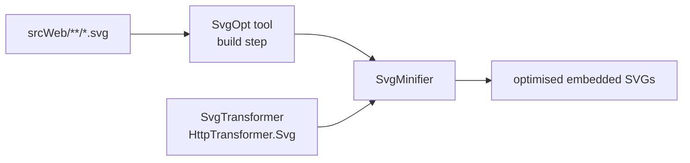

# SysWeaver.Minifier.Svg

[⬆ SysWeaver overview](../README.md)

> SVG minifier/optimiser, used at build time (through the SvgOpt tool) for the framework's icons and at runtime by the SVG transformer.

| | |
|---|---|
| **Layer** | Media |
| **Kind** | Library |

## Purpose

Reduce SVG size and normalise icons (e.g. remove fill and size attributes so icons can be styled with CSS, limit decimals) without changing how they render.

## How it fits into SysWeaver

The pre-built `SvgOpt.exe` in `_tools/svg_opt` (source in [SysWeaver.Tools](https://github.com/dosh1974/SysWeaver.Tools)) runs as a build step in projects with embedded icons.

## Key features

- One switch per optimisation: comments, white space, titles, metadata, non-SVG namespaces, hidden elements, empty groups, unused ids, id renaming, colour and path shortening, transforms, leading/trailing zeros, decimal limits, fill/size/background removal
- Repeats the steps until nothing changes, so minifying the output again gives the same output
- Numbers are tokenized like the SVG grammar and written with the invariant culture
- Optional render-based validation and attribute removal (System.Drawing) that keeps output visually identical
- `SvgMinifierParams.CacheKey` (minifier version plus output-relevant options) lets callers name cached outputs so a new minifier version rebuilds them

## Key components

- [`SvgMinifier`](SvgMinifier.cs) — `Optimize(svgText, msg, opt)`
- [`SvgMinifierParams`](SvgMinifierParams.cs) — the optimisation switches

## Limitations and considerations

- Aggressive options can remove information some SVGs depend on; options are chosen per use
- Compact path syntax (e.g. arc flags without separators, "a5 5 0 0110 10") is valid SVG but not read by every parser
- The render-based steps (clip-rule/fill-rule removal, `TryRemoveAttributes`, `BitmapValidation`) use System.Drawing and are silently skipped where it is unavailable (non-Windows)
- The DOCTYPE is always removed; `RemoveDocType` controls the xml declaration

## Relationships

- **Project:** [`SysWeaver.Minifier.Svg.csproj`](SysWeaver.Minifier.Svg.csproj)
- **Builds on:** [SysWeaver.Common](../SysWeaver.Common/README.md)
- **Used by:** [SysWeaver.HttpTransformer.Svg](../SysWeaver.HttpTransformer.Svg/README.md), [SvgOpt](https://github.com/dosh1974/SysWeaver.Tools/blob/main/SvgOpt/README.md)
- **Third-party:** Svg (SVG.NET, rendering for validation)
