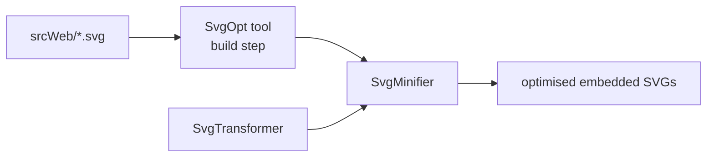

# SysWeaver.Minifier.Svg

[⬆ SysWeaver overview](../README.md)

> SVG minifier/optimiser, used at build time for all framework icons and at runtime by the SVG transformer.

| | |
|---|---|
| **Layer** | Media / Build tooling |
| **Kind** | Library |

## Purpose

Reduce SVG size and normalise icons (e.g. remove fill and size attributes so icons can be styled with CSS, limit decimals). The pre-built `SvgOpt` tool in `_tools` is built on it.

## How it fits into SysWeaver

## API overview

- `SvgMinifier.Optimize(svgText, msg, opt)`: minifies an svg document (or an xml fragment with several root elements), `msg` is not used.
- `SvgMinifierParams`: one switch per optimization (comments, white space, titles, metadata, non-svg namespaces, hidden elements, empty / attribute-less groups,
  unused ids and id renaming, colors, path shortening, transforms, leading / trailing zeros, decimals limits, fill / size / background removal), see the XML docs.

## Behaviour

- When the svg element has a view box with a positive size, its width and height are always removed (and x / y if zero).
- Path data is shortened: commas, tabs and line breaks become spaces, repeated L / A commands are joined, unnecessary spaces and the arc flag separators are removed
  ("a5 5 0 0 1 10 10" becomes "a5 5 0 0110 10"). This is valid svg path syntax, but some svg parsers don't read the compact arc flags
  (`SysWeaver.Media.SvgPath.Process` does).
- `MaxDecimals` / `MaxDecimalRes` round every number with a decimal point or an exponent (half to even, 2.25 => 2.2 with 1 decimal).
  Numbers are tokenized like the svg grammar: compact numbers ("1.5.5" is 1.5 and .5), exponents and (in path data) arc flags are handled,
  a space is inserted if two rounded numbers would otherwise merge ("1.5.5" with 0 decimals => "2 0"), a number rounded to zero loses its sign ("-0.001" => "0").
- Numbers are parsed and written with the invariant culture.
- `TrimTrailingZeros` only changes numerical attributes (coordinates, sizes, path data, points, transforms, viewBox, opacities, stroke / font sizes, filter and animation timing numbers,
  animation values of numerical attributes) and the numerical css properties of style attributes; href, id, class, font names etc. are never changed.
- `Optimize` repeats the optimization steps until nothing changes (at most 8 passes), so minifying the output again gives the same output.
  The steps form a dependency graph (the private `Steps` table in SvgMinifier.cs): after the first pass a step only runs again if a step that can enable more work for it changed the document
  (e.g. removed elements / attributes can make ids unused and g elements attribute-less), most documents need one pass.
  The rendering based clip-rule / fill-rule removal runs after the rounding (`MaxDecimals`) and is repeated until nothing more can be removed;
  if the rounded document can't be rendered by System.Drawing, these attributes are kept.
- `RemoveBackground` removes the leading rect elements that match the view box (repeated: after one is removed, the next first rect is checked).
- `RenameIds` renames all ids: the most used id (id attribute + href="#id" / url(#id) references, also url(#id) in style elements) gets "a", then "b" .. "z", "aa", "ba" ..
  (ties: first occurrence first). Ids that may be used by text that can't be rewritten (style elements, e.g. "#id" selectors, scripts, "on..." event attributes,
  begin / end and aria reference attributes) and references to ids that are not defined keep their names, and no other id gets such a name (or any word of such a text).
  Ids used only from outside the document (e.g. "sprite.svg#icon") are renamed too.
- `RemoveIds` removes unreferenced id attributes (not the ones used by such opaque text) and references to missing ids (fill / stroke attributes are kept;
  in a style attribute only the css declaration with the reference is removed).
- With `RemoveDocType = false` the output starts with `<?xml version="1.0" encoding="utf-8"?>` (also when the input had another or no declaration).
- The clip-rule / fill-rule removal, `TryRemoveAttributes` and `BitmapValidation` render the document with System.Drawing (Windows only, silently skipped elsewhere).
  `BitmapValidation` defaults to true in DEBUG builds of the library; when it fails it throws an InvalidOperationException naming the step.
  Nothing is written to disk unless `ErrorDir` is set (SvgOpt: `-ErrorDir <folder>`): then the reference image, the failed image and the source svg are saved there
  with unique names (`SvgMinifier_<source hash>_<step>_<random>_Ref.png`, `_Failed.png`, `_Source.svg`) and the paths are in the exception message.
- `SvgMinifierParams.CacheKey` identifies the output: `SvgMinifier.Version` (changed whenever the output of `Optimize` changes) followed by the options that change the output
  (not `ErrorDir` / `BitmapValidation`), letters, digits and '_' only. SvgOpt and SvgTransformer name their cached outputs with it, so a new minifier version rebuilds them.

## Limitations and considerations

- Aggressive options can remove information some SVGs depend on; options are chosen per project.
- The DOCTYPE is always removed; `RemoveDocType` controls the xml declaration.
- Not included in the main solution file.

## Known bugs (svg-cov review 2026-10-10)

| Id | Sev | Title |
|---|---|---|
| - | - | None known |

Fixed in this review: svg-cov-24 to svg-cov-27 (x / y parsing culture and crash, MaxDecimalRes culture, inverted `RemoveBackground` match, `RenameIds` dropping the text before url(#id)),
svg-cov-28 (`MaxDecimals` / `MaxDecimalRes` corrupted compact numbers such as "1.5.5", exponents and arc flags),
svg-cov-30 (utf-16 declaration), svg-cov-31 (trailing path separator / incomplete arc crash), svg-cov-32 ("1. 5" merged), svg-cov-33 / svg-cov-34 (`RenameIds` double renaming
and duplicate ids; all ids are now renamed, collision free), svg-cov-46 (`RemoveIds` removed a whole style attribute); `RemoveIds` no longer removes ids used by css selectors.
Also fixed: svg-cov-29 (`TrimTrailingZeros` changed non numerical attributes such as href / id / class), svg-cov-35 (a failed validation wrote images to the current directory,
now only to `ErrorDir`), svg-cov-49 (`Optimize` wasn't idempotent, it now runs to a fixed point), svg-cov-52 (SvgOpt logged a failed file as 0 bytes and reprocessed it on every run),
svg-cov-53 (`MaxDecimals` / `MaxDecimalRes` never rounded the view box, the decimal limits named it "viewbox").

## Relationships

- **Project:** [`SysWeaver.Minifier.Svg.csproj`](SysWeaver.Minifier.Svg.csproj)
- **Builds on:** [SysWeaver.Common](../SysWeaver.Common/README.md)
- **Used by:** [SysWeaver.HttpTransformer.Svg](../SysWeaver.HttpTransformer.Svg/README.md)
