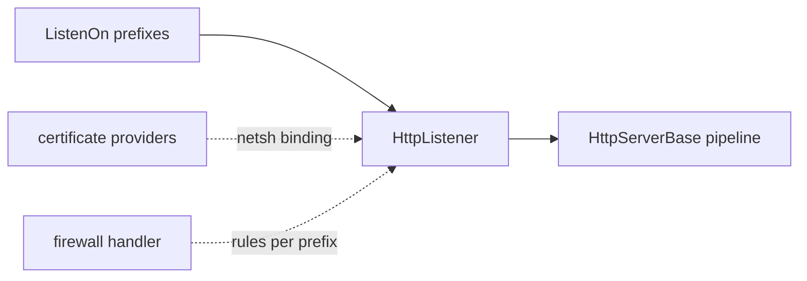

# SysWeaver.NetHttpServer

[⬆ SysWeaver overview](../README.md)

> HTTP listener adapter for the SysWeaver pipeline based on `System.Net.HttpListener`.

| | |
|---|---|
| **Layer** | Web platform |
| **Kind** | Library |

## Purpose

The lightweight, dependency-free way to host the SysWeaver HTTP pipeline. It listens on the configured prefixes and forwards each request to [SysWeaver.HttpServer](../SysWeaver.HttpServer/README.md).

## How it fits into SysWeaver

## Key features

- Listens on any number of prefixes (`http(s)://host:port/path/`), including paths and host names.
- Validates each prefix and, with `IgnoreBadPrefixes` (default), skips prefixes that fail (invalid, or HTTPS without a certificate) instead of failing the server.
- Binds certificates from SysWeaver certificate providers to HTTPS ports and re-binds them when a provider reports a new certificate.
- Optional firewall rule per prefix (`AddToFirewall`).
- Pause mode answering requests with 503, and graceful shutdown waiting up to `SecondsToWait` for pending requests.

## Key components

- [`NetHttpServer`](NetHttpServer.cs) — the `HttpServerBase` implementation on `HttpListener`
- [`NetHttpServerParams`](NetHttpServerParams.cs) — listen prefixes and server options

## Using it

Through [SysWeaver.MicroService.NetHttpServer](../SysWeaver.MicroService.NetHttpServer/README.md).

## Limitations and considerations

- HTTPS certificate binding uses `netsh http` and is only implemented on Windows (elevated rights required); use [SysWeaver.AspHttpServer](../SysWeaver.AspHttpServer/README.md) for HTTPS on other platforms or for HTTP/2 and HTTP/3.
- HttpListener on Windows requires administrator rights or URL reservations for non-localhost prefixes.
- The default `ListenOn` is external HTTPS on port 443; configure prefixes explicitly.

## Relationships

- **Project:** [`SysWeaver.NetHttpServer.csproj`](SysWeaver.NetHttpServer.csproj)
- **Builds on:** [SysWeaver.HttpServer](../SysWeaver.HttpServer/README.md)
- **Used by:** [SysWeaver.MicroService.NetHttpServer](../SysWeaver.MicroService.NetHttpServer/README.md), [SysWeaver.Security.Acme](../SysWeaver.Security.Acme/README.md)
