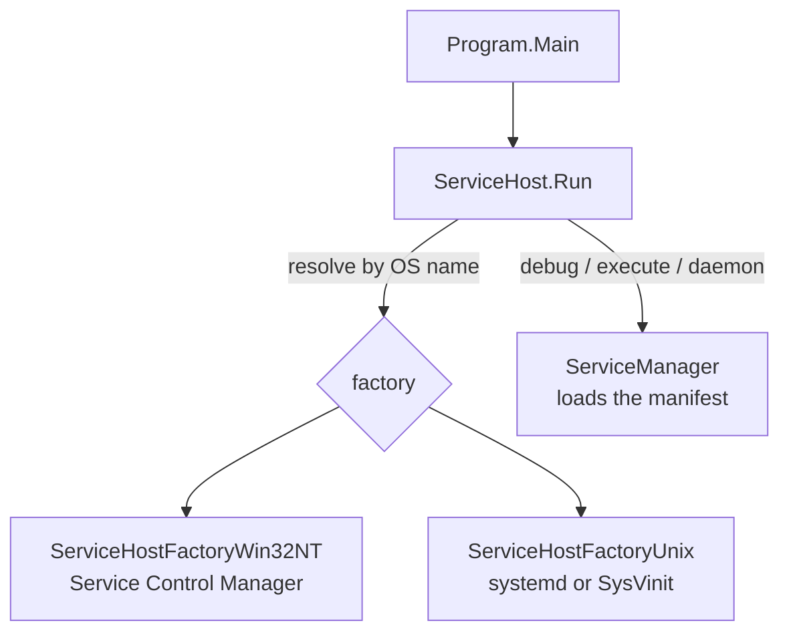

# SysWeaver.OsServices

[⬆ SysWeaver overview](../README.md)

> Turns a SysWeaver application into a proper operating-system service — Windows service, systemd unit or SysVinit script — controlled with simple command line verbs, with an interactive console mode and automatic recovery from broken manifests.

| | |
|---|---|
| **Layer** | Runtime |
| **Kind** | Library (host entry point) |
| **Platform** | Windows and Linux (via the platform factory assemblies) |

## Purpose

Writing and installing services is repetitive and OS specific. `ServiceHost.Run` makes it a one-liner: the same executable can be installed, controlled, debugged in a console, and run by the OS service manager.

## How it fits into SysWeaver



## Key features

- One executable for install, control, debugging and production
- OS-specific behaviour isolated in separately deployed factory assemblies ([Win32NT](../Platform/SysWeaver.OsServices.ServiceHostFactoryWin32NT/README.md), [Unix](../Platform/SysWeaver.OsServices.ServiceHostFactoryUnix/README.md))
- Interactive console mode: `Esc` stops the application, `Space` pauses/resumes all services, OS signals (SIGINT, SIGTERM, SIGHUP, SIGQUIT) trigger a graceful shutdown
- Restart-on-failure for the installed service: SCM failure actions on Windows (`RestartOnFail`, `RestartDelaySeconds`, ...), `Restart=always` in the systemd unit (SysVinit has none)
- Start-up mode (`ServiceStarts`: disabled, manual, normal, delayed) applied when installing (Windows only)
- Exit codes that follow the common 0 = success convention, with LSB init script codes for failures
- **Manifest auto-recovery** (`AutoRecover`): after a successful start the manifest is saved as `[Manifest].LastGood.json`; if an unhandled exception occurs during a later start-up, the current manifest is saved as `[Manifest].Replace.json`, the last good manifest is restored and the service (or console process) restarted (`IServiceHost.RequestRestart`). Overwritten manifests are backed up as `Bak_[date]_[date].[Manifest].json` (see `ServiceHost.BackupConfig` / `IsConfigBackupName`) and can be inspected from the [server manager](../SysWeaver.MicroService.ServerManager/README.md).

## Key components

- [`ServiceHost`](ServiceHost.cs) — `Run` entry point, console mode, auto-recovery and manifest backup helpers
- [`ServiceParams`](ServiceParams.cs) — service name, display name, description, start mode, restart policy, logo, auto-recover
- [`ServiceResponse`](ServiceResponse.cs) / [`ServiceStatus`](ServiceStatus.cs) — operation results and service states, with exit code mapping (`ServiceResponseHelper`, `ServiceStatusHelper`)
- [`IServiceHost`](IServiceHost.cs) / [`IServiceHostFactory`](IServiceHostFactory.cs) — the OS specific install / control / run contract, implemented as `SysWeaver.OsServices.ServiceHostFactory[Platform]`

## Using it

```csharp
using SysWeaver.OsServices;
public static class Program
{
    public static int Main() => ServiceHost.Run(new ServiceParams
    {
        Name = "MyService", DisplayName = "My Service", Description = "…",
    });
}
```
```text
MyService debug        # develop
MyService install      # deploy
MyService start
```

### Verbs

| Verb | Effect |
|---|---|
| `install`, `uninstall`, `reinstall` | Register/remove the OS service (elevation is requested when needed) |
| `start`, `stop`, `pause`, `continue`, `restart`, `status` | Control the installed service (`start` installs first if needed) |
| `debug` | Run in the console showing all message levels |
| `execute` | Run in the console with normal verbosity |
| `daemon` | The entry point used by the OS service manager |
| `hash [user] [password]` | Utility to compute a simple password hash for configuration |
| `help` (or none, in a console) | Usage; with no arguments and no console, `start` is used |

Verbs are matched case insensitively. Before starting, console mode waits up to 15 seconds for another console mode instance of the *same application* (same executable / entry assembly path, tracked with a global named mutex) to exit, ex: the old process during a restart.

`restart` stops the service and starts it again (a service that isn't running is just started); `reinstall` uninstalls and then starts the service if it was running, starting, pausing, paused or resuming, else only installs it.

### Exit codes

**0 = success, non-zero = failure**, with the failure codes taken from the LSB init script codes where one exists, all in the range 0-255. The `ServiceResponse` / `ServiceStatus` enum values are *not* the exit codes; they are mapped with `ServiceResponseHelper.ToExitCode(verb)` / `ServiceStatusHelper.ToExitCode()` (the printed result line still shows the response, ex: `The service is already running [AlreadyRunning: 3]`, and `ServiceResponseHelper.TryParseOutput` finds it in the output).

| Exit code | Meaning (verbs except `status`) |
|---|---|
| 0 | Success: `Ok`, or the service already is in the requested state (`AlreadyInstalled`, `AlreadyRunning`, `AlreadyStarting`, `AlreadyStopping`, `AlreadyPaused`, `NotRunning` for `stop`, `NotInstalled` / `NotFound` for `uninstall`); also `help`, `hash`, `debug` / `execute` and `daemon` when they end normally |
| 1 | Generic error (`GenericError`, an exception) |
| 2 | Invalid or excess arguments (`InvalidCommad`, `ToManyArgs`, invalid `hash` input) |
| 3 | Not supported (`NotSupported`), or no service system for this OS (`UnhandledOs`) |
| 5 | The service is not installed (`NotInstalled`, `NotFound`) |
| 7 | The service is not running / not paused (`NotRunning`, `NotPaused`) |
| 150-155 | `InstallFailed`, `UninstallFailed`, `StartFailed`, `StopFailed`, `PauseFailed`, `ContinueFailed` (LSB application range) |

`status` exits with the LSB status codes: 0 = running, 3 = stopped, 4 = unknown, and 150 + the `ServiceStatus` value for the others (151 = not installed, 153 = starting, 154 = stopping, 156 = resuming, 157 = pausing, 158 = paused).
A verb that is re-run elevated exits with the exit code of the elevated process; if the elevation itself fails (ex: `sudo` isn't installed) the exit code is 1, and a code outside 0-255 also becomes 1.

## Limitations and considerations

- The OS factory assemblies are resolved by name at runtime (`SysWeaver.OsServices.ServiceHostFactory[Platform]`, already loaded or as a dll next to the executable); forgetting to reference/deploy them makes all service verbs (`install`, `start`, `status`, `daemon`, `hash`, ...) unavailable, only `debug`, `execute` and `help` work.
- Auto-recovery only reacts to unhandled exceptions during start-up, not to services that merely fail to start.
- Installing and controlling services requires administrative rights.
- Only Windows and Linux are implemented.
- `IsConfigBackupName` only checks the shape of the name (digits and separators), the dates themselves are not validated.
- Only console mode instances of the current version take the console instance mutex; a console instance of an older version isn't waited for.

## Relationships

- **Project:** [`SysWeaver.OsServices.csproj`](SysWeaver.OsServices.csproj)
- **Builds on:** [SysWeaver.MicroServices.ServiceManager](../SysWeaver.MicroServices.ServiceManager/README.md)
- **Used by:** [SysWeaver.MicroService.ServerManager](../SysWeaver.MicroService.ServerManager/README.md), [SysWeaver.OsServices.ServiceHostFactoryUnix](../Platform/SysWeaver.OsServices.ServiceHostFactoryUnix/README.md), [SysWeaver.OsServices.ServiceHostFactoryWin32NT](../Platform/SysWeaver.OsServices.ServiceHostFactoryWin32NT/README.md); services [ExchangeRateService](https://github.com/dosh1974/SysWeaver.Services/blob/main/ExchangeRateService/README.md), [IpLocationService](https://github.com/dosh1974/SysWeaver.Services/blob/main/IpLocationService/README.md), [TranslationService](https://github.com/dosh1974/SysWeaver.Services/blob/main/TranslationService/README.md)
