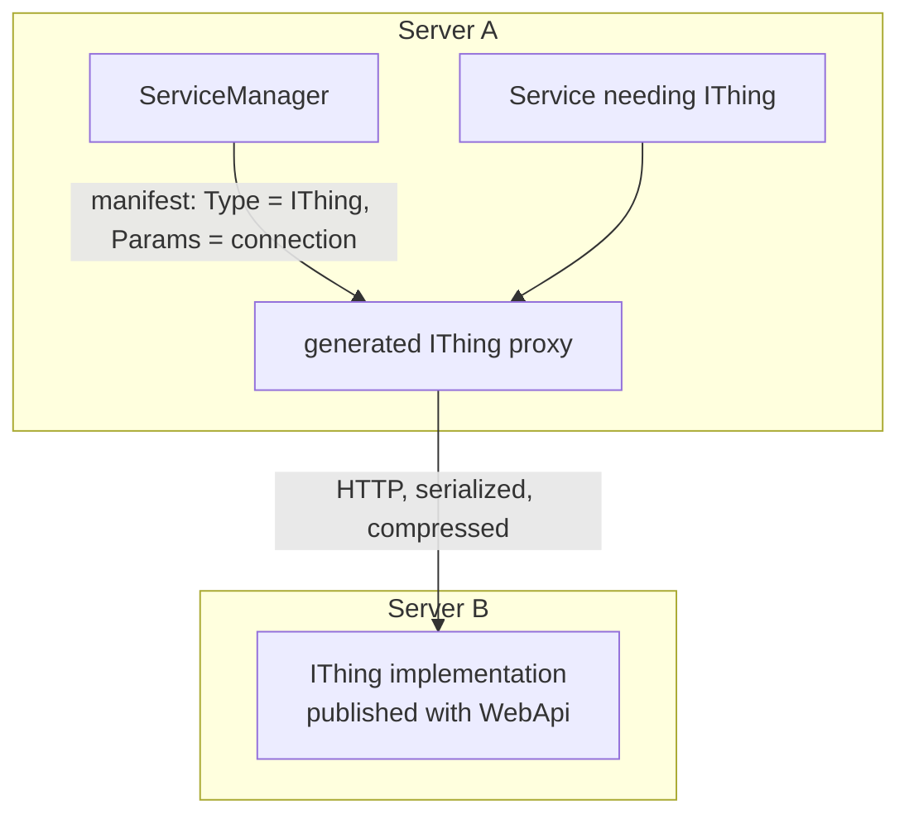

# SysWeaver.Remote.Connection

[⬆ SysWeaver overview](../README.md)

> Runtime engine for remote APIs: generates classes implementing `IRemoteApi` interfaces that perform HTTP calls with SysWeaver serialization, compression, caching, authentication and concurrency limits. Enables local and remote services to be interchangeable.

| | |
|---|---|
| **Layer** | Remote APIs |
| **Kind** | Library |

## Purpose

Make distribution a deployment decision. A service that depends on an interface does not care whether the implementation runs in-process or on another server: the manifest either lists a local implementation, or lists the *interface* with connection parameters, and the service manager creates a remote proxy.

## How it fits into SysWeaver



## Key features

- Implementation emitted at runtime (IL generation) and cached per interface; each method declared on the interface becomes an end point (`RemoteEndPoint` attribute, or by default GET for parameterless methods and POST otherwise, prefixed by `RemotePathPrefix`).
- GET/DELETE parameters are formatted into the url from a template such as `Get?id={Id}`; POST/PUT parameters are sent as the serialized payload (multiple parameters as an `object[]`, or as an object with `ParamAsObject`).
- Per connection: base URL (path templates, or read from a file), auth (bearer token / API key, Basic, a custom header via a `*header` user name, or the SysWeaver challenge login), time-out, accepted and sent compression, serializer choice (json by default, write-only `formUrl` available), max connections per server, proxy or Tor, certificate validation, user agent and response caching.
- Per end point: serializers, time-out and an LRU response cache (GET/DELETE only) via `RemoteSerializer`, `RemoteTimeout` and `RemoteCache` attributes.
- Call monitoring through `IRemoteApi.OnCallBegin` / `OnCallEnd`, per-endpoint timing (`PerfMon`) and per-method failure statistics.
- Error messages can be stripped of URLs to avoid leaking sensitive information.
- Helpers for calling SysWeaver servers directly with `HttpClient` (json / raw POST, login / logout, file upload).
- Proxies created by the service manager from a manifest are registered as remote, so consumers can prefer local or remote instances.

## Key types

| Type | Role |
|---|---|
| `RemoteConnection` | Connection parameters (usually the manifest `Params`) and `Create<T>()` / `Create(Type)` factory |
| `RemoteConnectionBase` | Base class of the generated implementations; owns the `HttpClient`, exposes `UrlBase`, `Client`, stats |
| `RemoteAuthMethod` | `HttpAuth` (Bearer / Basic / custom header) or `SysWeaverLogin` |
| `EndPointOptions` | Per end point serializer / time-out overrides (built from attributes) |
| `FormUrlSerializer` | Write-only `application/x-www-form-urlencoded` serializer (`formUrl`) |
| `IgnoreDefaultsFormUrlSerializer` | Write-only form serializer that omits members with default values (`formUrlIgnoreDefaults`) |
| `HttpClientTimeoutHandler` | Delegating handler applying the per request time-out (reported as `TimeoutException`) |
| `UriParamsEncoder<T>` | Compiles the GET/DELETE url templates |
| `JsonRequestExt` | `HttpClient` extensions to POST json or raw payloads (non 2xx responses throw `HttpResponseException`, a 2xx other than 200 without a body deserializes to `default`) |
| `SysWeaverHttpClientExt` | `HttpClient` extensions for SysWeaver login, logout and file upload |
| `RemoteConnectionExt` | The same SysWeaver actions on a generated remote API instance |

## Limitations and considerations

- Remote calls have network semantics (latency, failures, time-outs) even though they look like method calls; design interfaces accordingly (coarse-grained, async).
- Interfaces must be public (nested interfaces must only be nested in public types), inherit `IDisposable` (optionally `IRemoteApi`), only declare methods, and every method must return `Task`, `Task<T>`, `ValueTask` or `ValueTask<T>`. An invalid interface fails with a `TypeInitializationException` (the inner exception, typically a `NotSupportedException`, tells why) and keeps failing for that interface.
- GET/DELETE templates: with one primitive / string parameter every `{x}` is the value, with one object parameter `{Member}` names a public field or property, with several parameters `{parameterName}` (case sensitive) or the parameter index `{0}`, `{1}`, ... (with `ParamAsObject` only `{parameterName}`). Strings, floating point values and `DateTime` are url escaped, numbers are formatted with the invariant culture, `bool` as `True` / `False`. Enums, nullables and `char` are not supported in templates, except with several parameters (without `ParamAsObject`): then the values are formatted at runtime (the same formats, other types with the invariant culture, ex: enums by name) and always url escaped, null is an empty string.
- POST/PUT end points without parameters send a null object (`null` with the json serializer, an empty body with `formUrl`, with the serializer's content type); SysWeaver API end points without parameters ignore the body. Several parameters are sent as an array (`[1,2]`), or with `ParamAsObject` as an object with one member per parameter. Note that SysWeaver API end points only accept GET and POST.
- Any 2xx status code is a success: the body is deserialized, except for a 2xx other than 200 without a body (ex: 204 No Content) that returns `default(T)`. Any other status code fails the call with an `HttpResponseException` (`ResponseCode` is the status, the message is the response body for `text/*` responses, else `GET "path", responded with [Status]`). Other failures are wrapped in an `Exception` whose message starts with the verb and the (cleaned) url; a time-out has a `TimeoutException` inner exception, `IRemoteApi.Cancel()` an `OperationCanceledException`.
- Types crossing the wire must be serializable by the chosen serializer (the default json serializer ignores read only fields); cached responses are shared between callers, so don't mutate them. Only GET/DELETE end points with a return value are cached, every end point has its own cache.
- A per end point time-out overrides the connection time-out (it can both shorten and extend it). The `HttpClient` time-out is the largest of the connection and per end point time-outs.
- Serializer names are validated when the type / instance is created (`NotSupportedException` for unknown names); `formUrl` and `formUrlIgnoreDefaults` are write only (use them as the post serializer). The first connection that uses one of them registers both in `SerManager` (once per process, thread safe).
- With `SysWeaverLogin` the login is performed synchronously when the instance is created.
- Disposing an instance cancels pending calls; later calls fail (`ObjectDisposedException` inner exception), disposing again does nothing.
- Runtime code generation requires a runtime that supports dynamic code (not AOT-only environments).

## Using it

```json
{ "Type": "SysWeaver.Remote.Services.IIpApiCom, SysWeaver.Remote.Services",
  "Params": { "BaseUrl": "http://ip-api.com/" } }
```
```csharp
using var api = new RemoteConnection { BaseUrl = "https://other-server/", BearerToken = "key" }.Create<IMyApi>();
```

## Relationships

- **Project:** [`SysWeaver.Remote.Connection.csproj`](SysWeaver.Remote.Connection.csproj)
- **Builds on:** [SysWeaver.Common](../SysWeaver.Common/README.md), [SysWeaver.Compression](../SysWeaver.Compression/README.md), [SysWeaver.Remote](../SysWeaver.Remote/README.md), [SysWeaver.Serialization](../SysWeaver.Serialization/README.md)
- **Used by:** [SysWeaver.ExchangeRate](../SysWeaver.ExchangeRate/README.md), [SysWeaver.FolderSync](../SysWeaver.FolderSync/README.md), [SysWeaver.MicroServices.ServiceManager](../SysWeaver.MicroServices.ServiceManager/README.md), [SysWeaver.ReverseProxy](../SysWeaver.ReverseProxy/README.md), [SysWeaver.Security](../SysWeaver.Security/README.md)
