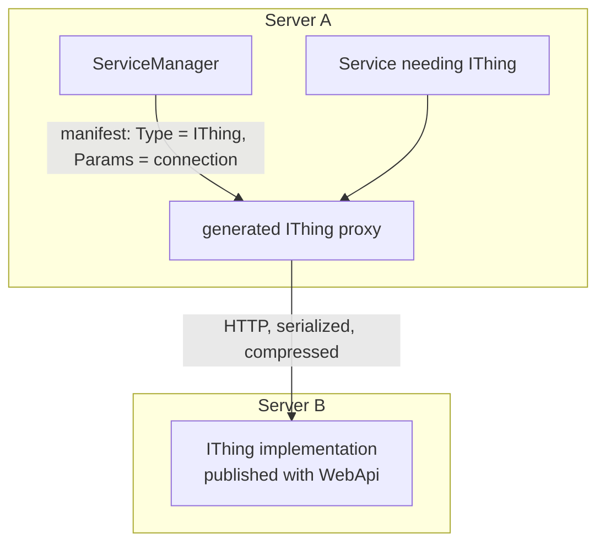

# SysWeaver.Remote.Connection

[⬆ SysWeaver overview](../README.md)

> Runtime engine for remote APIs: generates classes implementing `IRemoteApi` interfaces that perform HTTP calls with SysWeaver serialization, compression, caching, authentication and concurrency limits. Enables local and remote services to be interchangeable.

| | |
|---|---|
| **Layer** | Networking |
| **Kind** | Library |

## Purpose

Make distribution a deployment decision. A service that depends on an interface does not care whether the implementation runs in-process or on another server: the manifest either lists a local implementation, or lists the *interface* with connection parameters, and the service manager creates a remote proxy.

## How it fits into SysWeaver



## Key features

- Implementation emitted at runtime (IL generation) and cached per interface; each method declared on the interface becomes an end point (`RemoteEndPoint` attribute, or by default GET for parameterless methods and POST otherwise, prefixed by `RemotePathPrefix`)
- GET/DELETE parameters are formatted into the url from a template such as `Get?id={id}`; POST/PUT parameters are sent as the serialized payload (several parameters as an array, or as an object with `ParamAsObject`)
- Per connection: base URL (path templates, or read from a file), auth (bearer token / API key, Basic, a custom header via a `*header` user name, or the SysWeaver challenge login), time-out, accepted and sent compression, serializer choice (json by default, write-only `formUrl` available), max concurrency, proxy or Tor (via [SysWeaver.Tor](../SysWeaver.Tor/README.md) when deployed), certificate validation, user agent and response caching
- Per end point: serializers, time-out and an LRU response cache (GET/DELETE only) via `RemoteSerializer`, `RemoteTimeout` and `RemoteCache` attributes
- Call monitoring through `IRemoteApi.OnCallBegin` / `OnCallEnd`, per-endpoint timing and per-method failure statistics
- Error messages can be stripped of URLs (`CleanUrl`) to avoid leaking sensitive information
- Helpers for calling SysWeaver servers directly with `HttpClient` (json / raw POST, login / logout, file upload)
- Proxies created by the service manager from a manifest are registered as remote, so consumers can prefer local or remote instances

## Key components

- [`RemoteConnection`](RemoteConnection.cs) — connection parameters (usually the manifest `Params`) and the `Create<T>()` / `Create(Type)` factory
- [`RemoteConnectionBase`](RemoteConnectionBase.cs) — base class of the generated implementations; owns the `HttpClient`
- [`InterfaceTypeCache`](Connection/InterfaceTypeCache.cs) — validates an interface and emits its implementation
- [`JsonRequestExt`](JsonRequestExt.cs) / [`SysWeaverHttpClientExt`](SysWeaverHttpClientExt.cs) — `HttpClient` extensions for json/raw POST and SysWeaver login, logout and file upload

## Using it

```json
{ "Type": "SysWeaver.Remote.Services.IIpApiCom, SysWeaver.Remote.Services",
  "Params": { "BaseUrl": "http://ip-api.com/" } }
```
```csharp
using var api = new RemoteConnection { BaseUrl = "https://other-server/", BearerToken = "key" }.Create<IMyApi>();
```

## Limitations and considerations

- Remote calls have network semantics (latency, failures, time-outs) even though they look like method calls; design interfaces accordingly (coarse-grained, async).
- Interfaces must be public, inherit `IDisposable` (optionally `IRemoteApi`), only declare methods, and every method must return `Task`, `Task<T>`, `ValueTask` or `ValueTask<T>`. An invalid interface fails with a `TypeInitializationException` (the inner exception tells why).
- GET/DELETE templates support primitives, strings, `DateTime` and public members of a single object parameter; enums, nullables and `char` are only supported when there are several parameters (formatted at runtime). Values are formatted with the invariant culture and url escaped where needed.
- Any 2xx status code is a success (a 2xx other than 200 without a body returns `default(T)`); other status codes throw an `HttpResponseException`. Other failures are wrapped in an `Exception` whose message starts with the verb and the (cleaned) url; time-outs have a `TimeoutException` inner exception, `IRemoteApi.Cancel()` an `OperationCanceledException`.
- SysWeaver API end points only accept GET and POST.
- Cached responses are shared between callers, so don't mutate them.
- A per end point time-out overrides the connection time-out (it can both shorten and extend it).
- `formUrl` and `formUrlIgnoreDefaults` are write only (use them as the post serializer); unknown serializer names fail when the instance is created.
- With `SysWeaverLogin` the login is performed synchronously when the instance is created.
- Disposing an instance cancels pending calls; later calls fail.
- Runtime code generation requires a runtime that supports dynamic code (not AOT-only environments).

## Folder layout

| Folder | Content |
|---|---|
| [`Connection/`](Connection/README.md) | Proxy generation (IL emission), URL parameter and form encoding, per request time-outs |

## Relationships

- **Project:** [`SysWeaver.Remote.Connection.csproj`](SysWeaver.Remote.Connection.csproj)
- **Builds on:** [SysWeaver.Common](../SysWeaver.Common/README.md), [SysWeaver.Compression](../SysWeaver.Compression/README.md), [SysWeaver.Remote](../SysWeaver.Remote/README.md), [SysWeaver.Serialization](../SysWeaver.Serialization/README.md)
- **Used by:** [SysWeaver.ExchangeRate](../SysWeaver.ExchangeRate/README.md), [SysWeaver.FolderSync](../SysWeaver.FolderSync/README.md), [SysWeaver.MicroServices.ServiceManager](../SysWeaver.MicroServices.ServiceManager/README.md), [SysWeaver.ReverseProxy](../SysWeaver.ReverseProxy/README.md), [SysWeaver.Security](../SysWeaver.Security/README.md), [SysWeaver.TextMessage.WhatsApp](../Communication/SysWeaver.TextMessage.WhatsApp/README.md); tool [SwCurl](https://github.com/dosh1974/SysWeaver.Tools/blob/main/SwCurl/README.md)
- **Third-party:** `BitFaster.Caching` (LRU response cache)
