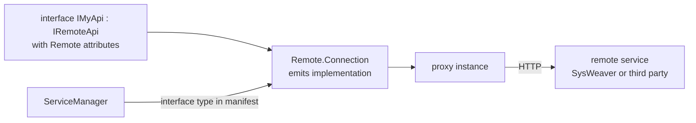

# SysWeaver.Remote

[⬆ SysWeaver overview](../README.md)

> Declarative HTTP client contracts: describe a remote API as a C# interface with attributes, and SysWeaver generates the implementation.

| | |
|---|---|
| **Layer** | Networking |
| **Kind** | Library (attributes and interfaces, no dependencies) |

## Purpose

Calling an HTTP API should look like calling a local method. An interface deriving from `IRemoteApi` (or just `IDisposable`) describes endpoints, verbs, path templates, serializers, time-outs and caching; [SysWeaver.Remote.Connection](../SysWeaver.Remote.Connection/README.md) turns it into a working client. Because this assembly has no dependencies, API contracts can be shared cheaply between servers and clients.

## How it fits into SysWeaver



## Key features

- Endpoint path templates and HTTP verbs (GET, POST, PUT, DELETE) per method (`[RemoteEndPoint]`), with a path prefix per interface (`[RemotePathPrefix]`); by default the method name is the path, GET without parameters and POST otherwise
- Per-interface or per-method serializer (`[RemoteSerializer]`), time-out (`[RemoteTimeout]`) and response cache (`[RemoteCache]`, `[NoRemoteCache]`) overrides
- Option to send several parameters as one object instead of an array (`[ParamAsObject]`)
- `IRemoteApi`: `Cancel()` and the `OnCallBegin` / `OnCallEnd` monitoring events implemented by every generated client
- Serializer name constants (`RemoteParam`: `json`, `formUrl`, `formUrlIgnoreDefaults`)

## Key components

- [`IRemoteApi`](IRemoteApi.cs) — optional base interface of remote API contracts
- [`RemoteEndPointAttribute`](RemoteEndPointAttribute.cs) — path template and verb, plus `RemotePathPrefixAttribute`
- [`RemoteTimeoutAttribute`](RemoteTimeoutAttribute.cs) — time-out, cache and `ParamAsObject` attributes

## Using it

```csharp
using SysWeaver.Remote;

[RemotePathPrefix("Api/orders/")]
public interface IOrders : IRemoteApi
{
    [RemoteEndPoint(HttpEndPointTypes.Get, "Get?id={id}")]
    [RemoteCache(10)]
    Task<Order> Get(int id);

    Task<bool> Purge();     // GET "Api/orders/Purge"
}
```

## Limitations and considerations

- Contracts only; nothing works without [SysWeaver.Remote.Connection](../SysWeaver.Remote.Connection/README.md) (see its README for the exact template, error and time-out behaviour).
- `RemoteCache` values below -1 are clamped to -1 (`UseConnection`); `RemoteCache(0, 0)` disables caching even if the connection enables it.

## Relationships

- **Project:** [`SysWeaver.Remote.csproj`](SysWeaver.Remote.csproj)
- **Builds on:** —
- **Used by:** [SysWeaver.Remote.Connection](../SysWeaver.Remote.Connection/README.md), [SysWeaver.Remote.Services](../SysWeaver.Remote.Services/README.md)
