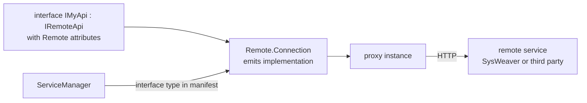

# SysWeaver.Remote

[⬆ SysWeaver overview](../README.md)

> Declarative HTTP client contracts: describe a remote API as a C# interface with attributes, and SysWeaver generates the implementation.

| | |
|---|---|
| **Layer** | Remote APIs (contracts) |
| **Kind** | Attribute library (no dependencies) |

## Purpose

Calling an HTTP API should look like calling a local method. An interface deriving from `IRemoteApi` describes endpoints, verbs, path templates, serializers, time-outs and caching; [SysWeaver.Remote.Connection](../SysWeaver.Remote.Connection/README.md) turns it into a working client. Because this assembly has no dependencies, API contracts can be shared cheaply between servers and clients.

## How it fits into SysWeaver

## Key features

- Endpoint path templates and HTTP verbs per method.
- Per-interface or per-method serializer, time-out and cache overrides.
- Option to send multiple parameters as an object rather than an array.

## Key types

| Type | Role |
|---|---|
| `IRemoteApi` | Optional base interface: `Cancel()` and the `OnCallBegin` / `OnCallEnd` monitoring events |
| `RemoteEndPoint` | Path template and verb (`HttpEndPointTypes`: Get, Post, Put, Delete) of a method; default: the method name, GET without parameters, POST otherwise |
| `RemotePathPrefix` | Path prefix for all methods of an interface |
| `RemoteSerializer` | Serializer (and post serializer) names, on an interface (connection default) or a method |
| `RemoteTimeout` | Time-out in ms, on an interface (connection default) or a method (overrides it, can also extend it) |
| `RemoteCache` / `NoRemoteCache` | Response cache (seconds, max items) of GET/DELETE end points with a return value, on a method or an interface |
| `ParamAsObject` | Send several parameters as an object (one member per parameter) instead of an array |
| `RemoteParam` | Serializer name constants (`json`, `formUrl`, `formUrlIgnoreDefaults`) |

## Limitations and considerations

- Contracts only; nothing works without [SysWeaver.Remote.Connection](../SysWeaver.Remote.Connection/README.md) (see its README for the exact template, error and time-out behaviour).
- `RemoteCache` values below -1 are clamped to -1 (`UseConnection`); `RemoteCache(0, 0)` disables caching even if the connection enables it.

## Relationships

- **Project:** [`SysWeaver.Remote.csproj`](SysWeaver.Remote.csproj)
- **Used by:** [SysWeaver.Remote.Connection](../SysWeaver.Remote.Connection/README.md), [SysWeaver.Remote.Services](../SysWeaver.Remote.Services/README.md)
