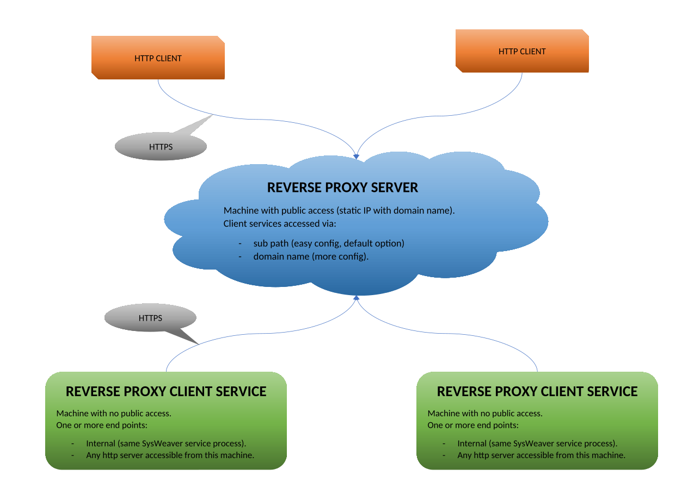
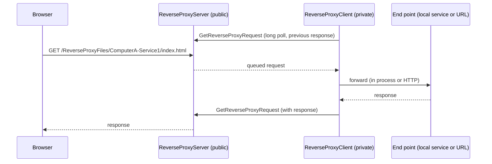

# SysWeaver.ReverseProxy

[⬆ SysWeaver overview](../README.md)

> Expose web services on machines that are not reachable from the internet: a client on the private machine keeps outbound connections to a public SysWeaver server, which forwards incoming requests through them.

| | |
|---|---|
| **Layer** | Networking |
| **Kind** | Library with micro services |

## Purpose

Reach services on machines without a public IP address, port forwarding or inbound firewall rules. The private machine runs a `ReverseProxyClient` that long-polls a public SysWeaver server running `ReverseProxyServer`; requests arriving at the server for that client are queued, picked up by the client, executed locally and the responses sent back with the next poll.



## How it fits into SysWeaver



## Key features

- **Sub path routing** (default): `https://<server>/<BaseUrl>/<ClientId>[-<EndPoint>]/<path>`, `BaseUrl` defaults to `ReverseProxyFiles`.
- **Domain routing**: with `AllButDomains` set, requests to any other host name are routed by the first host label, `https://<ClientId>[-<EndPoint>].<domain>/<path>`; this keeps root-relative URLs (`/logo.png`) of proxied sites working, but needs DNS records, listeners and certificates for every name (or wildcards).
- Client ids and end point names use only `a-z`, `A-Z` and `0-9`; the client id defaults to the machine name. Without an end point name the client's first end point is used.
- Client end points (`"name:destination"`) can be the hosting SysWeaver server itself (handled in process, no HTTP call), or any URL the client can reach (localhost, LAN or internet).
- Several parallel connections per client (`MaxConcurrentRequests`, default 8); server-side response caching per client using the HTTP cache headers.
- Debug tables of connected clients (server) and end points (client).

## Key components

- [`ReverseProxyServer`](ReverseProxyServer.cs) — raw HTTP module on the public server, queues requests per client
- [`ReverseProxyClient`](ReverseProxyClient.cs) — service on the private machine, polls the server and executes requests
- [`IReverseProxyServer`](IReverseProxyServer.cs) — the remote API contract between them
- [`ReverseProxyClientParams`](ReverseProxyClientParams.cs) / [`ReverseProxyServerParams`](ReverseProxyServerParams.cs) — configuration

## Using it

Public server manifest (with an auth manager and an authorizer that knows the client's service user):

```json
{ "Type": "SysWeaver.ReverseProxy.ReverseProxyServer, SysWeaver.ReverseProxy",
  "Params": { "BaseUrl": "ReverseProxyFiles" } }
```

Private client manifest (`BaseUrl` and `CredFile` are the remote connection parameters of the server):

```json
{ "Type": "SysWeaver.ReverseProxy.ReverseProxyClient, SysWeaver.ReverseProxy",
  "Params": { "BaseUrl": "https://proxy.example.com", "CredFile": "$(KeyFolder)/ReverseProxyClient_ReverseProxyServer.txt",
              "ClientId": "ComputerA", "EndPoints": [ "Service1:", "Service2:http://localhost:8080/" ] } }
```

Ready-made hosts: [ReverseProxyServer](https://github.com/dosh1974/SysWeaver.Services/blob/main/ReverseProxyServer/README.md) and [ReverseProxyClient](https://github.com/dosh1974/SysWeaver.Services/blob/main/ReverseProxyClient/README.md).

## Limitations and considerations

- With sub path routing, sites that use root-relative URLs (`/logo.png`) break, as these resolve outside the client's sub path; use domain routing for such sites.
- `ReverseProxyServer` is a raw module: proxied requests bypass the server's pipeline, including auth, so every end point is public unless the end point itself requires authentication. Cookies and the `Authorization` header are forwarded.
- Clients authenticate with a user having the `Service` role; any such user can register any client id.
- The client IP seen by the end point is not forwarded (no `X-Forwarded-For`).
- `BaseUrl` must not be `ReverseProxy` (used by the API) and everything under it is routed to clients.

## Relationships

- **Project:** [`SysWeaver.ReverseProxy.csproj`](SysWeaver.ReverseProxy.csproj)
- **Builds on:** [SysWeaver.HttpServer](../SysWeaver.HttpServer/README.md), [SysWeaver.MicroServices.ServiceManager](../SysWeaver.MicroServices.ServiceManager/README.md), [SysWeaver.Remote.Connection](../SysWeaver.Remote.Connection/README.md)
- **Used by:** [ReverseProxyClient](https://github.com/dosh1974/SysWeaver.Services/blob/main/ReverseProxyClient/README.md), [ReverseProxyServer](https://github.com/dosh1974/SysWeaver.Services/blob/main/ReverseProxyServer/README.md), [SwServerManager](https://github.com/dosh1974/SysWeaver.Services/blob/main/SwServerManager/README.md)
