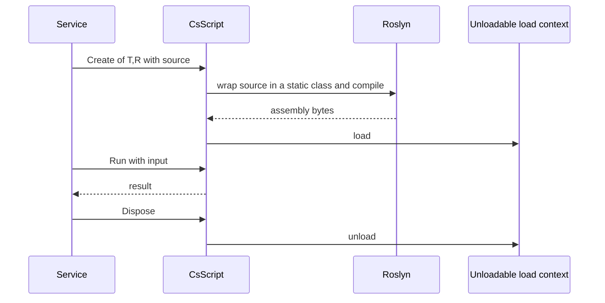

# SysWeaver.Script

[⬆ SysWeaver overview](../README.md)

> Runtime C# scripting: compile a snippet with Roslyn into an unloadable assembly and call it like a function.

| | |
|---|---|
| **Layer** | Foundation |
| **Kind** | Library |

## Purpose

Enables configurable behaviour written in real C# (rules, transformations, custom logic) without recompiling the service, while allowing the compiled code to be unloaded again.

## How it fits into SysWeaver



## Key features

- The script is the *body* of a static class: you write members, including a static `Main` that takes one input and returns a result (`CsScript.Create<T, R>`), or a `Task<R>` (`CsScript.CreateAsync<T, R>`).
- `using`s for the namespaces of a default set of types (System, System.Linq, System.Collections.Generic, System.Collections.Concurrent, System.IO, System.Threading, System.Threading.Tasks, System.Runtime), of `T`, `R` and of any extra types you pass; all assemblies loaded from a file into the process are referenced.
- Each script lives in its own collectible load context; `Dispose` unloads it (the assembly is collected once nothing uses it).
- Choice of the C# language version (default C# 12).

## Limitations and considerations

- Scripts run with the full permissions of the host process — only run trusted code.
- Compilation is comparatively expensive (a few hundred milliseconds for the first script, less after that); create once and reuse.
- The expected `Main` signature is checked at creation time: a compile error or a missing / mismatching `Main` throws an `ArgumentException` (compile errors list the compiler messages). `Main` is found with the default binder, so a parameter type that `T` widens to (ex: `long` for `int`) is accepted.
- An exception thrown by the script is wrapped in a `TargetInvocationException` by `Run` (for an async script, exceptions thrown after the first await are in the returned task).
- `Run` after `Dispose` throws an `ObjectDisposedException`.

## Using it

```csharp
using SysWeaver.Script;
using var s = CsScript.Create<int, int>("static int Main(int x) => x * x;");
int r = s.Run(12);
```

## Relationships

- **Project:** [`SysWeaver.Script.csproj`](SysWeaver.Script.csproj)
