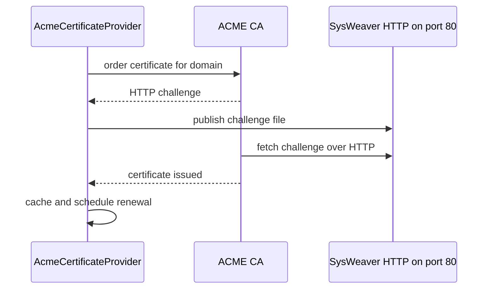

# SysWeaver.Security.Acme

[⬆ SysWeaver overview](../README.md)

> Automatic public certificates via ACME (Let's Encrypt by default), validated through HTTP challenges served by SysWeaver itself.

| | |
|---|---|
| **Layer** | Security |
| **Kind** | Certificate provider |

## Purpose

Obtain and renew browser-trusted certificates for public domains with no manual steps.

## How it fits into SysWeaver



## Limitations and considerations

- The domain must resolve to the server and port 80 must be reachable from the internet.
- Subject to the CA's rate limits; certificates are cached to avoid unnecessary orders.
- `Email` and `DomainName` are required (`ArgumentException` with the parameter name), `AuthApi` must be an absolute uri. The default `AuthApi` is the Let's Encrypt **production** directory.
- File names (`Filename`, `AccountFilename`, `ChallengeFolder`) can use `$(AuthApi)`, `$(Email)`, `$(DomainName)` (made valid file names) and `$(Hash)` (hex MD5 of `AuthApi|DomainName|Email`). An empty `Filename` disables caching.
- Without a `ChallengeFolder`, the provider serves the challenges itself (it's an `IHttpServerModule` for `.well-known/acme-challenge/`, http only) and starts a temporary HTTP server on port 80 (with a firewall rule) during validation.
- A cached certificate is used while it's valid for at least `MinValidHours` (at least the effective `RenewBeforeExpirationHours`); at `RenewBeforeExpirationHours` before expiration it's dropped and `OnChanged` is raised, the next `GetCert` orders a new one. Terms of service changes are accepted automatically.
- Intermediate certificates are only embedded for the Let's Encrypt staging directory; for other CA's use `ImportCertFiles` if needed.
- **Security**: the account key is stored as an unencrypted PEM and the certificate pfx with the configured password (default: the application name), by default in `$(CommonApplicationData)`, readable by all local users (security-cov-7). Challenge files are named after the CA's token made a valid file name (`AcmeCertificateProvider.GetChallengeFilename`, invalid chars including directory separators become `_`), so a malicious token can't write outside the `ChallengeFolder`; a token that had to be changed is reported as a warning (and its validation fails).

## Known bugs

See `_docs/BugReview-2026-10-06.md`: security-cov-7.

## Using it

```json
{ "Type": "SysWeaver.Security.AcmeCertificateProvider, SysWeaver.Security.Acme",
  "Params": { "DomainName": "www.example.com" } }
```

## Relationships

- **Project:** [`SysWeaver.Security.Acme.csproj`](SysWeaver.Security.Acme.csproj)
- **Builds on:** [SysWeaver.NetHttpServer](../SysWeaver.NetHttpServer/README.md), [SysWeaver.Security](../SysWeaver.Security/README.md)
- **Used by:** [SysWeaver.MicroService.LanCertificateManager](../SysWeaver.MicroService.LanCertificateManager/README.md)
