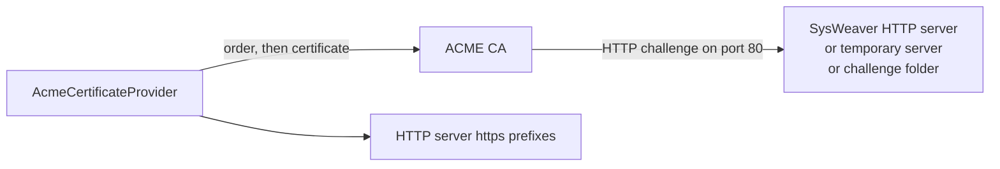

# SysWeaver.Security.Acme

[⬆ SysWeaver overview](../README.md)

> Automatic public certificates via ACME (Let's Encrypt by default), validated through HTTP challenges served by SysWeaver itself.

| | |
|---|---|
| **Layer** | Security |
| **Kind** | Library with a micro service (certificate provider) |

## Purpose

Obtain and renew browser-trusted certificates for public domains with no manual steps.

## How it fits into SysWeaver



The provider implements `ICertificateProvider` (see [SysWeaver.Security](../SysWeaver.Security/README.md)), so HTTPS prefixes use it like any other certificate provider.

## Key features

- ACME account creation and certificate ordering through the [Certes](https://www.nuget.org/packages/Certes) library, against Let's Encrypt production by default (any ACME directory can be configured)
- HTTP-01 challenges served by the provider itself under `.well-known/acme-challenge/` (it is an HTTP server module), by a temporary HTTP server on port 80, or written to a challenge folder served by another web server
- Certificate and account key cached on disc and reused until renewal is due; `OnChanged` is raised so servers pick up the new certificate
- Terms of service changes are accepted automatically

## Key components

- [`AcmeCertificateProvider`](AcmeCertificateProvider.cs) — the ACME client, challenge module and certificate cache
- [`AcmeCertificateParams`](AcmeCertificateParams.cs) — CA directory, domain, contact and file locations

## Using it

```json
{ "Type": "SysWeaver.Security.AcmeCertificateProvider, SysWeaver.Security.Acme",
  "Params": { "DomainName": "www.example.com", "Email": "admin@example.com" } }
```

`DomainName` and `Email` are required.

## Limitations and considerations

- The domain must resolve to the server and port 80 must be reachable from the internet
- Subject to the CA's rate limits; certificates are cached to avoid unnecessary orders
- Intermediate certificates are only embedded for the Let's Encrypt staging directory; for other CAs use `ImportCertFiles` if needed
- **Security:** the account key is stored as an unencrypted PEM and the certificate `.pfx` with the configured password (default: the application name), by default under `$(CommonApplicationData)`, readable by all local users; protect the folders

## Folder layout

| Folder | Content |
|---|---|
| [`Certs/`](Certs/README.md) | Embedded issuer certificates per ACME directory (Let's Encrypt staging root) |

## Relationships

- **Project:** [`SysWeaver.Security.Acme.csproj`](SysWeaver.Security.Acme.csproj)
- **Builds on:** [SysWeaver.NetHttpServer](../SysWeaver.NetHttpServer/README.md), [SysWeaver.Security](../SysWeaver.Security/README.md)
- **Used by:** [SysWeaver.MicroService.LanCertificateManager](../SysWeaver.MicroService.LanCertificateManager/README.md), the services [ExchangeRateService](https://github.com/dosh1974/SysWeaver.Services/blob/main/ExchangeRateService/README.md), [FakeEmailService](https://github.com/dosh1974/SysWeaver.Services/blob/main/FakeEmailService/README.md), [FakeTextService](https://github.com/dosh1974/SysWeaver.Services/blob/main/FakeTextService/README.md), [IpLocationService](https://github.com/dosh1974/SysWeaver.Services/blob/main/IpLocationService/README.md), [ReverseProxyServer](https://github.com/dosh1974/SysWeaver.Services/blob/main/ReverseProxyServer/README.md), [SwServerManager](https://github.com/dosh1974/SysWeaver.Services/blob/main/SwServerManager/README.md), [TranslationService](https://github.com/dosh1974/SysWeaver.Services/blob/main/TranslationService/README.md), [WebServerService](https://github.com/dosh1974/SysWeaver.Services/blob/main/WebServerService/README.md), and the tool [AcmeCertUtil](https://github.com/dosh1974/SysWeaver.Tools/blob/main/AcmeCertUtil/README.md)
- **Third-party:** [Certes](https://www.nuget.org/packages/Certes)
