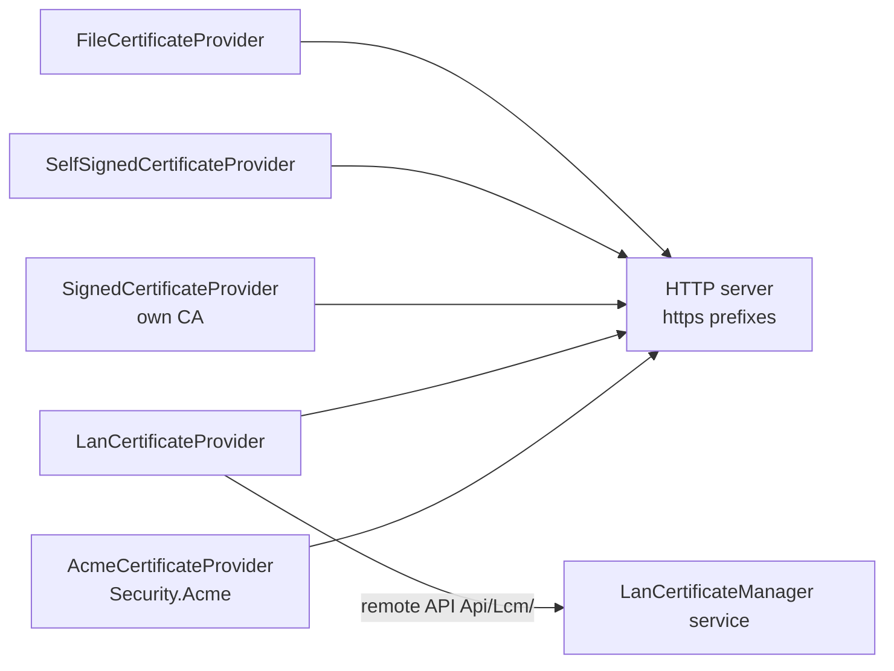

# SysWeaver.Security

[⬆ SysWeaver overview](../README.md)

> Certificate providers for HTTPS: certificates from files, self-signed certificates, certificates signed by your own CA, and LAN certificates issued by a central SysWeaver certificate manager.

| | |
|---|---|
| **Layer** | Security |
| **Kind** | Library with micro services (`ICertificateProvider` implementations) |

## Purpose

Decouple where certificates come from and how they are renewed from the web server that uses them. HTTPS prefixes of the HTTP server services select a registered provider by name (or `"*"` for the first one), and the servers pick up renewals through the provider's `OnChanged` event.

## How it fits into SysWeaver



All providers implement `ICertificateProvider` from [SysWeaver.Common](../SysWeaver.Common/README.md); [SysWeaver.Security.Acme](../SysWeaver.Security.Acme/README.md) adds a public ACME provider.

## Key features

- `FileCertificateProvider`: a `.pfx` from disc, reloaded when the file changes; the password can be given directly or as a file
- `SelfSignedCertificateProvider`: generates a self-signed RSA certificate and renews it before it expires
- `SignedCertificateProvider`: generates certificates signed by a local root (CA) `.pfx`, and can publish the public root certificate on the web server so clients can install it
- `LanCertificateProvider`: fetches the certificate for a LAN domain from a central `ILanCertificateManager` (checked hourly), with a self-signed fallback while the manager is unavailable
- Subject alternative names can include localhost, the machine name, configured names and the LAN IP addresses
- Generated certificates are cached between runs (`.pfx` plus a PEM `.crt`) and reused while they still match the configuration and are valid long enough
- Change notifications so servers rebind renewed certificates without restarts

## Key components

- [`SignedCertificateCreator`](SignedCertificateCreator.cs) — builds subjects and SANs and creates self-signed or CA-signed TLS server certificates
- [`SignedCertificateProvider`](SignedCertificateProvider.cs) — CA-signed certificates and root certificate publishing
- [`LanCertificateProvider`](LanCertificateProvider.cs) — client of the LAN certificate manager
- [`ILanCertificateManager`](ILanCertificateManager.cs) — the remote API implemented by [SysWeaver.MicroService.LanCertificateManager](../SysWeaver.MicroService.LanCertificateManager/README.md)

## Using it

```json
[
  { "Type": "SysWeaver.Security.SelfSignedCertificateProvider, SysWeaver.Security" },
  { "Type": "SysWeaver.MicroService.AspHttpServerService, SysWeaver.MicroService.AspHttpServer",
    "Params": { "ListenOn": [ { "Prefix": "https://*:8443", "Certificate": "*" } ] } }
]
```

## Limitations and considerations

- Providers must be registered before the HTTP server service
- Self-signed and privately signed certificates are only trusted by clients that trust the issuer
- **Security:** the cached `.pfx` files are by default written to `$(CommonApplicationData)` (readable by all local users) with the application name as password, so effectively any local user can read the private key; configure a protected folder and a real password
- Certificates are loaded with machine key storage, which typically requires elevated rights on Windows
- With LAN IP addresses in the SANs, a change of the local IP addresses causes a new certificate to be generated
- Subject fields may not contain distinguished name special characters; an unknown `Country` throws

## Relationships

- **Project:** [`SysWeaver.Security.csproj`](SysWeaver.Security.csproj)
- **Builds on:** [SysWeaver.Common](../SysWeaver.Common/README.md), [SysWeaver.HttpServer](../SysWeaver.HttpServer/README.md), [SysWeaver.IsoData](../SysWeaver.IsoData/README.md), [SysWeaver.Remote.Connection](../SysWeaver.Remote.Connection/README.md)
- **Used by:** [SysWeaver.Security.Acme](../SysWeaver.Security.Acme/README.md), and the services [ReverseProxyClient](https://github.com/dosh1974/SysWeaver.Services/blob/main/ReverseProxyClient/README.md), [ReverseProxyServer](https://github.com/dosh1974/SysWeaver.Services/blob/main/ReverseProxyServer/README.md), [SwServerManager](https://github.com/dosh1974/SysWeaver.Services/blob/main/SwServerManager/README.md)
