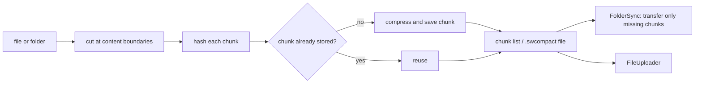

# SysWeaver.Storage.Cdc

[⬆ SysWeaver overview](../README.md)

> Content-defined chunking (CDC) storage: files are split at content-dependent boundaries into hashed, compressed, de-duplicated chunks, and whole files or folders are represented as compact chunk lists.

| | |
|---|---|
| **Layer** | Storage / Data |
| **Kind** | Library |

## Purpose

Efficient versioned storage and transfer of large, slowly changing data (deployments, backups, media folders). Because chunk boundaries depend on content rather than fixed offsets, an edit only changes the chunks around it; unchanged chunks are stored and transferred once.

## How it fits into SysWeaver



## Key features

- Content-defined cut points from a rolling hash with normalized chunk sizes (default average 32 KiB, min 8 KiB, max 128 KiB); chunks are identified by their SHA256 hash and stored Brotli compressed (hash, compression and sizes are configurable with `CdcProps`)
- A machine-wide chunk store (by default under the shared data folders, `ContentChunks/<props key>`), optionally spread over several folders
- Compact and expand files or whole folders to/from a single `.swcompact` chunk-list file (file times and attributes are preserved)
- Verification, recovery of damaged archives (missing chunks are replaced by a marker) and pruning of chunks unused since a given time, plus chunk store statistics
- APIs to cut a file or stream into a chunk list, compute missing chunks for a list, copy or add individual compressed chunks and open a chunk list as one continuous stream — the basis of delta synchronisation

## Key components

- [`ContentDependentChunking`](ContentDependentChunking.cs) — cutting, chunk storage, compact / expand / verify / recover / prune
- [`CdcProps`](CdcProps.cs) — chunking parameters (sizes, hash, compression, folders); `CdcProps.Default` is recommended

## Using it

```csharp
await ContentDependentChunking.Compact(@"D:\Data\Project", @"D:\Backup\Project.swcompact");
await ContentDependentChunking.Expand(@"D:\Backup\Project.swcompact", @"D:\Restore\Project");
```

## Limitations and considerations

- A `.swcompact` file only contains chunk hashes: it is useless without the chunk store that holds its chunks.
- The chunk parameters must be the same everywhere (they are part of the chunk store folder name); use `CdcProps.Default` except for testing.
- Pruning permanently deletes chunks; archives that still reference them become unrecoverable. Chunk stores grow with history until pruned.
- Throughput and de-duplication ratio depend on the chunk size settings.

## Relationships

- **Project:** [`SysWeaver.Storage.Cdc.csproj`](SysWeaver.Storage.Cdc.csproj)
- **Builds on:** [SysWeaver.Storage](../SysWeaver.Storage/README.md)
- **Used by:** [SysWeaver.FolderSync](../SysWeaver.FolderSync/README.md), [SysWeaver.MicroService.FileUploader](../SysWeaver.MicroService.FileUploader/README.md), [SysWeaver.MicroService.FolderSync](../SysWeaver.MicroService.FolderSync/README.md), [SwSyncTool](https://github.com/dosh1974/SysWeaver.Tools/blob/main/SwSyncTool/README.md) (SysWeaver.Tools)
